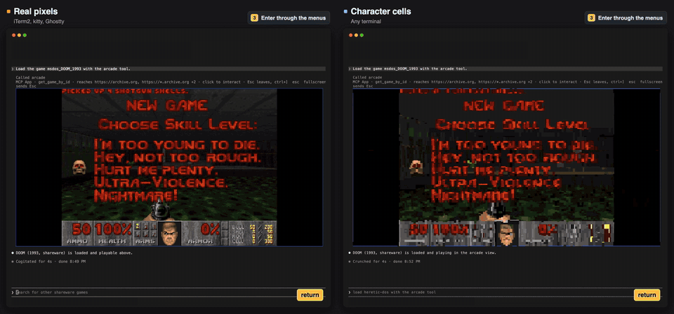

# MCPolyfill

MCP extensions for hosts that haven't shipped them yet. Claude Code first.

MCP now grows through extensions: Apps, Skills, Events, Tasks. Each is a
published spec with its own identifier. A server can adopt one quickly. A host
has to build, review and ship it, and no host ships all of them at once. Until
enough hosts do, server authors have little reason to implement an extension,
and hosts see little demand for it.

A polyfill closes that gap from the outside. It is third-party code that
implements an extension's client side inside a host, exactly as the spec says,
and steps aside when the host supports the extension itself. Servers need no
changes, and never know the difference.

## Polyfills

| Extension | Spec | Claude Code | Polyfill | State |
|---|---|---|---|---|
| Events (`io.modelcontextprotocol/events`) | [SEP-3415](https://github.com/modelcontextprotocol/modelcontextprotocol/blob/main/seps/3415-events-extension.md), Final | not supported | [`mcp-events`](https://github.com/idosal/claude-events-mod) | Works: poll, push and webhook delivery; an event wakes an idle session. No OAuth servers. |
| Apps (`io.modelcontextprotocol/ui`) | [MCP Apps](https://github.com/modelcontextprotocol/ext-apps), Stable | not supported | [`mcp-apps-cli`](polyfills/claude-code/apps) | Prototype: renders app UIs inline in the terminal, with mouse and keyboard. No OAuth servers. |
| Skills (`io.modelcontextprotocol/skills`) | [SEP-2640](https://github.com/modelcontextprotocol/modelcontextprotocol/blob/main/seps/2640-skills-extension.md), Final | not supported | `mcp-skills` | Pre-release: skills served by an MCP server are listed, loaded and read in Claude Code, with the checks the spec asks of a client. No OAuth servers. |

MCP Apps in the Claude Code terminal with `mcp-apps-cli`: real pixels on the
left, character cells on the right
([full video, 57 s](https://github.com/idosal/MCPolyfill/releases/download/mcp-apps-cli-v0.1.0/mcp-apps-cli-demo.mp4)).



A demo server for Apps: the arcade server (classic shareware games from
archive.org, played in the app's view) is hosted at
`https://mcp-apps-arcade.idosalomon.workers.dev/mcp`. With `mcp-apps-cli`
installed ([Install](#install)), add it, start `claude` and ask for a game
("Load the game msdos_DOOM_1993 with the arcade tool"):

```
claude mcp add --transport http arcade https://mcp-apps-arcade.idosalomon.workers.dev/mcp
```

"Claude Code" is what the official
[extension support matrix](https://modelcontextprotocol.io/extensions/client-matrix)
showed on 23 November 2026: Tasks, and none of the three above. Hosts are
adding extensions steadily, so check the matrix for today's picture. The Skills
SEP notes that Claude Code support has been prototyped at Anthropic.

## What makes something a polyfill

1. It implements one published extension, client side, and nothing else. No
   extra protocol, no vendor additions.
2. It names the spec revision it implements.
3. Every client rule in the spec has a test, and it is run against a server
   someone else wrote.
4. It stands down when the host supports the extension natively.
5. It says plainly what it cannot do on each host, and what the host would
   need to change.

The full text is in [`docs/polyfill-contract.md`](docs/polyfill-contract.md).
For rule 4, `mcp-events` has a setting that turns it off; none of the three
detects native support yet.

## Build one

The `create-polyfill` skill walks an agent through building a polyfill to this
contract: the spec's client rules as a checklist, how each wire need is reached
on the host, stand-down, and what counts as proof.

```
/plugin install polyfill-author --marketplace idosal/MCPolyfill
```

Then ask for the extension you want, for example "polyfill MCP Server Cards in
Claude Code". It points the agent at the primary sources (the SEP, the
extension's spec, the core spec for the revision in use, the conformance
suite) and has it work from those.

### When the spec doesn't have what you want

A polyfill stays exact, so new behaviour does not go into one. The
`design-extension` skill, in the same plugin, covers that case: first check
whether the protocol already has a slot for it, then, if it really is new,
design it as its own extension under MCP's extension rules (your own
identifier, a declaration, defined behaviour when the other side lacks it, a
written spec, two implementations) and take it to the working group.

Both skills are plain `SKILL.md` files
([create-polyfill](plugins/polyfill-author/skills/create-polyfill/SKILL.md),
[design-extension](plugins/polyfill-author/skills/design-extension/SKILL.md)),
so other agents that read skills can use them too.

## Why this works in Claude Code, and where it stops

Claude Code's mods (early access) run third-party code inside the host. A mod
can register tools, draw UI, start a turn in an idle session, and call a
server's tools over Claude Code's own connection. That is the host half of
almost any extension.

The protocol half is missing. Over Claude Code's connection a mod can call a
tool and read a resource's contents, and nothing else: it cannot send
`events/poll` or `skills/list`, see what a server advertised, or receive a
server's notifications. So each polyfill here
opens a second connection of its own, using the headers in your config. A
second connection cannot use Claude Code's sign-in, which is why none of them
reaches servers behind OAuth.

Four small, generic changes would remove that limit. None of them names an
extension:

| Change | Events | Skills | Apps |
|---|---|---|---|
| Send any MCP method over the host's connection | needed | needed | needed |
| Read what the server advertised | needed | needed | needed |
| Deliver server notifications to the plugin | push only | not needed | needed |
| Raw tool results in hooks; declare a client extension | not needed | not needed | needed |

The first two are enough for Events (by poll and webhook) and Skills on every
server. The details, and the questions they raise about permissions, are in
[`docs/host-changes.md`](docs/host-changes.md).

## Other hosts

We have not found a documented way for third-party code to send requests over
the host's MCP connection in Codex, Cursor or VS Code, and ChatGPT runs no
third-party code on the client side. For those hosts the only polyfill is a
gateway: an MCP server that presents an extension as plain tools. It is a
weaker form (for Events, the model has to poll and nothing wakes it), and none
is built here yet.

## Install

Every polyfill at once, at the prompt of a `claude` session:

```
/plugin install mcpolyfill --marketplace idosal/MCPolyfill
```

Or one of them:

```
/plugin install mcp-apps-cli --marketplace idosal/MCPolyfill
```

```
/plugin install mcp-events --marketplace idosal/MCPolyfill
```

The same works in a terminal as `claude plugin install mcpolyfill --marketplace idosal/MCPolyfill`.
It adds this repository's marketplace and installs from it in one step; start
a new `claude` session for the polyfills to load. `mcpolyfill` holds nothing
of its own: it depends on each polyfill, and each stays a plugin you can
disable or uninstall on its own.

With the marketplace already added, the short form is
`/plugin install mcp-apps-cli@mcpolyfill`; to add it by itself,
`/plugin marketplace add idosal/MCPolyfill`.

Each polyfill's own README lists its requirements and limits.

## Repository layout

Each polyfill is a folder, `polyfills/<host>/<extension>/`: the Apps polyfill
for Claude Code is [`polyfills/claude-code/apps`](polyfills/claude-code/apps).
One marketplace file ([`.claude-plugin/marketplace.json`](.claude-plugin/marketplace.json))
lists them all, with two plugins in [`plugins/`](plugins): `mcpolyfill`, which
installs every polyfill, and `polyfill-author`, the skills for building one.
Each polyfill releases on its own, under tags that start with its
plugin's name (`mcp-apps-cli-v0.1.0`). A polyfill whose row in the table links
another repository has not moved here yet.

## Contributing

Problems and questions: open an issue here, or, for a polyfill whose row in
the table links another repository, in that one. A new polyfill is welcome if
it meets the [contract](docs/polyfill-contract.md); the `create-polyfill`
skill is the quickest way to build one that does.
[`CONTRIBUTING.md`](CONTRIBUTING.md) says how to add one to this
repository.

## Licence and status

Apache-2.0. See [LICENSE](LICENSE).

A community project by [Ido Salomon](https://github.com/idosal). It is not
part of the MCP specification and is not affiliated with or endorsed by the
MCP project, Anthropic or any host vendor.
