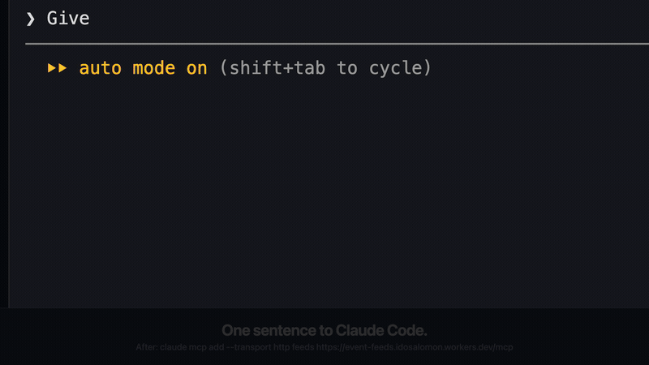

# AgentPolyfill

Polyfills for agent protocols. Bring more of MCP to the clients you already
use. Plugins and extensions add Apps, Skills, Events, Server Cards and ARD;
the table below shows which run in each host.

> **An early proof of concept.** It works today, and it has real gaps. Events,
> Skills and Apps can't reach servers behind OAuth yet, Apps runs only in
> Claude Code, and a few spec rules can't be met from a plugin. Each gap comes
> from what the host APIs expose, and small, generic changes to those APIs
> would close them:
> [what hosts would need to change](docs/host-changes.md).

MCP grows through extensions now: Apps, Skills, Events, Server Cards. A server
can adopt one in a day, but every host has to build each one itself, on its
own schedule, so a new extension can sit unused for months. A polyfill closes
that gap from the outside. It implements one published extension's client side
as a plugin or host extension, follows that extension's spec (any exception
is listed and can be switched off), and steps aside once the host ships its
own. Servers don't change at all.

We want this to be an open community around open specs: anyone can use these
extensions in the host they have, bring a polyfill to another host, or propose
a new extension, without waiting on one company's roadmap.

- **If you use one of the supported hosts,** see its install steps below.
- **If you build,** the `create-polyfill` and `design-extension` skills and the
  [contract](docs/polyfill-contract.md) every polyfill here meets are your
  starting point. New polyfills, and existing ones brought to another host,
  are welcome: [Build one](#build-one). If you keep one in your own
  repository, list it in the [community directory](community/).
- **If you write specs,** a polyfill can be the client half of the two
  implementations an extension needs to reach Stable:
  [For spec authors](#for-spec-authors).

## Install

**Claude Code** (2.1.329 or newer). At the prompt of a `claude` session,
install every polyfill at once:

```
/plugin install agent-polyfill --marketplace idosal/AgentPolyfill
```

Or install just one, with its name in place of `agent-polyfill`:
`mcp-events`, `mcp-apps-cli` or `mcp-server-cards`. Beyond MCP,
`ard-discovery` adds ARD; it isn't in the bundle, so install it by name. Then
start a new `claude` session. There is no Skills polyfill for Claude Code:
Claude Code lists skills from MCP servers itself, in beta from 2.1.332
([Skills, below](#polyfills)).

**Codex** (0.170 or newer; Skills was tested on 0.172; Node 20 or newer). In a
terminal:

```
codex plugin marketplace add idosal/AgentPolyfill
codex plugin add mcp-events@agent-polyfill
codex plugin add mcp-skills@agent-polyfill
codex plugin add mcp-server-cards@agent-polyfill
```

Beyond MCP, ARD (a draft; every search asks you first and goes to a registry
you choose):

```
codex plugin add ard-discovery@agent-polyfill
```

**Pi** (1.6.0, the version tested; Node 22 or newer). Install Events, Skills
and Server Cards together:

```bash
pi install git:github.com/idosal/AgentPolyfill
```

Pi clones the repository into its agent folder (under `~/.pi/agent/git/`)
and loads the three extensions from there. Nothing is published to npm or
Pi's package gallery, and nothing is built. Start `pi` to use them.

ARD is installed on its own, from a clone. As with the Claude Code bundle,
it is left out because its search sends the words of your request to a
registry, after asking you each time:

```bash
git clone https://github.com/idosal/AgentPolyfill.git
cd AgentPolyfill
pi install ./polyfills/ard/pi/extension
```

Pi loads a local path where it is, so keep the clone. The clone path also
works for any one form alone.

**OpenCode** (2.4 or newer, for the V2 plugin API; tested with 2.4.1; Git).
Nothing for OpenCode is published to npm: OpenCode installs each plugin from
this repository on GitHub. In a terminal:

```
opencode plugin add 'github:idosal/AgentPolyfill#main::path:polyfills/events/opencode/plugin'
opencode plugin add 'github:idosal/AgentPolyfill#main::path:polyfills/skills/opencode/plugin'
opencode plugin add 'github:idosal/AgentPolyfill#main::path:polyfills/server-cards/opencode/plugin'
```

Beyond MCP, ARD (a draft; every search asks you first and goes to a registry
you choose):

```
opencode plugin add 'github:idosal/AgentPolyfill#main::path:polyfills/ard/opencode/plugin'
```

Each line adds one plugin to your global `opencode.json`; OpenCode has no
bundle. OpenCode runs the plugins itself, so you don't need Node. They load
the next time OpenCode opens a project.

**Google Antigravity** (CLI 1.5.17, the version these builds were tested in;
App 2.35.1 ran earlier builds; Node 20 or newer on your `PATH`). Nothing for
Antigravity is published to its Marketplace. Install from a clone, with the
Antigravity CLI: `agy plugin install` needs it, and the App doesn't ship
`agy`.

```bash
git clone https://github.com/idosal/AgentPolyfill.git
cd AgentPolyfill
agy plugin install ./polyfills/events/antigravity/plugin
agy plugin install ./polyfills/skills/antigravity/plugin
agy plugin install ./polyfills/server-cards/antigravity/plugin
```

Beyond MCP, ARD (a draft; every search asks you first and goes to a registry
you choose), from the same clone:

```bash
agy plugin install ./polyfills/ard/antigravity/plugin
```

Each line copies one plugin to `~/.gemini/config/plugins/`, which the App
and the CLI both read. The IDE documents no plugin hooks, so the forms
aren't supported there, and their gated calls are refused.

**GitHub Copilot CLI** (1.0.115, the version tested). From a clone, added as a
marketplace:

```bash
git clone https://github.com/idosal/AgentPolyfill.git
copilot plugin marketplace add ./AgentPolyfill
copilot plugin install mcp-events@agent-polyfill
copilot plugin install mcp-server-cards@agent-polyfill
```

Beyond MCP, ARD (a draft published by the ards-project on GitHub; every search
asks you first and goes to a registry you choose):

```bash
copilot plugin install ard-discovery@agent-polyfill
```

That is the install that was tested. Copilot loads a local marketplace's
plugins where they are, so keep the clone. From GitHub,
`copilot plugin marketplace add idosal/AgentPolyfill` adds the same
marketplace; that was checked on 25 November 2026 with Copilot CLI 1.0.105 in an isolated home with no sign-in (the three plugins installed and loaded, byte-identical to main), not on 1.0.115, in the interactive TUI, or in VS Code. Events is a Copilot
extension, and Copilot loads extensions only in its experimental mode: start
it with `copilot --experimental` (Copilot's help also names
`/settings experimental on`; the runs here used `--experimental`). Copilot
runs Events with its own Node. Server Cards and ARD are MCP servers: they need
no experimental mode, and need Node 20 or newer on your `PATH`. Copilot has Skills over MCP
and MCP Apps built in, so there is no Copilot form of those
([why](polyfills/events/copilot/README.md#skills-and-apps-in-copilot)).

**T3 Code** (0.1.11, the version tested). T3 Code runs the Codex and Claude
Code you have, so install the plugins above for the agent you use in it. For
Events in Codex threads, add the T3 form from a clone instead of the Codex
plugin (nothing for T3 Code is published):

```bash
git clone https://github.com/idosal/AgentPolyfill.git
codex mcp add mcp-events-t3 -- node "$PWD/AgentPolyfill/polyfills/events/t3/plugin/dist/server.js"
```

Then **Restart agent session** in T3 Code. What works and what doesn't is in
[In T3 Code](#in-t3-code).

There are [more ways to install](#more-ways-to-install) further down.

## Polyfills

| Extension | Spec | Claude Code | Codex | Pi | OpenCode | Antigravity | Copilot CLI |
|---|---|---|---|---|---|---|---|
| Events | [SEP-3415](https://github.com/modelcontextprotocol/modelcontextprotocol/blob/main/seps/3415-events-extension.md), Final | [`mcp-events`](polyfills/events/claude-code) | [`mcp-events`](polyfills/events/codex) | [`mcp-events`](polyfills/events/pi) | [`mcp-events`](polyfills/events/opencode) | [`mcp-events`](polyfills/events/antigravity) | [`mcp-events`](polyfills/events/copilot) |
| Skills | [SEP-2640](https://github.com/modelcontextprotocol/modelcontextprotocol/blob/main/seps/2640-skills-extension.md), Final | built into Claude Code, in beta from 2.1.332 ([changelog](https://code.claude.com/docs/en/changelog)) | [`mcp-skills`](polyfills/skills/codex) | [`mcp-skills`](polyfills/skills/pi) | [`mcp-skills`](polyfills/skills/opencode) | [`mcp-skills`](polyfills/skills/antigravity) | built into Copilot |
| Server Cards | [SEP-2127](https://github.com/modelcontextprotocol/modelcontextprotocol/blob/main/seps/2127-mcp-server-cards.md), Final (the extension is Beta) | [`mcp-server-cards`](polyfills/server-cards/claude-code) | [`mcp-server-cards`](polyfills/server-cards/codex) | [`mcp-server-cards`](polyfills/server-cards/pi) | [`mcp-server-cards`](polyfills/server-cards/opencode) | [`mcp-server-cards`](polyfills/server-cards/antigravity) | [`mcp-server-cards`](polyfills/server-cards/copilot) |
| Apps | [MCP Apps](https://github.com/modelcontextprotocol/ext-apps) 2026-01-26, Stable | [`mcp-apps-cli`](polyfills/apps/claude-code) | not yet | not available | not available | native in the App (v2.34.0+); the CLI and IDE show text | built into Copilot for graphical hosts (VS Code); none in the terminal |
| ARD (beyond MCP) | [Agentic Resource Discovery](https://github.com/ards-project/ard-spec) v0.91, a draft | [`ard-discovery`](polyfills/ard/claude-code) | [`ard-discovery`](polyfills/ard/codex) | [`ard-discovery`](polyfills/ard/pi) | [`ard-discovery`](polyfills/ard/opencode) | [`ard-discovery`](polyfills/ard/antigravity) | [`ard-discovery`](polyfills/ard/copilot) |

T3 Code isn't a column here: it's an app that runs Codex, Claude Code and
other agents for you, so what works in it is mostly what works in those, with
one Events form of its own. [In T3 Code](#in-t3-code) says which.

All of them are early. Here is what each one does, and where it stops:

- **Events.** The agent watches events on your MCP servers, by poll, push or
  webhook, and an event wakes an idle session. In Codex, a woken session is a
  Codex CLI session (the terminal app or `codex exec`): a chat in the ChatGPT
  desktop app keeps its events but can't be woken, so ask it for
  `recent_events`. A resumed Codex session starts watching at its first Events
  tool call. In Pi, event types are listed in the system prompt at session
  start. `watch_event` asks in a Pi dialog, naming the server, event type,
  filters and note, and saying that events will start turns. After yes, an
  event wakes the idle session with a message starting `[mcp-events]`, and
  Pi reads it with `get_event`. The message says it came from the extension,
  not from you; Pi delivers it to the model in the user's turn. In OpenCode,
  by default a watch starts only after OpenCode asks you, naming the server
  and event type. An event then wakes the idle session with a synthetic
  message from the plugin, starting `[mcp-events]`, which gives the events'
  ids and none of their content; the model reads them with
  `mcp_events_get_event`. OpenCode stores the message as synthetic but sends
  it to the model in the user's role, and OpenCode Desktop shows no entry for
  it, so the turn starts with no visible cause. OpenCode's own automations
  also take push events, so use a watch or an automation for an event type,
  not both. In Antigravity, a watch asks in Antigravity's approval card, and
  new events reach a conversation at its next model call, through the
  plugin's `PreInvocation` hook (seen live in the CLI; Antigravity's plugins
  page doesn't list `PreInvocation` among plugin hooks). What it adds is fixed
  text with a count and the plugin's own watch ids, nothing a server wrote.
  In the App only, a sidecar you turn on wakes an idle conversation; its
  message arrives as a system message, not as yours.
  In Copilot, Events needs experimental mode. `watch_event` goes
  through Copilot's tool prompt, then asks in the plugin's own dialog, naming
  the server, event type, filters and note, with "Don't watch it" first. An
  event then wakes the idle session with a turn Copilot marks as an
  automation, whose first line says the plugin sent it; VS Code's Copilot
  harness shows it as a message from the plugin, then the turn.
- **Skills.** In Codex, Pi, OpenCode and Antigravity, skills an MCP server
  serves show up next to your own, load only after you say yes to each one,
  and are checked against the server's digests. Claude Code needs no
  polyfill for Skills: it lists skills from MCP servers itself, in beta from
  2.1.332. Its
  [changelog](https://code.claude.com/docs/en/changelog) says they show as
  `server:skill` in the `/` menu, and other skills keep their names. It is a
  beta and may not be on for every account or server yet; where it isn't on,
  there is currently no Skills over MCP in Claude Code. The Claude Code form
  this repository had was removed for that reason;
  [if you installed it](#if-you-installed-mcp-skills-in-claude-code),
  uninstall it. In Codex, served skills appear in Codex's own skill list
  after you ask once to list them, from the next turn. One rule of the spec
  can't be met in Codex yet: a skill from one server reading another server's
  resources isn't put to you first (rule X8), because Codex doesn't let a
  plugin ask. In Pi,
  served skills appear in its own list as `mcp-<server>-<name>`, marked
  `[MCP server "<server>", not a local skill]`. Loading one asks "Don't load
  it", "Show me its SKILL.md first", or "Load it"; a yes is kept for exactly
  those files. Pi meets X8: a read from another MCP server while a served
  skill is loaded asks first, naming both servers, including in codemode.
  In OpenCode, served skills appear in its own skill list as
  `mcp-skills:<server>:<name>`, marked the same way, with none of their text.
  Loading takes two steps: OpenCode's skill tool returns a note from the
  plugin, then the model calls `mcp_skills_load_skill` and, by default,
  OpenCode asks you, with no preview of `SKILL.md`. "Allow always" covers
  that skill as it is now; a changed skill is asked about again. OpenCode
  meets X8: once a session has loaded a served skill, OpenCode's own resource
  read of another server is asked about, per call, naming both servers,
  including in Code Mode and in subagents.
  In Antigravity, served skills appear in its skill list as placeholder
  folders in `~/.gemini/config/skills/`, and loading a new or changed one asks
  in Antigravity's own approval card (yes or no; there's no "show me first").
  X8 isn't met in Antigravity: once a served skill is loaded, the plugin's
  hook asks before a read from another server, but Antigravity (CLI 1.5.17,
  App 2.35.1) ignores that question, shows no card, and lets the read go
  ahead.
  Copilot needs no polyfill for
  Skills: Copilot CLI 1.0.115 declares Skills over MCP to every server (seen in its `initialize`; no served skill was listed or loaded in Copilot)
  ([how it's switched](polyfills/events/copilot/README.md#skills-and-apps-in-copilot)).
- **Server Cards.** Name a company and the agent finds the MCP servers its domain
  publishes, checks each card against the schema, and adds the one you pick
  to the host's own configuration. The host then connects it with its own
  sign-in, so servers behind OAuth work. You see the host it connects to
  before you add it. In Pi, `add_mcp_server` asks "Don't add it" or "Add it",
  showing the host, URL, headers, `mcp.json` file and undo command. Only
  "Add it" runs `pi mcp add` and registers the server for the current
  session, so it connects without a restart. In OpenCode, by default
  `server_cards_add_mcp_server` asks you about each addition ("Allow always"
  saves nothing). Once you allow it, the server is in OpenCode's MCP servers
  at once and OpenCode connects it. It belongs to the project it was added
  in: the plugin keeps it in its OpenCode storage, adds it again each time it
  loads there, and writes no configuration file. In Antigravity, the addition
  asks in Antigravity's own approval card, whose question gives the host,
  URL, headers, file and undo (the CLI's card shows its first two lines: the
  URL, header names and file); only your approval writes
  `~/.gemini/config/mcp_config.json`.
  A card that needs a secret can't be added: that file reads no `${VAR}`.
  In Copilot, after Copilot's
  tool prompt, the plugin's form names the server, URL, headers, file and
  undo command; only "Add it" runs `copilot mcp add`, and the server connects
  after `/mcp reload`. Copilot declines the form in `copilot -p`, even with
  `--yolo`.
- **Apps.** A server's app opens right under the tool call in the terminal
  and answers the mouse and keyboard: real pixels in iTerm2, kitty and
  Ghostty, text cells everywhere else. This form runs in Claude Code. No Pi
  form is built or tested: Pi 1.6.0 leaves out `ui://` resources and tool
  `_meta`, so an extension can't get an App's UI. No OpenCode form is built:
  OpenCode 2.4.1 has no MCP Apps support, a plugin can't read a `ui://`
  resource or a tool's `_meta` over OpenCode's connection, and there is no
  place in the conversation for a plugin to draw. Antigravity needs no form:
  its App renders MCP Apps itself (v2.34.0 and later); its CLI and IDE show
  text.
  Copilot needs no form:
  VS Code's Copilot harness turns MCP Apps on itself (from its source; no app was drawn there), and Copilot CLI's
  terminal draws none.

In Antigravity, which neither tells a plugin's MCP server which conversation
calls it nor shows MCP forms, the plugins ask through its approval card from a
`PreToolUse` hook: before a watch, a new or changed skill load, an addition
or a search. Their other tools get Antigravity's usual MCP question.

Events, Skills and Apps can't reach servers behind OAuth yet, in any host
where these forms run.
[Why, and what would fix it.](#how-it-works-in-each-host-and-where-it-stops)

**Beyond MCP**, `ard-discovery` adds
[Agentic Resource Discovery](https://github.com/ards-project/ard-spec) v0.91,
a draft. It finds MCP servers through a domain's `ard.json`, or by searching
an ARD registry you choose, and hands the cards to `mcp-server-cards` (the
Pi, OpenCode and Antigravity forms carry the Server Cards checks and add step
themselves; Antigravity's has its own `add_mcp_server`). A search sends the
words of your request to that registry, so every search asks you first and
names where it's going. That's also why it isn't part of the Claude Code
`agent-polyfill` bundle or Pi's one-line install. Install it by name in
Claude Code, Codex or Copilot, from a clone in Pi, with its own
`opencode plugin add` in OpenCode, and with its own `agy plugin install`
from a clone in Antigravity.

In Pi, `ard_search` asks "Don't send it" or "Send the search", naming the
registry endpoint and exact query. There is no default registry: name one
or set `ARD_DISCOVERY_REGISTRY`. `ard_add_mcp_server` asks separately before
adding, using the Server Cards Pi flow. It has its own tool name because
Pi shares tool names across extensions and keeps the first registration.
The [Pi live run](polyfills/ard/pi/docs/live-run.md) showed discovery and a
search of the repository's demo registry after consent, but **did not complete
the add step**: the model asked in chat instead of calling the add tool.
Adding is covered by real-Pi tests with a scripted model and a local server.

In OpenCode, by default each `ard_search` asks you first, on the registry
hosts, with the exact query in the request; "Allow always" saves nothing. A
registry a referral names is asked about on its own before the query goes
there. There is no default registry: name one or set
`ARD_DISCOVERY_REGISTRY`. `ard_add_mcp_server` adds a server as the OpenCode
Server Cards form does, under the same permission actions. The
[OpenCode live run](tools/opencode/live-run.md) read buildkite.com's
`ard.json` and sent a search to the repository's demo registry after
OpenCode asked; it added no server. Adding is covered by tests in a real
OpenCode with a scripted model and a local server. ARD wasn't tried in
OpenCode's TUI or in OpenCode Desktop.

In Antigravity, `ard_search` asks in Antigravity's approval card, naming the
registry endpoints and exact query, and `add_mcp_server` asks separately, as
in `mcp-server-cards`. There is no default registry. The
[Antigravity record](polyfills/events/antigravity/docs/live-run.md) shows, in
CLI 1.5.17, a search of Hugging Face's own registry sent to that endpoint
only after the approval, and a declined one that sent nothing; earlier
builds showed discovery for buildkite.com. An editor on `agy acp` shows the
query and the registry argument, not the endpoints or the referrals.

In Copilot, each `ard_search` goes through Copilot's tool prompt, then the
plugin's form, which names the registry endpoint and the exact query; only
"Send the search" sends. `ard_search` is marked not read-only, so a host that
runs read-only tools unasked, as VS Code's Copilot harness did, doesn't run it
unasked. There is no default registry: name one or
set `ARD_DISCOVERY_REGISTRY`. `add_mcp_server` adds a server as the Copilot
Server Cards form does. In Copilot CLI, with a scripted stand-in model,
`ard_discover` read buildkite.com's `ard.json` and a search went to the
repository's demo registry after the form; search has been run against no
other registry.

The supported hosts don't implement these extensions themselves yet, apart
from Skills in Claude Code (a beta, from 2.1.332), part of Events in
OpenCode and MCP Apps in Antigravity's App. On 23 November 2026 the official
[extension support matrix](https://modelcontextprotocol.io/extensions/client-matrix)
listed Tasks for Claude Code, and none of Events, Apps or Skills (Server Cards
isn't in the matrix). Codex doesn't support Events for your own servers, or
Skills (openai/codex#48000). OpenCode 2.4's own client takes Events by push,
for its automations; it doesn't poll or take webhooks, and it skips event
types whose schemas it can't check. It doesn't support Skills, Server Cards
or Apps. Antigravity's App supports MCP Apps (v2.34.0), and none of the
others. Copilot has Skills over MCP and MCP Apps (in graphical hosts)
itself, and its SDK's types declare a catalogue API that accepts Server Cards (not run), but nothing seen in it reads them from a domain
([what was checked](polyfills/server-cards/copilot/README.md#copilots-own-catalogue)).
Hosts add extensions all the time, so check the
matrix for today's picture. Claude Code's
[changelog](https://code.claude.com/docs/en/changelog) lists skills from MCP
servers, as a beta, in 2.1.332 (25 November 2026).

## Try it

### Events: the agent wakes up when something happens



Add the hosted demo server (no sign-in), start your host, and ask
"Give me a demo button and tell me what I type when I press it":

**Claude Code:**

```
claude mcp add --transport http feeds https://event-feeds.idosalomon.workers.dev/mcp
```

**Codex:**

```
codex mcp add feeds --url https://event-feeds.idosalomon.workers.dev/mcp
```

**Pi:**

```bash
pi mcp add feeds --url https://event-feeds.idosalomon.workers.dev/mcp
```

**OpenCode**, in `opencode.json`:

```jsonc
{
  "mcp": { "feeds": { "type": "remote", "url": "https://event-feeds.idosalomon.workers.dev/mcp" } }
}
```

**Copilot CLI** (start it with `copilot --experimental`):

```bash
copilot mcp add --transport=http feeds https://event-feeds.idosalomon.workers.dev/mcp
```

In Pi, you can ask "Watch for new earthquakes from the feeds server and tell
me where each one was", then confirm the watch in its dialog. In OpenCode,
allow the watch when OpenCode asks. In Copilot, allow `watch_event` at
Copilot's prompt, then choose "Watch it" in the plugin's question.

**Antigravity:**

```bash
agy mcp add feeds https://event-feeds.idosalomon.workers.dev/mcp
```

`agy mcp add` is in CLI 1.5.17's own help, not in Antigravity's docs; the
App doesn't ship `agy`. In Antigravity, approve the watch in its approval
card. Events reach the conversation at its next turn; for an idle App
conversation to be woken, turn on the plugin's sidecar
([how](polyfills/events/antigravity/README.md#enable-idle-wakes-in-the-app)).
This demo wasn't run in Antigravity: its
[live run](polyfills/events/antigravity/docs/live-run.md) used the
repository's local deploys demo.

The same server also offers new comments in a Hacker News thread, new npm and
GitHub releases, and earthquakes. Its source is in
[`servers/event-feeds`](servers/event-feeds).

### Skills: skills that come from an MCP server

In Codex, Pi, OpenCode or Antigravity, add Hugging Face's public MCP server
(no sign-in) and ask a question one of its skills covers.

- **Codex:** the served skills appear in the `$` list after you ask once to
  list the served skills, from the next turn.
- **Pi:** the served skills appear in its own list at session start. Ask a
  question or use `/skill:mcp-<server>-<name>`, then answer the load dialog.
- **OpenCode:** the served skills are in OpenCode's skill list as
  `mcp-skills:huggingface:<name>`. Ask a question, then allow the load when
  OpenCode asks.
- **Antigravity:** ask once to list the served skills. The plugin writes
  them to Antigravity's skills folder, which Antigravity documents reading
  before each turn. Ask a question, then approve the load in Antigravity's
  approval card.
- **Copilot CLI:** nothing to install: Copilot has Skills over MCP built in.

**Codex:**

```
codex mcp add huggingface --url https://huggingface.co/mcp
```

**Pi:**

```bash
pi mcp add huggingface --url https://huggingface.co/mcp
```

**OpenCode**, in `opencode.json`:

```jsonc
{
  "mcp": { "huggingface": { "type": "remote", "url": "https://huggingface.co/mcp", "oauth": false } }
}
```

**Antigravity:**

```bash
agy mcp add huggingface https://huggingface.co/mcp
```

### Server Cards: add a company's MCP server by its domain

Nothing to set up. Ask "What MCP servers does neon.com publish?" and add
**Neon Docs** (no sign-in). For one behind a sign-in, ask about buildkite.com;
once it's added, sign in through the host.

- **Claude Code:** the host asks you to sign in.
  `claude mcp remove neon-docs -s local` removes it again.
- **Codex:** the host asks you to sign in.
- **Pi:** choose "Add it" in the extension's dialog; use `/mcp` or
  `pi mcp login <name>` for sign-in, and `pi mcp remove neon-docs` to remove
  the server.
- **OpenCode:** allow the addition when OpenCode asks; OpenCode connects the
  server at once. Run `opencode mcp auth <name>` for sign-in, and ask OpenCode
  to remove Neon Docs to take it away again
  (`server_cards_remove_mcp_server`).
- **Antigravity:** approve the addition in its approval card. For a sign-in,
  use Authenticate in Customizations > Installed > MCP Servers (`/mcp` in the
  CLI); signing in after an addition hasn't been checked yet. Remove the
  server there, or with `agy mcp remove neon-docs` (in CLI 1.5.17's own help,
  not in Antigravity's docs).
- **Copilot CLI:** after Copilot's tool prompt, choose "Add it" in the
  plugin's form, then `/mcp reload`; `/mcp auth <name>` signs in, and
  `copilot mcp remove neon-docs` removes it.

### Apps: an MCP App's interface, in the terminal

A server's app opens under the tool call and answers the mouse
([full video, 33 s](https://github.com/idosal/AgentPolyfill/releases/download/mcp-apps-cli-v0.1.0/mcp-apps-cli-demo.mp4)).


Add the hosted arcade (classic shareware games from archive.org), start
`claude`, and ask "Find a shareware game in the arcade and load it":

```
claude mcp add --transport http arcade https://mcp-apps-arcade.idosalomon.workers.dev/mcp
```

Each polyfill's own README has the details: requirements, what happens between
installing and first use, and everything it can't do yet.

## What makes something a polyfill

1. It implements one published extension, client side, and nothing else: no
   extra protocol and no vendor additions. The extension is an MCP extension,
   or a spec for agents published outside MCP, such as ARD, and is labelled
   as that. The one exception is an earlier form of the same extension that
   servers still speak, listed in the polyfill's README and switched off with
   one setting.
2. It names the spec revision it implements.
3. Every client rule in the spec has a test, and it runs against servers
   someone else wrote.
4. It stands down once the host supports the extension itself.
5. It says plainly what it can't do in each host, and what the host would
   need to change.

The full text is in [`docs/polyfill-contract.md`](docs/polyfill-contract.md).

Events uses the exception in rule 1: by default it also talks to servers that
advertise events in the form from before SEP-3415. `MCP_EVENTS_PRE_STANDARD=off`
makes it follow the SEP exactly.

For rule 4, no polyfill can detect native support on its own yet, because
none of the hosts tells a plugin or extension which extensions its own MCP
client supports. When your host ships one of these extensions, turn that
polyfill off:

- **Claude Code:** disable its plugin (`/plugin disable mcp-events`), or use
  its own setting (`MCP_EVENTS_OFF=1`, or `disabled` in `/config` for Server
  Cards and ARD). Skills was the first case: Claude Code ships it itself now,
  in beta, so that form was removed from this repository.
- **Codex:** remove the plugin
  (`codex plugin remove mcp-events@agent-polyfill`).
- **Pi:** `pi remove git:github.com/idosal/AgentPolyfill` removes Events,
  Skills and Server Cards together and Pi's copy of the repository. For a
  local install, use `pi remove ./polyfills/<form>/pi/extension` from the
  same clone. To turn off one form, use `MCP_EVENTS_OFF=1`,
  `MCP_SKILLS_OFF=1`, `MCP_SERVER_CARDS_DISABLED=1` or
  `ARD_DISCOVERY_DISABLED=1` for the corresponding form.
- **OpenCode:** remove the plugin (`opencode plugin remove` with the text it
  was added with), or use `MCP_EVENTS_OFF=1`, `MCP_SKILLS_OFF=1`,
  `MCP_SERVER_CARDS_DISABLED=1` or `ARD_DISCOVERY_DISABLED=1`, or the plugin
  option `off`, for the corresponding form.
- **Antigravity:** disable or uninstall the plugin
  (`agy plugin disable mcp-events`), or use its own setting (`MCP_EVENTS_OFF`
  in its settings file, `MCP_SKILLS_DISABLED`, `MCP_SERVER_CARDS_DISABLED=1`,
  `ARD_DISCOVERY_DISABLED=1`).
- **Copilot CLI:** disable or uninstall the plugin
  (`copilot plugin disable mcp-events@agent-polyfill`), or use
  `MCP_EVENTS_OFF=1`, `MCP_SERVER_CARDS_DISABLED=1` or
  `ARD_DISCOVERY_DISABLED=1`.

Each README says how.

Events in OpenCode states a departure from rule 4. OpenCode's own client
takes push events for its automations, but it skips event types whose
schemas it can't check, and a plugin can't ask which ones it took. So the
polyfill watches every event type, push included, and tells the model to use
a watch or an automation for an event type, not both. Its
[README](polyfills/events/opencode/README.md#push-and-opencodes-automations)
says why.

## How it works in each host, and where it stops

Each host lets outside code in, in a different way.

- **Claude Code** runs mods inside the host (on by default since 2.1.287). A
  mod can register tools, draw UI, start a turn in an idle session, and call a
  server's tools over Claude Code's own connection.
- **Codex** runs plugins that bring their own MCP server. Every tool call the
  server receives says which session it came from, `codex queue --resume`
  starts a turn in an idle session from outside, and Codex lists the skills a
  plugin's folder holds alongside its own.
- **Pi** runs extensions inside its own process. They can register tools,
  ask in Pi dialogs, list skills and wake an idle session. Events and Skills
  each open their own MCP connections; Server Cards and ARD save servers
  through Pi's CLI and register them for the current session.
- **OpenCode** runs plugins inside its own server, once per project folder
  (the V2 plugin API, from 2.4). A plugin can add tools, ask through
  OpenCode's permission rules, add skills to OpenCode's list, start a turn in
  an idle session, and see a tool call before it runs. Events and Skills each
  open their own MCP connections; Server Cards and ARD add servers to
  OpenCode's MCP configuration in memory, and OpenCode connects them with its
  own client.
- **Antigravity** runs plugins that bring their own MCP server, command hooks
  and, in its App, sidecars. A plugin's MCP server isn't told which
  conversation calls it and can't ask you anything, so the plugins ask
  through a `PreToolUse` hook that shows Antigravity's approval card, and pass
  the conversation to the call through it. A sidecar wakes an idle App
  conversation with `agentapi send-message`.
- **GitHub Copilot CLI** runs plugins with MCP servers, and, in experimental
  mode, extensions: a process that joins the session, registers tools, starts
  a turn with `session.send`, opens dialogs, and calls a server's tools or
  reads its resources over Copilot's own connection. VS Code's Copilot harness
  runs the same runtime and loads the same extensions. Events opens its own
  MCP connections; Server Cards and ARD add servers with `copilot mcp add`.

That's the host half of almost any extension. The protocol half is missing.
None of these hosts lets a plugin or extension send an extension's own
methods, such as `events/poll` or `skills/list`, over the host's connection,
see everything a server advertised, or receive a server's notifications. So
Events, Skills and Apps each open a second connection of their own, using the headers in your
config. That connection can't use the host's sign-in, which is why those
three can't reach servers behind OAuth.

Server Cards doesn't have this problem. A card is a public document, and the
server it describes goes into the host's own config, so the host connects it
with its own sign-in.

Four small, generic changes would address the limit in each host. None of
them names an extension:

| Change | Claude Code today | Codex today | Pi today | OpenCode today | Antigravity today | Copilot today |
|---|---|---|---|---|---|---|
| Send any MCP method over the host's connection | missing | missing (its client can, internally) | missing (its client can, internally) | missing (its client sends `events/*` for itself) | missing | missing (tool calls and resource reads only) |
| Read what the server advertised | missing | mostly there | missing | missing | missing | missing (instructions only) |
| Deliver a server's notifications to the plugin | missing | only for OpenAI's hosted apps server | missing | missing (its client takes Events push for its automations only) | missing | `list_changed` only |
| Raw tool results; declare a client extension | missing | declaring only by Codex's own client | `structuredContent` reaches hooks; tool `_meta` and declaring are missing | raw results not checked; declaring only by OpenCode's own client, for Events | missing (its App declares the Apps extension itself) | raw tool results; declaring only by Copilot itself |

The first two are enough for Events (by poll and webhook) and Skills to work
with every server you've signed in to, with one additional change in Pi:
Events needs protocol revision 2026-07-28, and Pi 1.6.0's own client stops
at 2025-11-25. What each change would look like, what
each extension needs, and the questions they raise about permissions are in
[`docs/host-changes.md`](docs/host-changes.md).

### Limits in Pi

- Events and Skills can't use a sign-in through Pi (`/mcp`, `pi mcp login`,
  or `auth.provider`). An `Authorization` header in `mcp.json` works,
  written out or resolved from `${VARIABLE}` or `!command`. Their separate
  connections mean a local (stdio) server runs twice.
- Events needs an open Pi session. A watch on a local server resumes only
  when the session is resumed in the same folder. By default, a watch wakes
  at most once a minute and a session at most 30 times an hour; past that it
  is told once and waits until you write. Events stay stored.
- Events and Skills stand down when Pi's own MCP support is off
  (`--no-mcp`, `-builtin:mcp`, or a replacement MCP extension). A server
  another extension registers later is reached after `/reload`.
- Skills added mid-session appear in Pi's list after `/reload`. There is
  no switch for one extension-provided skill; leave a server out with
  `{"skip": [...]}` in `mcp-skills/settings.json` in Pi's agent folder.
- Server Cards and ARD don't compare a card with the live server (S-3),
  as in the other forms. Their Pi conformance pages record that limit
  ([Server Cards](polyfills/server-cards/pi/docs/conformance.md),
  [ARD](polyfills/ard/pi/docs/conformance.md)).

### Limits in OpenCode

- Events and Skills can't reach a server OpenCode signs in to with OAuth
  (`opencode mcp auth`): OpenCode gives a plugin neither its sign-in nor a
  way to send `events/*` or `skills/*` over its own connection. They connect
  with the headers in your OpenCode configuration, so a local server runs
  twice.
- Each polyfill asks by default. OpenCode's shipped rules allow every action,
  so each plugin turns `allow` into `ask` for its own actions (a watch, a
  skill load, a cross-server read, an addition, a search) and nothing else.
  A `deny` or `ask` rule you write wins; an `allow` rule you write doesn't
  skip the question, because the plugin can't tell it from OpenCode's
  default. To leave it to your rules alone, set the plugin option
  `askByDefault: false`, or `MCP_EVENTS_ASK_BY_DEFAULT=0`,
  `MCP_SKILLS_ASK_BY_DEFAULT=0`, `MCP_SERVER_CARDS_ASK_BY_DEFAULT=0` or
  `ARD_DISCOVERY_ASK_BY_DEFAULT=0`. The plugin keeps its own copy of each
  "Allow always", so taking one back in OpenCode doesn't remove it; an `ask`
  rule does.
- OpenCode 2.4.1's TUI shows a plugin's question only as "Call tool
  `<action>`"; the details are on the model's call line just above it. Server
  Cards' prompt there offers only "Allow once" and "Reject", since nothing
  is saved, and ARD's search would too. A registry an ARD referral names is
  asked about in a prompt of its own, and in the TUI nothing on screen names
  it. OpenCode Desktop shows the action and its resource (seen for Events and
  Skills).
- After a skill loads or an event wakes a session, what the model does goes
  through OpenCode's rules as usual, and their default allows it. In a live
  run, the model ran a command a loaded skill described, without a prompt.
- Events watches resume when OpenCode next opens the project. By default, a
  watch wakes at most once a minute and a session at most 30 times an hour.
- Skills has no preview of `SKILL.md` before you decide. A loaded skill is
  held for 64 sessions at once; past that, or after a restart, a file read
  asks the model to load it again. A skill's binary files are checked, not
  shown.
- Server Cards and ARD add only streamable HTTP servers. A card that needs a
  secret isn't added; the answer gives the `opencode.json` entry with
  `{env:VAR}` where the secret goes. They don't compare a card with the live
  server (S-3), as in the other forms.
- Not tried: Server Cards and ARD in OpenCode Desktop, ARD in the TUI,
  OpenCode Console's `console_watch` tools, and Windows by hand (CI runs the
  tests on Linux, macOS and Windows). The
  [live-run record](tools/opencode/live-run.md) has what was run.

### Limits in Antigravity

- Events and Skills can't use Antigravity's own sign-in (Authenticate, or
  `oauth` in `mcp_config.json`); a server that needs it is left out. A header
  written in `mcp_config.json` works. Their separate connections mean a local
  (stdio) server runs twice.
- Only App conversations can be woken, and only with the Events sidecar on;
  CLI conversations get events at their next model call, through the
  plugin's `PreInvocation` hook (seen live; Antigravity's plugins page
  doesn't list `PreInvocation` among plugin hooks). A watch restarts when its
  conversation next calls the plugin: a resumed CLI conversation did, and got
  the events it had missed. A webhook watch wasn't run.
- The approval card is yes or no. The CLI's card shows the question's first
  two lines and hides the rest, and still lists "always allow" choices,
  which the App greys out. Antigravity's MCP client declares elicitation but
  cancels every request, and an editor connected to `agy acp` sees the tool
  and its arguments, not the plugins' question.
- Watches, new or changed skill loads, additions and searches ask through
  `force_ask`. The other Events tools, an approved unchanged skill load and
  skill file reads pass with a ticket and then get Antigravity's usual MCP
  question, which allow rules can skip. Whether
  `--dangerously-skip-permissions` also skips `force_ask` hasn't been
  checked.
- X8 isn't met: the Skills hook asks before another server's
  `read_resource` once a served skill is loaded, but Antigravity (CLI 1.5.17
  in auto and default mode, and App 2.35.1) ignores that question (no card;
  the read goes ahead). The plugin doesn't refuse such reads instead: that
  would block another server's reads, unrelated ones included, and no opt-in
  setting for it is built.
- In CLI 1.5.17, a `PreToolUse` hook that fails, times out or prints
  something that isn't JSON makes the call fail.
- Server Cards can't add a card that needs a secret: Antigravity's personal
  `mcp_config.json` reads no `${VAR}`, and the plugin never writes one.
- The IDE documents no plugin hooks, so the forms aren't supported there,
  and their gated calls are refused.
- These builds were run in App 2.35.1 and CLI 1.5.17.

### Limits in Copilot

- Everything Events needs from Copilot is in its extension API, which is
  experimental: extensions load only in experimental mode, and the API may
  change in any release. Tested on Copilot CLI 1.0.115. `copilot --acp`
  loads no extensions, and `copilot -p` ends the session with the prompt, so
  nothing is woken there.
- Events can't use a sign-in through Copilot. A header in `mcp-config.json`
  works, written out or from `${VARIABLE}`, except variables Copilot keeps
  from extensions. Its separate connection means a local (stdio) server
  runs twice.
- Events reads only the servers Copilot enables for the session, from
  `mcp-config.json` and a trusted project's `.mcp.json` or
  `.github/mcp.json`. Servers a plugin brings, `--additional-mcp-config` and
  the built-in GitHub server are listed as unavailable. A server you switch
  off with `/mcp disable` stops its watches until a session has it again.
- Events needs an open session; `copilot --resume` picks watches up from
  their cursors. The wake limits are the same as in the other forms.
- Each watch asks you in the plugin's own dialog, after Copilot's tool
  prompt, because Copilot's prompt isn't always a person: in assisted mode
  (which an organisation can make the default) an LLM review approves calls,
  and allow-all approves everything. Where Copilot can't ask anyone
  (`copilot -p`), no watch starts. `MCP_EVENTS_ASK_BY_DEFAULT=0` leaves it to
  Copilot's rules.
- Server Cards and ARD add a server with `copilot mcp add`; it connects
  after `/mcp reload` or in the next session. Copilot declines their form in
  `copilot -p`, even with `--yolo`, so adding works in the interactive
  session only. ARD's search was run only against the repository's demo
  registry. They don't compare a card with the live server (S-3), as in
  the other forms
  ([Server Cards](polyfills/server-cards/copilot/docs/conformance.md),
  [ARD](polyfills/ard/copilot/docs/conformance.md)).
- In VS Code's Copilot harness (1.147.0), signed in by the user in a
  throwaway profile, Events was run end to end; a wake looks like a typed
  message whose first line names the plugin. The plugin's own watch question
  came later and wasn't seen there. Server Cards added a server there,
  through VS Code's tool prompt and then the plugin's form, which VS Code
  shows as one paragraph. ARD's server loaded there, but no search was run
  through it.

The Copilot CLI runs used a scripted stand-in model, with no GitHub sign-in;
the VS Code run used GitHub's Claude Haiku 4.5
([live runs](polyfills/events/copilot/docs/live-run.md)).

## In T3 Code

[T3 Code](https://github.com/pingdotgg/t3code) (0.1.11) is an app (desktop,
web and phone) that runs the coding agents already on your machine, Codex,
Claude Code and OpenCode among them, from one interface. It has no plugin
layer of its own and no MCP client for your servers: the agent connects them,
as it does on its own. So the plugins above load in T3 Code's threads, and
most of what they need from a host, T3 Code passes through. What follows was
checked with Codex as the agent; [T3 Code](docs/t3-code.md) has the details
and the sources.

- **Apps: T3 Code does it itself.** It shows an MCP App under the tool call,
  for Codex and for Claude Code 2.1.301 or newer. Don't install the Apps
  polyfill for use in T3 Code.
- **Skills, Server Cards and ARD: the tools work, the one question doesn't.**
  With Codex, each asks you before its consequential step ("Load it", "Add
  it", "Send the search") with an MCP elicitation form. T3 Code shows such a
  form only when it can answer it with Approve or Decline, and cancels the
  others without showing them, so the step is refused as if you'd said no.
  Nothing is approved for you. Tried live with Skills; Server Cards and ARD
  use the same kind of form and weren't run in T3 Code.
- **Events: the T3 form, for Codex threads only.** The Codex plugin's wake
  doesn't fit T3 Code: its turn runs where the thread doesn't show it.
  [`mcp-events-t3`](polyfills/events/t3) is an MCP server you add to Codex.
  T3 Code tells it which thread it serves, a watcher it starts outlives the
  agent's sessions and T3 Code itself, and an event wakes the thread through
  T3 Code's own `t3 thread send`
  ([live run](polyfills/events/t3/docs/live-run.md)). Claude Code threads
  can't use it, because T3 Code doesn't tell Claude Code's servers which
  thread they serve. The Claude Code mod's wakes could reach a thread at most
  while T3 Code keeps its session open, and that wasn't checked live.
- **Not run live in T3 Code:** anything with Claude Code or OpenCode as the
  agent; the approval prompt for `watch_event` in a thread whose mode asks
  (the live run's thread was in Full access); Server Cards and ARD.

What T3 Code would need to change is in
[`docs/host-changes.md`](docs/host-changes.md#in-t3-code).

## Other hosts

We haven't found a documented way for third-party code to send requests over
the host's MCP connection in Cursor or in VS Code's own chat, and ChatGPT runs
no third-party code on the client side. (VS Code's Copilot harness is another
matter: it runs Copilot CLI's runtime, and the Copilot forms run there.) For those, the only polyfill would be a
gateway: an MCP server that presents an extension as plain tools. That's a
weaker form (for Events, the model would have to poll, and nothing would wake
it), and none is shipped here: we built one for Grok Bot and left it out.
Bringing a polyfill to another host is
[welcome](#an-existing-polyfill-in-another-host).

We also built forms for Muse Code, Grok Build, Grok Bot and OpenClaw that
aren't shipped: the host gave a plugin no way to do what the spec asks of a
client, the form only worked through a workaround, or the form isn't
finished yet. [Hosts and forms we built and don't ship](docs/hosts-not-shipped.md)
says what was missing in each and what would change the answer.

## Build one

There are three ways in: build a new polyfill, bring an existing one to
another host, or list your own in the community directory.

### A new polyfill

The `create-polyfill` skill walks an agent through building a polyfill to
this contract: the spec's client rules as a checklist, how to reach each
thing the extension needs in the host, standing down, and what counts as
proof.

```
/plugin install polyfill-author --marketplace idosal/AgentPolyfill
```

Then ask for the extension you want, for example "polyfill MCP Apps in
Codex". The skill points the agent at the primary sources (the SEP, the
extension's spec, the core spec for the revision in use, the conformance
suite) and has it work from those.

### When the spec doesn't have what you want

A polyfill stays exact, so new behaviour doesn't go into one. The
`design-extension` skill, in the same plugin, covers that case. First it
checks whether the protocol already has a place for what you want. If it's
really new, it helps you design it as its own extension under MCP's extension
rules (your own identifier, a declaration, defined behaviour when the other
side lacks it, a written spec, two implementations) and take it to the
working group.

Both skills are plain `SKILL.md` files
([create-polyfill](plugins/polyfill-author/skills/create-polyfill/SKILL.md),
[design-extension](plugins/polyfill-author/skills/design-extension/SKILL.md)),
so any agent that reads skills can use them.

### An existing polyfill in another host

Each polyfill is one folder per extension. The part that doesn't depend on a
host (the protocol, the spec's client rules and their tests) lives in `core/`,
and next to it is one adapter per host, which wires that core into what the
host lets outside code do. Events and Skills are built that way: one `core/`
with these forms:

- `claude-code/`: a Claude Code mod (Events has one; Skills doesn't, because
  Claude Code lists served skills itself).
- `codex/`: a Codex plugin.
- `pi/`: a Pi extension.
- `opencode/`: an OpenCode plugin.
- `antigravity/`: a Google Antigravity plugin.
- `copilot/`: a Copilot CLI plugin (Events only; Copilot has Skills built in).

Bringing one to a new host means writing a new adapter. Find how the host lets
a plugin reach the wire (a connection of its own, a tool call, a way to wake
an idle session), meet the contract there, write down what that host can't
do, and make it installable in that host (through its marketplace, where it
has one).
[`CONTRIBUTING.md`](CONTRIBUTING.md#bringing-a-polyfill-to-another-host) has
the steps, and `create-polyfill` covers it too.

### Your own, listed in the community directory

If you keep a polyfill in your own repository, you can list it in
[`community/`](community/) with a pull request: one entry with the extension,
the spec revision, the hosts, your repository and its install line. Listed
polyfills aren't reviewed or shipped by this project and aren't in its
marketplaces. One that meets the contract can move into `polyfills/` after a
review.

## For spec authors

An MCP extension reaches Stable through a second Extensions Track SEP. Among
other things, that SEP must "Show two independent implementations, at least
one client-side and one server-side, that interoperate", include a
conformance scenario, and show the extension has been used for real
([SEP-3392](https://github.com/modelcontextprotocol/modelcontextprotocol/blob/main/seps/3392-extension-lifecycle.md)).

A polyfill can be that client-side implementation, in hosts that haven't
shipped the extension yet, used by real people against real servers. Each one
here names the spec revision it implements. Events and Skills have a test for
every client rule and run against servers their authors didn't write. Skills
passes the official conformance suite's Skills client scenarios in Codex, Pi
and Antigravity, and Events passes the Events client scenarios proposed
upstream (still an open pull request in the conformance suite). Apps checks
the spec requirement by requirement in its design notes. Whether a polyfill
counts as an independent implementation for a given SEP is up to that
extension's maintainers.

In Pi, Skills passes all four upstream client scenarios. Events passes all
17 checks with the shared client as the Pi form runs it; end to end through
real Pi, 11 pass, none fail, and six can't be evaluated because Pi's own
client also connects to the suite's server. The Pi forms' conformance pages
record the details ([Skills](polyfills/skills/pi/docs/conformance.md),
[Events](polyfills/events/pi/docs/conformance.md)).

In OpenCode, the forms bundle the shared Events and Skills clients
unchanged, and the upstream suites weren't run through OpenCode. The Skills
form's conformance page maps all 60 rules to OpenCode: 54 met, 4 met with a
stated exception, and one not met, X13b (letting you inspect a skill before
it loads), which needs a change in OpenCode. The Events page lists the
clauses its tests check end to end in a real OpenCode, and its departure
from rule 4 ([Skills](polyfills/skills/opencode/docs/conformance.md),
[Events](polyfills/events/opencode/docs/conformance.md)).

In Antigravity, Skills passes all four upstream client scenarios and Events
all 17 checks (suite at `c8625de`): Events through its MCP server and real
hook, Skills through its MCP server code with its hook's handlers run
in-process (a `force_ask` taken as yes). The live runs used servers this project didn't write:
this repository's deploys demo, whose Events support is Mastra's own
implementation, and, with earlier builds, Hugging Face's Skills server. The Antigravity conformance pages record the details
([Skills](polyfills/skills/antigravity/docs/conformance.md),
[Events](polyfills/events/antigravity/docs/conformance.md)).

In Copilot, Events passes all 17 checks of the upstream Events client
scenarios end to end through the bundled extension, and its tests check the
SEP's rules through the extension as Copilot starts it. Its live runs in
Copilot CLI used a scripted stand-in model
([Events](polyfills/events/copilot/docs/conformance.md),
[Server Cards](polyfills/server-cards/copilot/docs/conformance.md),
[ARD](polyfills/ard/copilot/docs/conformance.md)).

If your extension needs a client in a host that doesn't have one, open an
issue, or build it with the `create-polyfill` skill.

## More ways to install

**Claude Code.** One polyfill at a time, at the prompt of a `claude` session:

```
/plugin install mcp-events --marketplace idosal/AgentPolyfill
```

The same works for `mcp-apps-cli`, `mcp-server-cards` and
`ard-discovery`; `ard-discovery` brings `mcp-server-cards` with it. In a
terminal, use `claude plugin install` with the same arguments.

The first install adds this repository's marketplace too. After that, the
short form is `/plugin install mcp-events@agent-polyfill`. To add the
marketplace on its own, run `/plugin marketplace add idosal/AgentPolyfill`.
`agent-polyfill` holds nothing of its own: it depends on every MCP polyfill
here (all of the above except `ard-discovery`), and each one stays a plugin
you can disable or uninstall separately. Start a new `claude` session for
plugins to load.

**Codex.** With the marketplace added, `codex plugin add <name>@agent-polyfill`
installs one (`mcp-events`, `mcp-skills`, `mcp-server-cards` or
`ard-discovery`), and `codex plugin remove <name>@agent-polyfill` removes it.
Codex has no bundle.

**Pi.** `pi install git:github.com/idosal/AgentPolyfill` installs Events,
Skills and Server Cards together. Update installed packages with
`pi update --extensions`. Remove all three and Pi's copy of the repository
with `pi remove git:github.com/idosal/AgentPolyfill`.

For one run of all three without installing:

```bash
pi -e git:github.com/idosal/AgentPolyfill
```

To install any one form alone, use a clone. Replace `<form>` with `events`,
`skills`, `server-cards` or `ard`:

```bash
git clone https://github.com/idosal/AgentPolyfill.git
cd AgentPolyfill
pi install ./polyfills/<form>/pi/extension
```

Pi loads the local path where it is, so keep the clone. For one run without
installing, use `pi -e ./polyfills/<form>/pi/extension`. To remove a local
install, run `pi remove ./polyfills/<form>/pi/extension` from the same folder.
Use one way per form, not both: Pi tells packages apart by their repository
address or local path, so a form installed both ways loads twice.

After removal, Events and Skills data stays in `mcp-events/` and `mcp-skills/`
in Pi's agent folder (`~/.pi/agent`, or `PI_CODING_AGENT_DIR`); delete those
folders too to remove it. Servers added by Server Cards or ARD stay in
`mcp.json`; remove each with `pi mcp remove <name>`.

**OpenCode.** A commit in place of `main` in the `opencode plugin add` line
pins one version. `opencode plugin remove` with the same text takes the
plugin out of your global `opencode.json`; OpenCode's downloaded copy stays
in `~/.cache/opencode/npm/` (a `git-AgentPolyfill-…` folder), which you can
delete. From a clone of this repository, you can instead add a polyfill's
`plugin` folder to `plugins` in `opencode.json`, the global one or a
project's:

```jsonc
{
  "plugins": ["/path/to/AgentPolyfill/polyfills/events/opencode/plugin"]
}
```

OpenCode loads it the next time it opens the project; take the entry out to
remove it. A plugin option such as `askByDefault` goes in the object form of
the entry: `{ "package": "<path or spec>", "options": { "askByDefault": false } }`.
Nothing for OpenCode is published to npm.

Removing a plugin leaves its data. Events keeps its watches, stored events
and log in `~/.local/share/opencode/mcp-events/`, and Skills its log in
`~/.local/share/opencode/mcp-skills/`; delete those folders too to remove
it. The "Allow always" answers Events and Skills kept, and which skills each
session loaded, stay in OpenCode's plugin storage. Servers added by Server
Cards or ARD were never in your configuration files, so they stop being
added; their list stays in that storage and comes back if you install the
plugin again, unless you remove each server first
(`server_cards_remove_mcp_server` or `ard_remove_mcp_server`).

**Antigravity.** `agy plugin install ./polyfills/<polyfill>/antigravity/plugin`
from the clone installs one, and `agy plugin uninstall <name>` removes it
(`mcp-events`, `mcp-skills`, `mcp-server-cards` or `ard-discovery`). Both
need the Antigravity CLI; the App doesn't ship `agy`. The
plugins' own data stays in `~/.gemini/agentpolyfill/<name>/`, Skills'
placeholders in `~/.gemini/config/skills/mcp-skills-served--*`, and servers
added by Server Cards or ARD in `~/.gemini/config/mcp_config.json`; each
README says what to delete. Nothing is published to Antigravity's
Marketplace.

**GitHub Copilot CLI.** With the marketplace added (Copilot reads
`.github/plugin/marketplace.json`), `copilot plugin install <name>@agent-polyfill`
installs one (`mcp-events`, `mcp-server-cards` or `ard-discovery`), and
`copilot plugin uninstall <name>@agent-polyfill` removes it. Copilot has no
bundle. For one run without installing, from a clone:
`copilot --experimental --plugin-dir ./AgentPolyfill/polyfills/<polyfill>/copilot/plugin`.
Uninstalling leaves Events' data in `~/.copilot/mcp-events/` and the servers
Server Cards or ARD added in `~/.copilot/mcp-config.json`
(`copilot mcp remove <name>`); the marketplace stays until
`copilot plugin marketplace remove agent-polyfill`. Each form's README has
the details.

### If you installed `mcp-skills` in Claude Code

The marketplace no longer lists `mcp-skills` for Claude Code, and from
version 0.3.0 the `agent-polyfill` bundle no longer depends on it. Remove an
install you already have with `/plugin uninstall mcp-skills@agent-polyfill`.
Whether Claude Code removes it by itself when the bundle stops depending on
it isn't known here, so look in `/plugin`. Before you uninstall,
`/mcp-skills forget` drops the approvals it kept and `/mcp-skills setup remove`
deletes its copy of Bun, if you had it download one;
[what it kept on your machine](polyfills/claude-code/skills/README.md) has
the rest.

## Safety

These are third-party plugins and extensions, and they run with your
permissions:

- **Claude Code:** a mod.
- **Codex:** a plugin.
- **Pi:** an extension in Pi's process. Pi runs tools without asking unless
  a permission extension asks. Each polyfill asks before its consequential
  step: a watch, a skill load, a registry search or a server addition. It
  never auto-approves; Pi's permissions remain the boundary.
- **OpenCode:** a plugin in OpenCode's server. OpenCode's shipped rules
  allow every action, so each polyfill puts its consequential step (a watch,
  a skill load, a registry search or a server addition) to OpenCode's
  permission rules and makes it ask by default. It never answers for you;
  OpenCode's rules remain the boundary.
- **Antigravity:** a plugin: an MCP server and command hooks, and for Events a
  sidecar you turn on. Antigravity's own approval card is the boundary: each
  watch, new or changed skill load, addition and registry search asks there
  through `force_ask`. Every other tool, an approved unchanged skill load
  included, gets Antigravity's usual MCP question, which allow rules can
  skip. Whether `--dangerously-skip-permissions` also skips `force_ask`
  hasn't been checked. Nothing is auto-approved. The plugins read
  `~/.gemini/config/mcp_config.json`, which can hold header values, and never
  log or show them.
- **Copilot CLI:** a plugin, and for Events an extension, a child process of
  Copilot's. Copilot's own prompts are the boundary, and its rules apply to
  every tool. It can approve a call without you, in assisted mode (an LLM
  review, which an organisation can make the default) or with allow-all, so
  each polyfill asks before its consequential step itself: a
  watch in the plugin's dialog, a registry search or a server addition in the
  plugin's form. It never answers for you.
- **T3 Code:** the plugins of the agent it runs, as above. The T3 Events form
  is an MCP server Codex starts, plus a watcher of its own that keeps running
  after T3 Code closes, until no thread has a watch.

None reads the host's stored credentials, including Pi's `mcp-auth.json`
or `auth.json`, OpenCode's OAuth tokens, Antigravity's
`mcp_oauth_tokens.json`, and Copilot's `config.json`, OAuth store or
keychain entries. Each polyfill's `SECURITY.md` says what it checks and what
it doesn't protect against.
[`SECURITY.md`](SECURITY.md) says how to report a problem privately.

## Repository layout

- **`polyfills/<extension>/`**: one folder per extension, with a subfolder per
  host it runs in, and a `core/` next to them when the hosts share code.
  [`events`](polyfills/events) and [`skills`](polyfills/skills) have a core.
  Each host's forms live in a folder named for it:

  - `claude-code/`: mods for Events, Server Cards, ARD and Apps.
  - `codex/`: plugins for Events, Skills, Server Cards and ARD.
  - `pi/`: extensions for Events, Skills, Server Cards and ARD, each with
    an installable `extension/` folder and its own README and SECURITY.md.
  - `opencode/`: plugins for Events, Skills, Server Cards and ARD, each with
    an installable `plugin/` folder (one bundled `server.js` and a
    `package.json`) and its own README and SECURITY.md.
  - `antigravity/`: plugins for Events, Skills, Server Cards and ARD, each
    with an installable `plugin/` folder, its own README, SECURITY.md and
    `docs/conformance.md`.
  - `copilot/`: Copilot CLI plugins for Events, Server Cards and ARD, each
    with an installable `plugin/` folder and its own README and SECURITY.md.
  - `t3/`: the Events form for T3 Code
    ([`polyfills/events/t3`](polyfills/events/t3)), an MCP server for Codex
    threads in T3 Code.
- **Marketplaces.**
  [`.claude-plugin/marketplace.json`](.claude-plugin/marketplace.json) lists
  everything for Claude Code, including the two plugins in
  [`plugins/`](plugins): `agent-polyfill`, which installs every MCP polyfill,
  and `polyfill-author`, the skills for building one.
  [`.agents/plugins/marketplace.json`](.agents/plugins/marketplace.json) lists
  the Codex plugins.
  The root [`package.json`](package.json) lists the three Pi extensions
  installed by `pi install git:github.com/idosal/AgentPolyfill`. Local
  folders are the alternative for one form, and the way to install ARD;
  none is published to npm or Pi's package gallery.
  OpenCode's forms are installed from their folders on GitHub with
  `opencode plugin add`; none is published to npm, and there is no
  marketplace file for them.
  Antigravity's are installed with `agy plugin install` from their `plugin/`
  folders; none is in its Marketplace.
  [`.github/plugin/marketplace.json`](.github/plugin/marketplace.json) lists
  the Copilot CLI plugins.
- **[`tools/opencode`](tools/opencode):** the pinned OpenCode, the scripted
  stand-in for a model and the harness the OpenCode forms' tests run in, and
  the [record of their live runs](tools/opencode/live-run.md).
- **[`servers/`](servers):** the demo servers hosted for trying a polyfill,
  such as [`event-feeds`](servers/event-feeds) for Events.
- **[`community/`](community/):** the community directory.
- **[`site/`](site):** the website, [agentpolyfill.com](https://agentpolyfill.com).

Marketplace plugins release on their own, under tags that start with the
plugin's name (for example `mcp-apps-cli-v0.1.0`).

## Contributing

Found a problem or have a question? Open an issue. A new polyfill, or an
existing one brought to another host, is welcome if it meets the
[contract](docs/polyfill-contract.md); the `create-polyfill` skill is the
quickest way to build one that does. [`CONTRIBUTING.md`](CONTRIBUTING.md)
explains how to add one to this repository, and how to list one you keep
elsewhere in the [community directory](community/).

## Licence and status

Apache-2.0. See [LICENSE](LICENSE).

A community project by [Ido Salomon](https://github.com/idosal). It isn't part
of the MCP specification, and it isn't affiliated with or endorsed by the MCP
project, the Agentic AI Foundation, the Linux Foundation, Anthropic, OpenAI or
any other host vendor. The author works in the MCP Apps working group; this
isn't working-group output. Model Context Protocol and MCP are trademarks of
LF Projects, LLC. Claude and Claude Code are trademarks of Anthropic, PBC.
OpenAI and Codex are trademarks of OpenAI.
