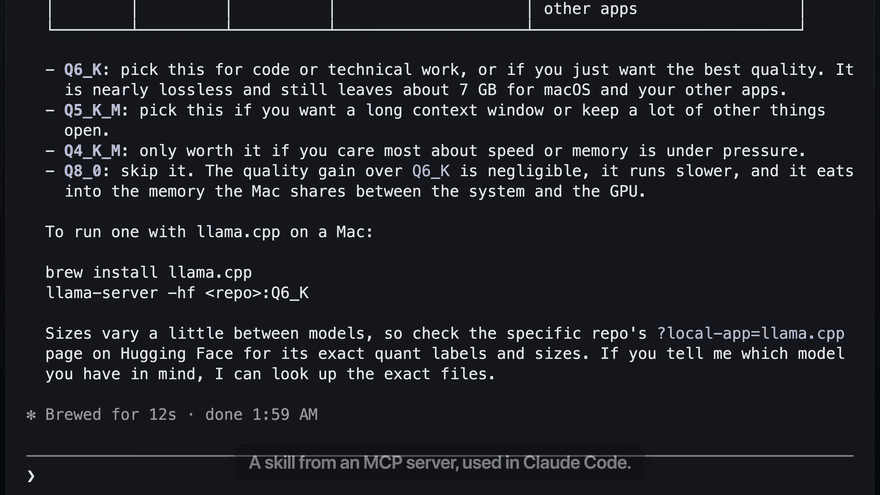

# AgentPolyfill

Open agent extensions, in the host you already have. Claude Code and MCP first.

MCP now grows through extensions: Apps, Skills, Events, Server Cards. A server can adopt one
quickly. Each host has to build and ship each one, on its own schedule. A
polyfill closes that gap from the outside: it implements one published
extension's client side as a plugin, follows that extension's spec (any
exception is listed and can be switched off), and steps aside when the host
ships its own. Servers need no changes.

The aim is an open community around open specs, where anyone can use these
capabilities in the host they have, build the next polyfill, or propose a new
extension, and support does not depend on one host's roadmap. Today that is
Claude Code, four MCP extensions, and one open draft beyond MCP (Agentic
Resource Discovery). Other hosts are where it is meant to go; they are not
built yet.

- **For users:** one line to install, one line to try. See below.
- **For builders:** the `create-polyfill` and `design-extension` skills, and
  the [contract](docs/polyfill-contract.md) every polyfill here meets. New
  polyfills are welcome: [Build one](#build-one).
- **For spec authors:** a polyfill can be the client half of the two
  implementations an extension needs to reach Stable:
  [For spec authors](#for-spec-authors).

## Install

At the prompt of a `claude` session (Claude Code 2.1.329 or newer), every
polyfill at once:

```
/plugin install agent-polyfill --marketplace idosal/AgentPolyfill
```

Or only the one you want: `mcp-events`, `mcp-apps-cli`, `mcp-skills` or
`mcp-server-cards` in place of `agent-polyfill`. Then start a new `claude` session. More ways to install
are [further down](#more-ways-to-install).

## Polyfills

| Extension | Spec | Claude Code | Polyfill | State |
|---|---|---|---|---|
| Events (`io.modelcontextprotocol/events`) | [SEP-3415](https://github.com/modelcontextprotocol/modelcontextprotocol/blob/main/seps/3415-events-extension.md), Final | not supported | [`mcp-events`](polyfills/events/claude-code) | Works: poll, push and webhook delivery; an event wakes an idle session. No OAuth servers. |
| Apps (`io.modelcontextprotocol/ui`) | [MCP Apps](https://github.com/modelcontextprotocol/ext-apps) 2026-01-26, Stable | not supported | [`mcp-apps-cli`](polyfills/apps/claude-code) | Early: app UIs render inline in the terminal, with mouse and keyboard. No OAuth servers. |
| Skills (`io.modelcontextprotocol/skills`) | [SEP-2640](https://github.com/modelcontextprotocol/modelcontextprotocol/blob/main/seps/2640-skills-extension.md), Final | not supported | [`mcp-skills`](polyfills/skills/claude-code) | Early: skills served by an MCP server are listed, loaded and read in Claude Code, with the checks the spec asks of a client. No OAuth servers. |
| Server Cards | [SEP-2127](https://github.com/modelcontextprotocol/modelcontextprotocol/blob/main/seps/2127-mcp-server-cards.md), Final (extension Beta) | not supported | [`mcp-server-cards`](polyfills/server-cards/claude-code) | Early: finds the servers a domain publishes, checks each card against the schema, and adds one to Claude Code's own config with a click, so servers behind OAuth work. |

Beyond MCP, [`ard-discovery`](polyfills/ard/claude-code) adds
[Agentic Resource Discovery](https://github.com/ards-project/ard-spec) v0.91, a
draft: it finds MCP servers through a domain's `ard.json` or by searching an
ARD registry, and hands the cards to `mcp-server-cards`. Its search sends the
words of your request to that registry, and asks you first every time; for
that reason it is not part of the `agent-polyfill` bundle. Install it by name.

"Claude Code" is what the official
[extension support matrix](https://modelcontextprotocol.io/extensions/client-matrix)
showed on 23 November 2026: Tasks, and none of Events, Apps or Skills (Server
Cards is not in the matrix). Hosts are
adding extensions steadily, so check the matrix for today's picture. The Skills
SEP notes that Claude Code support has been prototyped at Anthropic.

### Events: Claude is woken when something happens


Try it against the same hosted demo server (no sign-in). Add it, start
`claude`, and ask "Give me a demo button and tell me what I type when I press
it":

```
claude mcp add --transport http feeds https://event-feeds.idosalomon.workers.dev/mcp
```

The same server offers new comments in a Hacker News thread, new npm and
GitHub releases, and earthquakes; its source is in
[`servers/event-feeds`](servers/event-feeds). [More in the Events README](polyfills/events/claude-code).

### Apps: an MCP App's interface, in the terminal

A server's app opens under the tool call and answers the mouse; real pixels
in iTerm2, kitty and Ghostty, character cells elsewhere
([full video, 33 s](https://github.com/idosal/AgentPolyfill/releases/download/mcp-apps-cli-v0.1.0/mcp-apps-cli-demo.mp4)).


Try it against a hosted demo server (classic shareware games from archive.org,
played in the app's view). Add it, start `claude`, and ask for a game ("Find
a shareware game in the arcade and load it"):

```
claude mcp add --transport http arcade https://mcp-apps-arcade.idosalomon.workers.dev/mcp
```

[More in the Apps README](polyfills/apps/claude-code).

### Skills: skills served by an MCP server



Try it against Hugging Face's public MCP server (no sign-in). Add it, start
`claude`, and type `/mcp-skills` to see what it serves, or just ask a question
one of its skills covers:

```
claude mcp add --transport http huggingface https://huggingface.co/mcp
```

[More in the Skills README](polyfills/skills/claude-code).

### Server Cards: add a company's MCP server by its domain

Nothing to set up. Start `claude` and ask "What MCP servers does neon.com
publish?", then press **Add** on **Neon Docs** (no sign-in). For one behind a
sign-in, ask about buildkite.com; after **Add**, Claude Code asks you to sign
in through `/mcp`. `claude mcp remove neon-docs -s local` removes it again.

[More in the Server Cards README](polyfills/server-cards/claude-code).

## What makes something a polyfill

1. It implements one published extension, client side, and nothing else. No
   extra protocol, no vendor additions. The one exception allowed is an
   earlier form of the same extension that servers still speak, listed in the
   polyfill's README and switched off by one setting.
2. It names the spec revision it implements.
3. Every client rule in the spec has a test, and it is run against a server
   someone else wrote.
4. It stands down when the host supports the extension natively.
5. It says plainly what it cannot do on each host, and what the host would
   need to change.

The full text is in [`docs/polyfill-contract.md`](docs/polyfill-contract.md).
For rule 1, `mcp-events` uses that exception: by default it also talks to
servers that advertise events in the form from before SEP-3415, and
`MCP_EVENTS_PRE_STANDARD=off` makes it follow the SEP exactly.

For rule 4, `mcp-events` and `mcp-skills` each have a setting that turns them
off (`MCP_EVENTS_OFF=1`, `MCP_SKILLS_OFF=1`), `mcp-server-cards` and
`ard-discovery` have a `disabled` setting in `/config`, and any of them is
turned off by disabling its plugin (`/plugin disable mcp-apps-cli`). None can yet
detect native support reliably, because a mod cannot see what Claude Code's
own MCP client supports. So when Claude Code ships one of these extensions,
disable that polyfill; its README says how.

## Build one

The `create-polyfill` skill walks an agent through building a polyfill to this
contract: the spec's client rules as a checklist, how each wire need is reached
on the host, stand-down, and what counts as proof.

```
/plugin install polyfill-author --marketplace idosal/AgentPolyfill
```

Then ask for the extension you want, for example "polyfill MCP Server Cards in
Claude Code". It points the agent at the primary sources (the SEP, the
extension's spec, the core spec for the revision in use, the conformance
suite) and has it work from those.

### When the spec doesn't have what you want

A polyfill stays exact, so new behaviour does not go into one. The
`design-extension` skill, in the same plugin, covers that case: first check
whether the protocol already has a slot for it, then, if it really is new,
design it as its own extension under MCP's extension rules (your own
identifier, a declaration, defined behaviour when the other side lacks it, a
written spec, two implementations) and take it to the working group.

Both skills are plain `SKILL.md` files
([create-polyfill](plugins/polyfill-author/skills/create-polyfill/SKILL.md),
[design-extension](plugins/polyfill-author/skills/design-extension/SKILL.md)),
so other agents that read skills can use them too.

## For spec authors

An MCP extension reaches Stable through a second Extensions Track SEP that
must, among other things, "Show two independent implementations, at least one
client-side and one server-side, that interoperate", carry a conformance
scenario, and show that the extension has been in real use
([SEP-3392](https://github.com/modelcontextprotocol/modelcontextprotocol/blob/main/seps/3392-extension-lifecycle.md)).

A polyfill can be a client-side implementation in a host that has not shipped
the extension yet, used by real people against real servers. Each one here
names the spec revision it implements. Events and Skills each have a test for
each client rule and are run against servers their authors did not write, and
Skills passes the official conformance suite's Skills client scenarios. Apps
checks the spec requirement by requirement in its design notes. Whether one counts as an independent
implementation for a given SEP is for that extension's maintainers to decide.

If your extension needs a client in a host that lacks it, open an issue, or
build one with the `create-polyfill` skill.

## Why this works in Claude Code, and where it stops

Claude Code's mods (on by default since Claude Code 2.1.287) run third-party
code inside the host. A mod
can register tools, draw UI, start a turn in an idle session, and call a
server's tools over Claude Code's own connection. That is the host half of
almost any extension.

The protocol half is missing. Over Claude Code's connection a mod can call a
tool and read a resource's contents, and nothing else: it cannot send
`events/poll` or `skills/list`, see what a server advertised, or receive a
server's notifications. So Events, Skills and Apps each
open a second connection of their own, using the headers in your config. A
second connection cannot use Claude Code's sign-in, which is why none of those
three reaches servers behind OAuth. Server Cards needs no connection: a card is
a public document, and the server it describes is added to Claude Code's own
config, so Claude Code connects it with its own sign-in.

Four small, generic changes would remove that limit. None of them names an
extension:

| Change | Events | Skills | Apps | Server Cards |
|---|---|---|---|---|
| Send any MCP method over the host's connection | needed | needed | needed | only to check a card against the live server |
| Read what the server advertised | needed | needed | needed | only to check a card against the live server |
| Deliver server notifications to the plugin | push only | not needed | needed | not needed |
| Raw tool results in hooks; declare a client extension | not needed | not needed | needed | not needed |

The first two are enough for Events (by poll and webhook) and Skills on every
server. The details, and the questions they raise about permissions, are in
[`docs/host-changes.md`](docs/host-changes.md).

## Other hosts

We have not found a documented way for third-party code to send requests over
the host's MCP connection in Codex, Cursor or VS Code, and ChatGPT runs no
third-party code on the client side. For those hosts the only polyfill is a
gateway: an MCP server that presents an extension as plain tools. It is a
weaker form (for Events, the model has to poll and nothing wakes it), and none
is built here yet.

## More ways to install

One polyfill, at the prompt of a `claude` session:

```
/plugin install mcp-events --marketplace idosal/AgentPolyfill
```

```
/plugin install mcp-apps-cli --marketplace idosal/AgentPolyfill
```

```
/plugin install mcp-skills --marketplace idosal/AgentPolyfill
```

```
/plugin install mcp-server-cards --marketplace idosal/AgentPolyfill
```

```
/plugin install ard-discovery --marketplace idosal/AgentPolyfill
```

`ard-discovery` installs `mcp-server-cards` with it.

The same works in a terminal as `claude plugin install agent-polyfill --marketplace idosal/AgentPolyfill`.
It adds this repository's marketplace and installs from it in one step; start
a new `claude` session for the polyfills to load. `agent-polyfill` holds nothing
of its own: it depends on each MCP polyfill (everything above but
`ard-discovery`), and each stays a plugin you can disable or uninstall on its
own.

With the marketplace already added, the short form is
`/plugin install mcp-events@agent-polyfill`; to add it by itself,
`/plugin marketplace add idosal/AgentPolyfill`.

Each polyfill's own README lists its requirements, the steps between
installing and first use, and its limits.

## Safety

These are third-party plugins that run with your permissions, as every Claude
Code mod does. None of them reads Claude Code's stored credentials. Each
polyfill's `SECURITY.md` says what it checks and what it does not protect
against; [`SECURITY.md`](SECURITY.md) says how to report a problem privately.

## Repository layout

Each polyfill is a folder, `polyfills/<extension>/`, with one subfolder for
each host it runs in: for Claude Code,
[`events`](polyfills/events/claude-code), [`apps`](polyfills/apps/claude-code),
[`skills`](polyfills/skills/claude-code),
[`server-cards`](polyfills/server-cards/claude-code) and
[`ard`](polyfills/ard/claude-code).
One marketplace file ([`.claude-plugin/marketplace.json`](.claude-plugin/marketplace.json))
lists them all, with two plugins in [`plugins/`](plugins): `agent-polyfill`, which
installs every MCP polyfill, and `polyfill-author`, the skills for building one.
The demo servers that are hosted for trying a polyfill live in
[`servers/`](servers): [`event-feeds`](servers/event-feeds), the Events demo.
Each polyfill releases on its own, under tags that start with its
plugin's name (`mcp-apps-cli-v0.1.0`).

## Contributing

Problems and questions: open an issue here. A new polyfill is welcome if
it meets the [contract](docs/polyfill-contract.md); the `create-polyfill`
skill is the quickest way to build one that does.
[`CONTRIBUTING.md`](CONTRIBUTING.md) says how to add one to this
repository.

## Licence and status

Apache-2.0. See [LICENSE](LICENSE).

A community project by [Ido Salomon](https://github.com/idosal). It is not
part of the MCP specification and is not affiliated with or endorsed by the
MCP project, the Agentic AI Foundation, the Linux Foundation, Anthropic or any
host vendor. The author works in the MCP Apps working group; this is not
working-group output. Model Context Protocol and MCP are trademarks of LF
Projects, LLC. Claude and Claude Code are trademarks of Anthropic, PBC.
