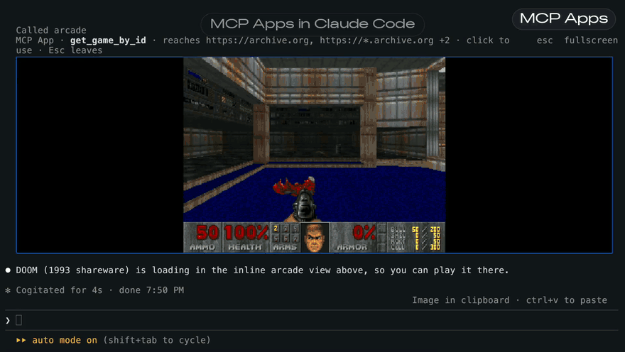

#  AgentPolyfill

MCP extensions for coding agents. Open an interactive app inside a tool call,
wake an idle session when a deployment fails, or load a skill directly from an
MCP server.

<a href="https://agentpolyfill.com/media/launch.mp4">
  <picture>
    <source media="(prefers-reduced-motion: reduce)" srcset="site/public/media/launch-poster.jpg">
    
  </picture>
</a>

[Watch the full demo (48 s)](https://agentpolyfill.com/media/launch.mp4) · [Installation](#install) · [Supported hosts](#polyfills) · [Documentation](https://agentpolyfill.com)

## Install

> AgentPolyfill is an independent community project with no affiliation to the maintainers of supported protocols or the vendors of supported hosts.
> The plugins are experimental and may have unintended effects in your agent sessions or host configuration. Use them at your own risk.

**Claude Code** · In Claude Code 2.1.329+, install the bundle and start a new session.
It includes Apps, Events and Server Cards.

```text
/plugin install agent-polyfill --marketplace idosal/AgentPolyfill
```

**Codex** · With Codex 0.170+ and Node.js 20+, add the marketplace once, then install a plugin. To try Server Cards, run

```sh
codex plugin marketplace add idosal/AgentPolyfill
codex plugin add mcp-server-cards@agent-polyfill
```

**Cursor** · Server Cards runs in the Cursor IDE with Node.js 20+. [Install the local plugin](polyfills/server-cards/codex/README.md#cursor-ide).

The [installation guide](https://agentpolyfill.com/guide/getting-started) covers prerequisites, setup and removal for each host.

## Try it

With Server Cards installed, try this prompt.

> What MCP servers does neon.com publish?

Choose **Neon Docs**, review its address and approve the addition. Your host handles the connection and any required sign-in.

See the [Muse Code and Grok Bot setup guide](docs/muse-grok.md) for experimental, host-specific support.

## Polyfills

Select a host adapter for its install commands, examples and limits.

| Polyfill | What you can do | Host adapters |
| --- | --- | --- |
| [**Apps**](https://agentpolyfill.com/guide/apps) | Play DOOM or explore a chart inside a tool call. | [Claude Code](polyfills/apps/claude-code) |
| [**Events**](https://agentpolyfill.com/guide/events) | Wake an idle agent when a deployment fails. | [Claude Code](polyfills/events/claude-code) · [Codex](polyfills/events/codex) · [Pi](polyfills/events/pi) · [OpenCode](polyfills/events/opencode) · [Antigravity](polyfills/events/antigravity) · [Copilot CLI](polyfills/events/copilot) · [Hermes](polyfills/events/hermes) · [T3 Code](polyfills/events/t3) |
| [**Skills**](https://agentpolyfill.com/guide/skills) | Load a skill from Hugging Face to choose a model quantization. | [Codex](polyfills/skills/codex) · [Pi](polyfills/skills/pi) · [OpenCode](polyfills/skills/opencode) · [Antigravity](polyfills/skills/antigravity) · [Hermes](polyfills/skills/hermes) |
| [**Server Cards**](https://agentpolyfill.com/guide/server-cards) | Find the MCP servers published by `neon.com` and add Neon Docs. | [Claude Code](polyfills/server-cards/claude-code) · [Codex](polyfills/server-cards/codex) · [Cursor IDE](polyfills/server-cards/codex/README.md#cursor-ide) · [Pi](polyfills/server-cards/pi) · [OpenCode](polyfills/server-cards/opencode) · [Antigravity](polyfills/server-cards/antigravity) · [Copilot CLI](polyfills/server-cards/copilot) · [Hermes](polyfills/server-cards/hermes) |
| [**ARD**](https://agentpolyfill.com/guide/ard) | Find Buildkite’s MCP server by domain or search an ARD registry. | [Claude Code](polyfills/ard/claude-code) · [Codex](polyfills/ard/codex) · [Pi](polyfills/ard/pi) · [OpenCode](polyfills/ard/opencode) · [Antigravity](polyfills/ard/antigravity) · [Copilot CLI](polyfills/ard/copilot) · [Hermes](polyfills/ard/hermes) |

Agentic Resource Discovery (ARD) is a separate draft protocol. Its plugin asks before sending your query to a registry.

Claude Code 2.1.332+ includes native Skills in beta. [Migrating from the older plugin](polyfills/claude-code/skills/README.md).
The Antigravity App renders MCP Apps natively. Copilot CLI advertises Skills and its VS Code integration enables Apps. [Copilot compatibility notes](polyfills/events/copilot/README.md#skills-and-apps-in-copilot).

[T3 Code](docs/t3-code.md) uses the underlying agent’s plugins and has a dedicated Events adapter for Codex threads.
[Tasks for Codex](polyfills/tasks/codex) is also available from source.

## Compatibility and security

- Events, Skills and Apps adapters that open a separate connection to a server cannot reuse the host’s OAuth session. [Host API limitations](docs/host-changes.md)
- Codex cannot prompt before a loaded skill reads resources from another server. [Skills in Codex](polyfills/skills/codex)
- When an app omits `ui.csp`, the Claude Code adapter uses a more permissive default content security policy. [Apps conformance](polyfills/apps/claude-code/docs/COMPLIANCE.md)

[Security and vulnerability reporting](SECURITY.md) · [Interoperability results](https://agentpolyfill.com/guide/spec-authors)

## Contributing

To add a host adapter or implement an extension, see the [contributing guide](CONTRIBUTING.md)
and [polyfill contract](docs/polyfill-contract.md). Independently maintained plugins can be listed in the [community directory](community/).

## License

[Apache-2.0](LICENSE).
