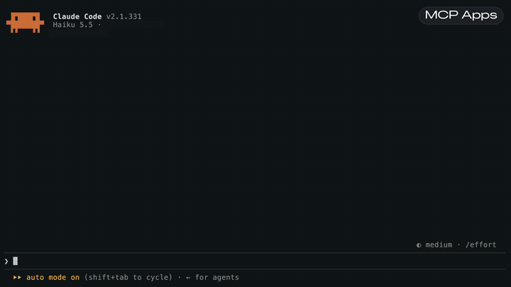
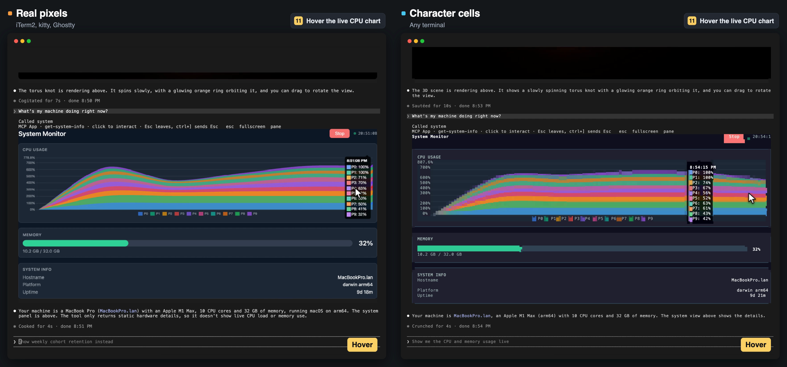

# mcp-apps-cli for Claude Code

MCP Apps in the Claude Code terminal. When Claude calls a tool that ships an
[MCP App](https://github.com/modelcontextprotocol/ext-apps), the app's
interface appears inline, under the tool call, and you can click, drag and
type into it. Existing MCP servers work unmodified.

<a href="https://agentpolyfill.com/media/apps.mp4">
  <picture>
    <source media="(prefers-reduced-motion: reduce)" srcset="../../../site/public/media/apps.jpg">
    
  </picture>
</a>

[Watch DOOM, a live chart and a 3D model in Claude Code (19 s)](https://agentpolyfill.com/media/apps.mp4)

- **Real pixels** in terminals that show images: iTerm2 3.5+, kitty and
  Ghostty.
- **Character cells** everywhere else: Terminal.app, VS Code, tmux and so on.
  Text, including chart labels, stays real characters.

Codex: not yet. What Codex would need is in
[What hosts would need to change](../../../docs/host-changes.md).

This Claude Code mod implements MCP Apps (`io.modelcontextprotocol/ui`), the
2026-01-26 Stable specification. Where it departs from the spec is in
[Spec and conformance](#spec-and-conformance).

## Install

At the prompt of a `claude` session:

```
/plugin install mcp-apps-cli --marketplace idosal/AgentPolyfill
```

Or in a terminal:

```bash
claude plugin install mcp-apps-cli --marketplace idosal/AgentPolyfill
```

Either one adds the [AgentPolyfill](../../../README.md) marketplace and
installs the plugin in one step. Start a new `claude` session for it to load.
With the marketplace already added, `/plugin install mcp-apps-cli@agent-polyfill`
does the same. `/plugin install agent-polyfill --marketplace idosal/AgentPolyfill`
installs every polyfill in the marketplace, this one included.

The plugin is one zip, attached to a release of this repository. Claude Code
checks it against the SHA-256 in the repository's marketplace file
([`.claude-plugin/marketplace.json`](../../../.claude-plugin/marketplace.json))
before it unpacks it. The zip carries a small helper program for each
platform and needs nothing else installed, not even Node.

You need:

- **Claude Code** 2.1.329 or later, the version it is tested with. It runs as
  a mod, Claude Code's plugin hooks module.
- **macOS** (Apple Silicon or Intel), **Linux** (x64 or Arm64, any
  distribution) or **Windows** x64. Windows is new: its helper passes the same
  checks in CI on Windows. Not checked in a Claude Code session on Windows, so
  please report what you see.
- **Chrome**, or another Chromium-based browser (Edge, Chromium, Brave). Views
  run in a headless copy of it. If none is installed, the plugin offers, once,
  to download Chrome for Testing's headless shell from Google (about 100 MB,
  kept in the plugin's data folder).
- **To click into views:** Claude Code's fullscreen layout, and mouse
  reporting turned on in your terminal. Outside fullscreen, views are
  view-only. [What can come up](#what-can-come-up) says how to set both.

## Try it

1. **Install** (above). Nothing is asked. The four settings below start at
   their defaults, and the install's note that they are "not yet set" needs no
   action.
2. **Add an MCP server that has apps,** as you add any server. To try one:
   `claude mcp add --transport http arcade https://mcp-apps-arcade.idosalomon.workers.dev/mcp`.
3. **Start `claude` and ask** for something the server's app shows: "Find a
   shareware game in the arcade and load it". Claude Code asks whether to
   allow the tool, as it does for any MCP tool, unless your permission rules
   already allow it. The app appears under the call.

### What can come up

Each of these comes up once.

- **No Chromium browser installed.** The view says so, and the plugin offers
  to download Chrome for Testing's headless shell (about 100 MB, from
  Google). If you say no, views stay closed. Install Chrome, Edge, Chromium or
  Brave, or point `MCP_APPS_CLI_CHROME` at one, and the next view opens. The
  offer isn't repeated.
- **Not in fullscreen.** After the first view appears, the plugin offers to
  switch Claude Code to its fullscreen layout, the only one that passes clicks
  and keys to a view. Claude Code restarts and resumes the conversation. If
  you say no, views stay view-only: you see them update but can't click into
  them. `/tui fullscreen` switches later. The offer isn't made in tmux, or if
  you chose the main screen yourself (`CLAUDE_CODE_NO_FLICKER=0`).
- **Mouse reporting off in your terminal.** Clicks don't reach the view. Most
  terminals have it on. In iTerm2, check Settings → Profiles → Terminal →
  Enable mouse reporting. In tmux, run `set -g mouse on`. A plugin can't
  change a terminal's settings.
- **An app asks to send Claude a message, open a link or save a file.** You
  are asked, with a choice to allow that app's messages or links for the rest
  of the session. If you say no, nothing is sent, opened or saved. An app
  calling its own server's tools follows your permission rules: you're asked
  where Claude Code would ask. The `appToolCalls` setting changes this.

## How it works

### Using a view



Add MCP servers as usual. When Claude calls a tool with an MCP App, the app
appears under the call, sized to fit.

- Click into the view to use it. **Esc** gives the keyboard back. **ctrl+]**,
  or **esc** in the view's header, sends the app an Escape.
- A view taller than its box scrolls with PgUp/PgDn.
- The header moves the view: **fullscreen**, **pane** (beside the chat, still
  running) or **back to the chat**.
- The app follows Claude Code's theme.

### What runs

Claude Code runs the plugin's hooks module (`mod/hooks/`). When Claude calls
an MCP tool, the hooks start a helper for the session (`helper-rs/`, a Rust
binary, 8–10 MB). The helper reads the app's UI from its server, runs it in
headless Chrome behind an MCP Apps host page, and streams it back as pictures
or cells. Your clicks and keys go the other way.

## Settings

The settings are in `/config`:

| Setting | Default | Choices |
|---|---|---|
| App tool calls: an app calling its own server's tools | rules: what your permission rules allow runs, and you're asked where they would ask | rules, ask (always), allow (without asking, as Claude Desktop does) |
| App messages: an app sending Claude a message | ask, as Claude Desktop does | ask, fill (put it in your prompt), allow |
| Offer fullscreen | ask once | ask, never |
| Offer a browser download | ask once | ask, never |
| Structured results from text: servers whose apps get `structuredContent` back from the JSON text of Claude's tool result | none (off) | MCP server names, separated by commas (see [Limits](#limits)) |

Your deny rules apply to an app's tool calls in every mode. Where Claude Code
can't check its rules for a tool, you're asked whatever the setting. When
you're asked, you can allow that tool for the rest of the session. An app may
ask to run only a tool its server lists. Opening a link or saving a file from
an app always asks.

### When Claude Code supports MCP Apps itself

The plugin draws views only in an interactive terminal session. Claude Code's
desktop app renders MCP Apps itself, and `claude -p` and the Agent SDK are
left alone.

In the terminal, the plugin can't tell whether Claude Code has started
rendering MCP Apps natively, because a mod can't see what Claude Code's own
MCP client supports. When it does, turn the plugin off:

```bash
claude plugin disable mcp-apps-cli@agent-polyfill
```

Or remove it with `claude plugin uninstall mcp-apps-cli@agent-polyfill`.

## Limits

- **Servers that need sign-in (OAuth) don't show apps yet.** Claude Code
  doesn't give plugins the UI metadata of a tool or of a resource. So the
  helper opens its own connection to each server, from your MCP config, and
  that connection can't sign in.
- **Own sign-in (opt-in, one server at a time, macOS only for now).** If you
  need a server's apps before Claude Code shares its connection, the helper
  can sign in to that server itself. It is off unless you list the server
  under **Own sign-in (OAuth)** in `/config` and run
  `mcp-apps-cli-helper signin <server>` once (the helper binary the plugin
  carries, in its `helper/bin/<platform>/` folder, from a terminal in your
  project's folder). Linux and Windows will follow if the idea is kept. Know
  what that means before you do:
  - **It is a separate grant, with its own life.** The server registers
    `mcp-apps-cli` as a client of its own and asks for your consent again.
    Signing out of the server in `/mcp` doesn't end it, and signing out here
    doesn't touch Claude Code's.
  - **The tokens are kept on your Mac, where you choose.** The macOS Keychain
    (the default), or a file encrypted with a passphrase (AES-256-GCM, key
    from PBKDF2-HMAC-SHA256) under `~/.cache/mcp-apps-cli/oauth/`
    (`MCP_APPS_CLI_OAUTH_DIR` puts it elsewhere). A plain file, not
    encrypted, exists only as an explicit option (`--token-store file`, or
    "Advanced" in the page) for a machine with no Keychain. A token is sent
    only to the address it was issued for, over `https` or to this machine
    itself, and no redirect is followed.
  - **Your organisation's controls for MCP sign-in don't see it.** With a
    managed MCP policy, or an allow or deny list for MCP servers, the helper
    uses no server at all, so this is off there too. The server's
    administrators see a client named `mcp-apps-cli`.
  - **To end it:** `mcp-apps-cli-helper signout <server>` deletes the tokens
    and asks the server to revoke them where it offers that; removing the
    server from the setting stops their use at once.

  `signin` prints one line ("Press Enter to review and approve in your
  browser"), then serves a small consent page on a loopback address of its own
  (a random port, a token against forged requests, closed after your answer
  or after five minutes). The page shows who the server says it is, read from
  what the server publishes without signing in (its name, icon, website,
  description and permissions, from the MCP `serverInfo` and the OAuth
  protected resource metadata, RFC 9728, with links to its policy and terms
  when it gives them; what it does not publish is left out, and the icon is
  downloaded by the helper, never loaded by the page). It says what the above
  means in three lines, asks where to keep the login, and has Accept and Refuse; Accept goes on to
  the server's own sign-in in the same tab, Refuse keeps nothing. Without a
  browser, `--no-browser` asks the same in the terminal (`Continue? [y/N]`,
  no by default; without a terminal it refuses). To skip the question and the
  page, pass `--yes`, or set `MCP_APPS_CLI_SIGNIN_YES=1` in your environment
  to skip them every time (a terminal can't read `/config`); only do that for
  servers you have already decided to sign in to. `--token-store
  keychain|encrypted|file` (or `MCP_APPS_CLI_TOKEN_STORE`) chooses the store
  without the page. There is no silent fall back: if the Keychain isn't
  available, `signin` says so and what to use instead.

  A file encrypted with a passphrase can't be opened by a session's helper
  unless it has the passphrase: set `MCP_APPS_CLI_PASSPHRASE` in the
  environment you start Claude Code from (the helper can't ask). The Keychain
  needs nothing. It works with a server of MCP 2026-07-28 and with one of the
  2025 revisions, only for `streamable-http` servers (not the older `sse`
  ones), only servers that register clients themselves (dynamic client
  registration), and not a server whose config already sets an
  `Authorization` header. The helper still uses a server only while Claude
  Code itself is connected to it in the session, and never reads Claude
  Code's stored credentials. Claude Code's sign-in is the recommended way;
  [host change 1](../../../docs/host-changes.md) would make this unnecessary,
  and the option will be removed when it lands.
- **A view gets Claude's tool result as the model reads it.** That is all
  Claude Code gives plugins: a result with `structuredContent` comes as one
  text block of that object's JSON, and the server's own `content` and the
  result's `_meta` don't come. So a view's `ui/notifications/tool-result`
  (`app.ontoolresult`) holds that text as `content`, with no
  `structuredContent` or `_meta`. The plugin never calls Claude's tool a
  second time to get the rest, as that would run the tool twice. What an app
  can do today:
  - **Data only the view should see** (a session key, a connection origin):
    put it behind an app-only tool (`_meta.ui.visibility: ["app"]`) and call
    that from the view with `app.callServerTool`. It goes over the plugin's
    own connection and comes back whole, `_meta` included, and the model
    never sees it. Tie it to the call with the tool's arguments, which the
    view gets (`ui/notifications/tool-input`): the host context's
    `toolInfo.id` isn't set, as Claude Code doesn't tell plugins the id of
    its request to the server.
  - **`structuredContent`:** `app.callServerTool` on a tool the model also
    sees comes back with it (no `_meta`); that is a call of its own, so it
    suits a tool that only reads. Or list the server under
    **Structured results from text** in `/config`. For that server, when
    Claude's result is a single text block of a JSON object that fits the
    tool's `outputSchema`, the view also gets it as `structuredContent`.
    This goes beyond the spec, and is off by default: a server whose text is
    JSON but which sent no `structuredContent` gets one all the same.

  Up to 0.1.4 the plugin did that for every server's tools with an
  `outputSchema`, without the check; from 0.1.5 only for the servers you
  list. The Claude Code change that would give views the whole result is in
  [What hosts would need to change](../../../docs/host-changes.md), change 4.
- **Some servers get no apps.** The helper can't find or judge these the way
  Claude Code does, so it leaves them alone:
  - claude.ai connectors and plugins' servers;
  - a server named both on `claude`'s command line (`--mcp-config`) and in a
    config file;
  - every server, under a managed MCP policy.
- **Clicks and keys** reach a view only in the fullscreen layout. There's no
  mouse wheel over inline views (use PgUp/PgDn), and a paste goes to the
  prompt.
- **Memory:** Chrome takes about 260 MB while views are open, plus 120–350 MB
  per live view. At most 3 views stay live, and a view you scrolled away from
  and never used sleeps after 10 minutes.
- **Cells** are one character each, so wide characters show as `?`.

[What hosts would need to change](../../../docs/host-changes.md) covers what
Apps needs from a host.

## Security

- **Only servers Claude Code uses.** The helper opens its own connection to a
  tool's MCP server only when Claude Code says it is connected to that server
  in this session under that name. It uses only the config entry Claude Code
  would use. That rules out a project server you haven't approved, one in a
  folder you haven't trusted, and one that is switched off. Under a managed
  MCP policy, it uses none at all.
- **Each request waits for Claude Code's yes.** Every request the helper then
  sends to a server waits for a yes from Claude Code, asked for that request.
  When Claude Code stops using the server, what the helper has in flight to it
  is cancelled and its connection closed.
- **Credentials in your environment** (`ANTHROPIC_*`, `AWS_*`, `GITHUB_*` and
  the like) are never put into a remote server's address or headers.
- **An app's tool calls follow your permission rules** by default: what they
  allow runs, what they deny is refused, and you're asked where they would
  ask. See [Settings](#settings).
- **Each view runs in a sandboxed iframe** inside a dedicated headless Chrome,
  under the app's Content Security Policy, one browser context per view.
  Chrome's own sandbox and its local-network checks stay on. A view of a
  server on your machine or local network may reach that network.
- **A view's storage is kept.** Its cookies, localStorage and IndexedDB are
  saved in the plugin's data folder, readable only by you, so a reopened view
  keeps its state. They're deleted after 30 days unused.
- **The plugin sends nothing anywhere.** Network traffic is the apps' own
  (limited by their CSP), the MCP servers Claude Code uses, and, if you
  accepted it, the Chrome download from Google and its update checks.
- **The plugin never reads Claude Code's stored credentials.** The helper
  answers only requests that carry its per-session token, on a local endpoint
  only you can open.

[SECURITY.md](SECURITY.md) lists what is checked and what isn't
protected, and how to report a security issue.

## Spec and conformance

It implements MCP Apps (`io.modelcontextprotocol/ui`) as published in
`specification/2026-01-26` (Stable), plus `ui/download-file` from the draft.
Where it departs from the spec:

- **Default CSP.** When an app declares no `ui.csp`, views get basic-host's
  default policy instead of the spec's `default-src 'none'`. That policy
  allows `eval` and `blob:`, and still opens no other domain. Apps that run
  code they generate, like the three.js example, need it.
- **Display modes.** A terminal has no floating windows. Fullscreen is a view
  as tall as the terminal, and picture-in-picture is a pane beside the chat.
- **`platform`** is sent as `"desktop"`, because the spec has no value for a
  terminal.
- **Tool results** are what Claude Code gives a plugin, without the server's
  `structuredContent` and `_meta` (see [Limits](#limits)).
- **Structured results from text** (off by default, one server at a time):
  for the servers you list, `structuredContent` is taken back from the JSON
  text of Claude's tool result where it fits the tool's `outputSchema`. The
  spec has no such step; it stands in for what Claude Code leaves out.

The helper's own MCP connection speaks revision 2026-07-28 to a server that
serves it (`server/discover`, no `initialize`), and the 2025 handshake at
2025-11-25 to one that doesn't; before 0.1.5 it sent `initialize` naming
2026-07-28, which a server serving only 2026-07-28 refused.

[docs/COMPLIANCE.md](docs/COMPLIANCE.md) goes through the spec clause by
clause, each MUST, SHOULD and MAY with its test. It also says how the plugin
is checked:

- a TLA+ model of which server a view's app comes from and what it may make
  happen, checked with TLC within stated bounds;
- the server gate, checked over every case;
- property-based tests.

## Development

From this folder (`polyfills/apps/claude-code` in the repository):

```bash
helper-rs/build-into-plugin.sh
```

```bash
package/package.sh
```

The first builds the helper for this machine into `mod/helper/bin/`. It needs
Rust, and several GB of disk for the build. The second packs the plugin zip,
and its entry for the repository's marketplace file, into `package/dist/`. To
try a local build, run `claude --plugin-dir mod`.

Releases are built on GitHub Actions
([`mcp-apps-cli-release.yml`](../../../.github/workflows/mcp-apps-cli-release.yml)).

## Licence

Apache-2.0 ([LICENSE](../../../LICENSE)). The helper includes third-party
crates and npm packages under their own licenses:
[THIRD_PARTY_LICENSES.txt](THIRD_PARTY_LICENSES.txt).
