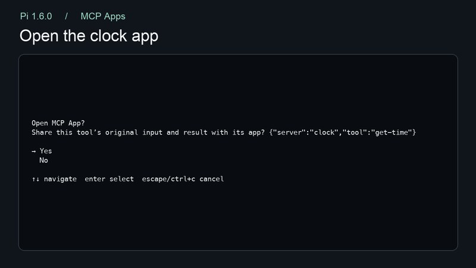

# MCP Apps in Pi

After Pi calls an MCP tool, type `/mcp-app` to open its most recent successful
MCP result. Confirm the server and tool. Pi opens the view in the terminal.
Tab moves focus, Enter activates a control, printable keys enter text and Esc
returns to the conversation. Image-capable terminals use Pi’s image renderer;
other terminals display colored character cells.

The extension is included in the repository's Pi package. From a local clone
run `npm ci` at the repository root and `pi install /absolute/path/to/AgentPolyfill`.
Install Chrome or set `MCP_APPS_CLI_CHROME` to a Chromium executable.
Set `MCP_APPS_OFF=1` before launching Pi to disable the adapter.

Watch the clock open with its original timestamp, request permission to refresh and display the new time.

## Compatibility

This is a partial client for the stable 2026-01-26 MCP Apps specification
(`io.modelcontextprotocol/ui`). Pi 1.6.0 exposes the original server and tool
in completed MCP tool details but filters App resources from its own client.
The command reads the tool definition and its UI resource on a separate
connection to the selected server. It never replays the original tool call.
A stdio server starts a second process. Views requiring Pi's stored OAuth
credentials, or a resource held only in the first process, are unavailable.

Only Pi's built-in MCP tool results qualify. A disabled server, a changed
configuration or a session switch invalidates the saved result. The view
receives the input and the content and structured content Pi exposed. Pi does
not expose the original result’s private MCP metadata here. Apps can display
that result and handle keyboard input. When the agent opens the viewer with the `open_mcp_app` tool, an app can
request an exposed tool on the same server. Pi asks you to approve its exact
arguments and dispatches the call through Pi. Views opened via the slash
command cannot initiate tool calls. App-only tools, sending chat messages,
external links and downloads are unavailable.
There is no pointer input or persisted browser storage in this version.

## Verification

Pi 1.6.0 rendered the upstream vanilla clock example in a disposable terminal.
The agent-opened view displayed the original server timestamp. After approval,
the refresh button issued one more native tool call and the clock displayed
the second timestamp. The local browser fixture checks decline,
approved refresh, absence of replay, and PNG output. Run `npm ci` at the
repository root, then `npm ci && npm run typecheck && npm test` here.
