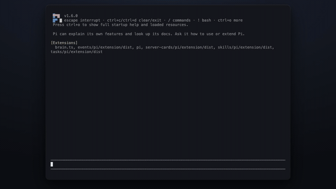
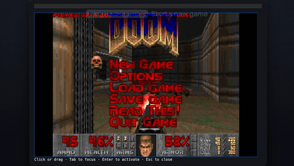
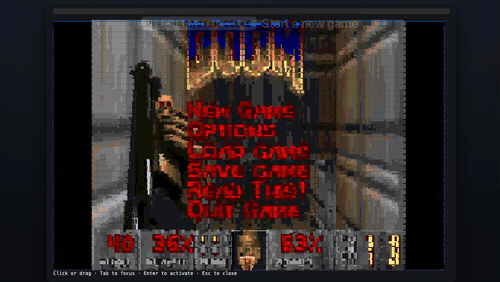

# MCP Apps in Pi

Type `/mcp-app` to open the latest app from a running or completed MCP tool call. Pi first asks to inspect the app on that server. Before the app
opens, a second prompt names the tool whose input and result the app will receive,
the server whose resources it can list and read, and any permitted external
destinations. Declining either prompt leaves you in the conversation.
In Pi’s fullscreen mode, click controls, drag to rotate a 3D model, or scroll
to zoom if the app supports it. Tab moves focus, Enter activates a control,
printable keys enter text and Esc returns to the conversation. Pi draws full-color
graphics when its terminal image renderer is available and colored character
cells otherwise.

Install the Apps-only release using Pi's package manager and restart Pi:

```sh
pi install git:github.com/idosal/AgentPolyfill@pi-mcp-apps-v0.1.0
```

The tagged Git package installs the renderer dependencies alongside the extension. It requires a Node build of Pi listed under Compatibility and a local Chrome or Chromium browser. If you already use the full AgentPolyfill bundle, follow the bundle setup below.

**Full bundle or source checkout.** Install the repository with `pi install git:github.com/idosal/AgentPolyfill`, or use
`pi install /absolute/path/to/AgentPolyfill` for a local clone. Run `/mcp-app`
in Pi to see the renderer directory for that installation. From that directory,
run `npm ci --omit=dev --ignore-scripts`, then restart Pi. From a local clone
you can run this command from the repository root instead:

```sh
npm ci --omit=dev --ignore-scripts --prefix polyfills/apps/claude-code/mod/helper
```

Install Chrome or set `MCP_APPS_CLI_CHROME` to a Chromium executable.
Set `MCP_APPS_OFF=1` before launching Pi to disable the adapter.

### Walkthroughs

Follow a fullscreen Pi session in Kitty from the first tool call through both
approvals. Once the satellite appears, dragging rotates it and scrolling zooms in.

<a href="../../../docs/media/demos/apps-pi-3d.mp4">
  <picture>
    <source media="(prefers-reduced-motion: reduce)" srcset="../../../docs/media/demos/apps-pi-3d.jpg">
    
  </picture>
</a>

[Play the 22-second 3D walkthrough](../../../docs/media/demos/apps-pi-3d.mp4).

The clock walkthrough shows both opening prompts and keyboard navigation.
Refreshing the clock asks for a separate tool approval and displays a new server timestamp.

<a href="../../../docs/media/demos/apps-pi.mp4">
  <picture>
    <source media="(prefers-reduced-motion: reduce)" srcset="../../../docs/media/demos/apps-pi.jpg">
    
  </picture>
</a>

[Watch the 18-second clock walkthrough](../../../docs/media/demos/apps-pi.mp4).

### Play Arcade

Add the hosted Arcade server, then launch Pi in fullscreen mode.

```sh
pi mcp add arcade --url https://mcp-apps-arcade.idosalomon.workers.dev/mcp
pi
```

Ask Pi to load the shareware game `msdos_DOOM_1993` and open its view.
You can also open the most recent result with `/mcp-app`.
Review the server, its embedded page and the listed external destinations.
Click the power button on the cover, choose a sound option, and start a new
game. Use the arrow keys to move and turn, click to fire and press Tab for
the automap. In Kitty, Pi uses graphics by default. To try the same game in
character cells, launch `PI_IMAGE_PROTOCOL=none pi`.

| Kitty graphics | Character cells |
| --- | --- |
| <a href="../../../docs/media/demos/apps-pi-arcade-kitty.mp4"><picture><source media="(prefers-reduced-motion: reduce)" srcset="../../../docs/media/demos/apps-pi-arcade-kitty.jpg"></picture></a> | <a href="../../../docs/media/demos/apps-pi-arcade-cells.mp4"><picture><source media="(prefers-reduced-motion: reduce)" srcset="../../../docs/media/demos/apps-pi-arcade-cells.jpg"></picture></a> |
| [Play the 18-second Kitty recording](../../../docs/media/demos/apps-pi-arcade-kitty.mp4) | [Play the 18-second cell recording](../../../docs/media/demos/apps-pi-arcade-cells.mp4) |

## Compatibility

The interactive Node builds of Pi 1.6.0, 1.6.1 and 1.7.0 support the stable 2026-01-26 MCP Apps revision through this adapter. Pi negotiates Apps on the same MCP connection that runs the tool. Its view can read session-specific resources and receive private result metadata without repeating the call or sharing that metadata with the model. [Feature coverage, spec obligations and remaining limits](COMPLIANCE.md)

**Tool visibility.** The adapter filters the native MCP catalog before Pi
registers tools, including after a server announces a list change. Tools whose
visibility omits `model` stay out of the model's catalog in direct, code-mode
and deferred exposure. Pi currently has no public hook at that point. On
startup the adapter checks the installed build's hash, then applies the
filter in memory. On an unrecognized build or when explicitly disabled, Pi
uses its own MCP behavior and the Apps viewer is unavailable. Restart Pi
after installing the adapter.

**Browser access.** If the app omits its policy, Pi sends the specification's
restrictive default to Chromium. The app can run inline code and display
embedded images. External connections and runtime JavaScript evaluation are
blocked. The opening prompt lists the external destinations that the policy
actually permits. A resource that explicitly includes `blob:` in
`_meta.ui.csp.frameDomains` may embed a page built from its own data. Pi
discloses this separately at review. That permission applies only to frames.
The specification makes the restrictive default mandatory
and recommends warning users about external access. [MCP Apps host behavior](https://github.com/modelcontextprotocol/ext-apps/blob/main/specification/2026-01-26/apps.mdx#host-behavior)
and [security requirements](https://github.com/modelcontextprotocol/ext-apps/blob/main/specification/2026-01-26/apps.mdx#4-content-security-policy-enforcement).

Use `/mcp-app` while an authorized MCP tool is running or after it completes. Pi asks before reading its app and again before sharing the input and result. The reviewed app can request chat messages, model context, external links, downloads, clipboard text and same-server tool calls. Each action has a separate approval. Use Ctrl+G to list and call tools the app offers. Ctrl+L shows its recent log messages inside the view.

Model-visible tool calls require the agent to open the viewer with `open_mcp_app` so Pi can apply its normal tool permissions. App-only tools use explicit approval on the original connection. Print, JSON and RPC modes have no interactive viewer. Camera, microphone and geolocation are unavailable. The [coverage report](COMPLIANCE.md#limits-and-exceptions) describes these limits and the difference between the stable spec and optional SDK features.

For an optional resource hash policy, set `PI_MCP_APPS_ALLOW_HASHES` or `PI_MCP_APPS_DENY_HASHES` to comma-separated SHA-256 digests. Denials take precedence. Find reviewed digests in the session's `mcp-app-policy` entries.

## Verification

The first recording shows Pi 1.6.0 in Kitty on macOS rendering a Three.js
fixture with the satellite scene bundled into the app. The upstream Three.js
example builds the scene from JavaScript at runtime and requires evaluation
that the default policy blocks. The recorded fixture omits CSP metadata and
exercises the restrictive default, drag-to-orbit, wheel zoom and Esc.

The clock recording uses Pi 1.6.1 and the unmodified upstream vanilla clock
example. Pi displayed the original server timestamp, asked for approval when
the app requested a refresh, then displayed the updated time. Both recordings
used a scripted local model to select tools.

The Arcade recordings used the hosted Arcade Server 1.0.0 and two real
fullscreen Pi 1.6.1 sessions in Kitty 0.50.0 on macOS. A scripted local model
selected the MCP tools. Terminal input started E1M1, walked and turned the
player, fired the pistol and toggled the Hangar automap. One session emitted
Kitty graphics and the other emitted ANSI-colored characters on a 136 × 48
grid. The recorded gameplay uses the game served by Arcade.

For a repeatable frame-rate comparison, we replayed the same 34 DOOM frames
at 31.25 frames per second in a 104 × 38 Kitty window. We held an arrow key
for three five-second intervals per mode and counted changed pictures or
game-area writes from Pi 1.6.1. The median rates were:

| Pi display mode | Before | After |
| --- | ---: | ---: |
| Kitty graphics | 17.4 fps | 29.4 fps |
| Character cells | 19.9 fps | 30.0 fps |

Kitty uses one image pixel per CSS pixel during sustained arrow input and
restores full detail when the view settles. In cell mode, Chromium can
capture the next picture while a worker fits glyphs and colors to the
previous one. A separate read of Kitty's visible character grid observed
29.4 changed frames per second at the median with the new renderer. In live
Arcade play, three measured intervals ranged from 7.5 to 16.4 fps in Kitty
graphics and 21.2 to 24.2 fps in cells. The live sessions had different game
states.

Run `npm ci` at the repository root and `npm ci && npm run typecheck && npm test`
in this directory. The regressions cover Pi's model-facing catalog and its live
updates, Chromium's applied policy, accepting and declining access, using the
exact reviewed resource, nested tool approval, and graphical and keyboard input.
