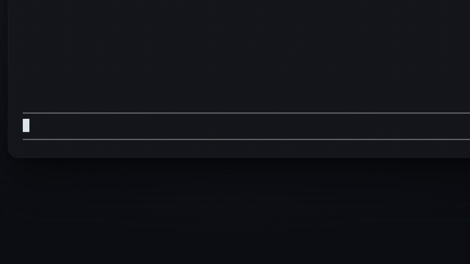

# MCP Apps in Pi

After Pi calls an MCP tool, type `/mcp-app` to open its most recent successful
MCP result. Confirm the server and tool. Pi opens the view in the terminal.
In Pi’s fullscreen mode, click controls, drag to rotate a 3D model, or scroll
to zoom if the app supports it. Tab moves focus, Enter activates a control,
printable keys enter text and Esc returns to the conversation. Pi draws full-color
graphics when its terminal image renderer is available and colored character
cells otherwise.

The extension is included in the repository's Pi package. From a local clone
run `npm ci` at the repository root and `pi install /absolute/path/to/AgentPolyfill`.
Install Chrome or set `MCP_APPS_CLI_CHROME` to a Chromium executable.
Set `MCP_APPS_OFF=1` before launching Pi to disable the adapter.

### Walkthroughs

Open the Three.js satellite in Pi, approve sharing the result, then drag to orbit
and scroll to zoom. The recording follows one Pi session in Kitty.

<a href="../../../docs/media/demos/apps-pi-3d.mp4">
  <picture>
    <source media="(prefers-reduced-motion: reduce)" srcset="../../../docs/media/demos/apps-pi-3d.jpg">
    
  </picture>
</a>

[Play the 19-second 3D walkthrough](../../../docs/media/demos/apps-pi-3d.mp4).

The clock walkthrough shows keyboard navigation and a separate approval before
the app calls its server to refresh the time.

<a href="../../../docs/media/demos/apps-pi.mp4">
  <picture>
    <source media="(prefers-reduced-motion: reduce)" srcset="../../../docs/media/demos/apps-pi.jpg">
    
  </picture>
</a>

[Watch the 15-second walkthrough](../../../docs/media/demos/apps-pi.mp4).

## Compatibility

This is a partial client for the stable 2026-01-26 MCP Apps specification
(`io.modelcontextprotocol/ui`). Pi 1.6.0 exposes the original server and tool
in completed MCP tool details but filters App resources from its own client.
The command reads the tool definition and its UI resource on a separate
connection to the selected server. It never replays the original tool call.
A stdio server starts a second process. Views requiring Pi's stored OAuth
credentials, or a resource held only in the first process, are unavailable.

Only Pi's built-in MCP tool results qualify. A disabled server, a changed
configuration or a session switch invalidates the saved result. The view
receives the input and the content and structured content Pi exposed. Pi does
not expose the original result’s private MCP metadata here. Apps receive that result and can handle
keyboard input and fullscreen mouse events. When the agent opens the viewer
with the `open_mcp_app` tool, an app can
request an exposed tool on the same server. Pi asks you to approve its exact
arguments and dispatches the call through Pi. Views opened via the slash
command cannot initiate tool calls. App-only tools, sending chat messages,
external links and downloads are unavailable.
Browser storage is scoped to the open view.

## Verification

Pi 1.6.0 rendered the upstream vanilla clock example in a disposable terminal.
The agent-opened view displayed the original server timestamp. After approval,
the refresh button issued one more native tool call and the clock displayed
the second timestamp.

A separate Pi 1.6.0 fullscreen session in Kitty rendered the upstream Three.js
example over loopback HTTP. The satellite stayed still until a drag rotated it,
wheel input zoomed the view, and Esc returned to Pi. Both recordings used a
scripted local model to select the tools. The 3D recording verifies Kitty on
macOS. Other graphical terminals have not been tested here.

The browser tests cover keyboard decline, mouse approval, absence of replay,
and PNG output. Surface tests check scaled coordinates, dragging beyond an
edge, wheel input and clipping. Run `npm ci` at the
repository root, then `npm ci && npm run typecheck && npm test` here.
