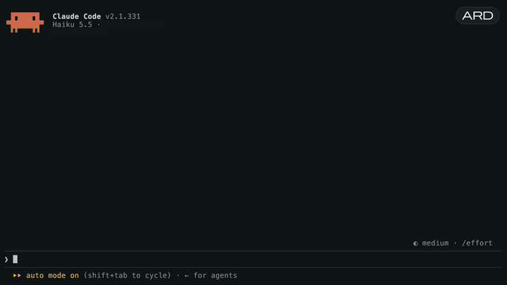

# ard-discovery for Claude Code

Claude finds MCP servers through Agentic Resource Discovery (ARD): in what a
domain lists, or by asking an ARD registry for a server that can do a task.
You choose the registry, and Claude Code asks you before every search.

<a href="https://agentpolyfill.com/media/ard.mp4">
  <picture>
    <source media="(prefers-reduced-motion: reduce)" srcset="../../../site/public/media/ard.jpg">
    
  </picture>
</a>

[Watch Claude Code look up Buildkite and search a registry (16 s)](https://agentpolyfill.com/media/ard.mp4)

Also available for Codex, Pi and OpenCode: [ard-discovery for Codex](../codex/README.md), [ard-discovery for Pi](../pi/README.md), [ard-discovery for OpenCode](../opencode/README.md).

> Search for an MCP server that can check why my CI build failed.

This Claude Code mod adds the consumer side of
[Agentic Resource Discovery](https://github.com/ards-project/ard-spec) for MCP
servers. It finds servers in two ways:

- **By domain.** It reads a domain's `/.well-known/ard.json` and the
  `rel="ard"` links on its pages, beside the AI Catalog.
- **By task.** It asks an ARD registry, in plain words, for a server that can
  do something.

It only finds. Each Server Card it finds goes to
[`mcp-server-cards`](../../server-cards/claude-code/README.md), which checks it
against the schema and shows it under the answer with an **Add** button. For a
search result, `mcp-server-cards` also asks the publisher's own domain whether
the server is theirs. Pressing **Add** puts the server into Claude Code's own
MCP configuration, and Claude Code connects it with its own sign-in.
`mcp-server-cards` is a declared dependency, installed with this plugin.

**A search sends your query to a third party.** `ard_search` posts the words
of your request to an ARD registry: a service someone else runs, which ranks
other people's servers.

- The plugin ships with no registry, so you choose which one sees your words.
  Name it in the request (a registry base URL, or a domain whose catalog lists
  one), or set it with the `registry` setting. With neither, a search is
  refused and nothing is sent.
- Claude Code asks you before every search, showing the query and where it
  goes. A session with nobody to ask (`claude -p`) can't search.
- Every result says which registries were asked.
- Discovery by domain sends nothing but plain `GET`s to that domain.

ARD is a draft published by the ards-project on GitHub, not an MCP
specification. The revision this plugin follows is
in [Spec and conformance](#spec-and-conformance).

## Install

At the prompt of a `claude` session:

```
/plugin install ard-discovery --marketplace idosal/AgentPolyfill
```

Or in a terminal:

```bash
claude plugin install ard-discovery --marketplace idosal/AgentPolyfill
```

Either one adds the [AgentPolyfill](../../../README.md) marketplace and
installs the plugin. The plugin lists `mcp-server-cards` as a dependency, and
Claude Code installs that from the same marketplace. With the marketplace
already added, `/plugin install ard-discovery@agent-polyfill` does the same.

You need Claude Code 2.1.329 or newer, with mods (on by default from Claude
Code 2.1.287), and nothing else: no helper process, no Node, no account.

To turn it off, set `disabled` in `/config`, or disable or uninstall the
plugin (`/plugin`). `mcp-server-cards` keeps working on its own.

To run both plugins from a clone of this repository, for one session:

```bash
git clone https://github.com/idosal/AgentPolyfill
claude --plugin-dir AgentPolyfill/polyfills/server-cards/claude-code/mod --plugin-dir AgentPolyfill/polyfills/ard/claude-code/mod
```

## Try it

Ask Claude "What MCP servers does buildkite.com list through ARD?", then press
**Add** under the answer. To try search, start the
[demo registry](#demo-registry) and ask Claude to search it for "check why my
CI build failed".

### Demo registry

[`demo/registry.mjs`](demo/registry.mjs) is a demo ARD registry, not a real
one. When it starts, it reads the live catalogs of ten publishers: Buildkite,
GitHub, Notion, Neon, Supabase, Netlify, Exa, Context7, Hugging Face and
Zapier. It keeps their Server Card entries as published, and answers
`POST /search` by word match. Every result points at the publisher's own card,
so each one comes back confirmed.

```bash
node demo/registry.mjs
```

It listens on `http://127.0.0.1:9011`. Then, in Claude Code:

> My CI build failed and I don't have a tool for it. Search the registry at http://127.0.0.1:9011 for an MCP server that can check why.

Claude finds Buildkite, and says buildkite.com's own catalog confirms it.
Press **Add**, and Claude Code asks you to sign in to Buildkite through
`/mcp`.

## How it works

### Step by step

1. **Ask.** For example "find an MCP server that can check why my CI build
   failed", or "what does buildkite.com list in its ard.json?".
2. **Claude Code asks first.** It asks before the first `ard_discover`, as for
   any new tool. It also asks before every `ard_search`: the plugin puts each
   search to you itself, with the query and the registry it goes to, so no
   allow rule or auto mode answers it.
   - The query sent is the one shown: at most 300 characters, on one line,
     with no invisible characters or direction marks.
   - The registry searched is the one named: at most 200 characters, with no
     spaces, control characters or direction marks, whether it was named in
     the request or set.
   - If you say no, nothing is fetched or sent.
   - With nobody to ask (`claude -p`, a background loop), every search is
     refused: such a session can't search.
3. **By domain (`ard_discover`):** `mcp-server-cards` reads the domain's
   `/.well-known/ai-catalog.json` and `/.well-known/ard.json`, and follows
   `rel="ai-catalog"` and `rel="ard"` links on the page. It fetches each Server
   Card listed and checks it. The result and the **Add** picker appear under
   the `ard_discover` call.
4. **By task (`ard_search`):** if no registry is set and you named none, Claude
   asks you which one to search. The plugin posts your query to that registry
   and follows the referrals it gives, one hop. It hands the Server Card
   results to `mcp-server-cards`, which fetches and checks each card. Then it
   reads each publisher's own catalogs: `ai-catalog.json` and `ard.json` on the
   domain in the result's `urn:air:<publisher>:…` identifier.
   - A server is confirmed only if its publisher lists it there with a valid
     card. The publisher's card is then the one shown and added.
   - Otherwise it is marked **NOT confirmed by its publisher**. Adding it is
     your call.
   - The registry's order is its relevance ranking, not a judgement of trust,
     and Claude is told to say so.
5. **Add.** Press **Add**, or ask Claude, who calls `mcp-server-cards`'
   `add_mcp_server`. Claude Code then asks you, naming the server, its URL and
   how to undo it. The rules are those of
   [`mcp-server-cards`](../../server-cards/claude-code/README.md#step-by-step).

### The tools

| Tool | What it does |
|---|---|
| `ard_discover(domain)` | Reads the domain's ARD and AI Catalog sources through `mcp-server-cards`, and shows each card it finds. Read-only. |
| `ard_search(query, registry?)` | Posts `query` to an ARD registry, then shows the Server Cards it returns through `mcp-server-cards`. `registry` is a registry base URL, or a domain whose catalog lists a registry (an entry of type `application/ai-registry+json`). Required unless the `registry` setting is set. |

### What differs between Claude Code and Codex

Both forms run the same registry client, in [`mod/hooks`](mod/hooks). Adding
a server differs as it does for `mcp-server-cards`: see
[its table](../../server-cards/claude-code/README.md#what-differs-between-claude-code-and-codex).

| | Claude Code | Codex |
|---|---|---|
| Cards it finds | handed to `mcp-server-cards` (a declared dependency), which checks, shows and adds them | checked, shown and added by this plugin, with the same code: one Codex plugin's server can't call another's tools |
| Its own `add_mcp_server` | no | yes, for what this plugin showed |
| Consent to a search | a question the mod makes in Claude Code's permission prompt | a form through MCP elicitation, naming the exact endpoints and the query; refused without a form, or on a decline or close |
| A registry named by domain | asked about before the domain is read | the domain's catalogs are read first (a `GET`, no query), so the form names the exact endpoints |
| A redirect of the search | followed by Claude Code's fetch | never to another origin, and never turned into a `GET`: the query goes only where the form said |
| Redirects of documents | followed unseen, so one to a private address isn't caught | followed by the plugin under the address rule, so one to a private address is refused |
| Settings | `/config` | environment variables |
| Picker | under each result | none: you ask Codex to add a server |

## Settings

The settings are in `/config`, under the plugin.

| Setting | Default | What it does |
|---|---|---|
| `disabled` | off | Turns the plugin fully off: no tools, nothing fetched or sent. |
| `registry` | empty | The base URL of an ARD registry for `ard_search` to ask when the request names none. It is empty by default: no registry is chosen for you, so each search names its own. Your query text is sent to the registry, once you say yes. |

### When Claude Code supports ARD itself

ARD is a draft, and no host supports it natively yet. The `disabled` setting
turns the plugin off, as does disabling or uninstalling it (`/plugin`).

## Limits

- **The query leaves your machine** once you approve that search. That is
  what a search is. Only the words Claude puts in `query` are sent, with no
  cookie or credential, but the registry sees them.
- **Search results today.** The one public registry returns MCP Registry
  entries, which aren't Server Cards, so nothing it returns can be added yet.
- **The address limits of `mcp-server-cards` apply here too.** Claude Code's
  `$.http.fetch` follows redirects and resolves names without reporting
  either. So a public registry URL that redirects to a private address, or a
  public name that resolves to one, isn't caught. Only addresses named
  directly are refused.

## Security

[SECURITY.md](SECURITY.md) says what the plugin sends, to whom, and what it
trusts. In short:

- Discovery by domain reads public documents from that domain, through
  `mcp-server-cards`.
- Search sends your query text to the registry, and to at most three
  registries it refers to, only after you say yes to that search.
- It writes nothing. Adding a server is `mcp-server-cards`' job, and needs
  you.

## Spec and conformance

It implements:

- **ARD v0.91** at commit
  [`f073b1ea9b`](https://github.com/ards-project/ard-spec): §5.1 (domain
  discovery: `ard.json` and `rel="ard"`), §5.3 (registry search) and Appendix
  B (error codes), for MCP Server Cards only. ARD is a draft ("Proposal") from
  Google, R.V. Guha and Hugging Face. It isn't an MCP specification, and it
  can still change.
- Through `mcp-server-cards`: MCP Server Cards
  ([SEP-2127](https://github.com/modelcontextprotocol/modelcontextprotocol/blob/main/seps/2127-mcp-server-cards.md))
  and the [AI Catalog](https://github.com/Agent-Card/ai-catalog) v0.9.

### Client rules

There is one row for each rule ARD v0.91 puts on a consumer of MCP Server
Cards, with the test that covers it. Tests named A-, R- and P- are in
[`mod/tests`](mod/tests); run them with `claude plugin test mod`. Those named
`mcp-server-cards` D-, B- or O- are in
[that plugin's tests](../../server-cards/claude-code/mod/tests), which hold the
checks this plugin hands over to. The Codex form runs the same registry rules,
and [its client rules](../codex/README.md#client-rules) list the rows where
Codex differs.

#### Domain discovery (§5.1)

| # | Rule | Source | Test | State |
|---|---|---|---|---|
| W-1 | Fetch `https://{domain}/.well-known/ard.json` | §5.1 (MUST) | A-1; mcp-server-cards D-1, B-6 | met |
| W-2 | Honour `rel="ard"` links, in a `Link` header or a `<link>` tag | §5.1 (MUST) | A-1; mcp-server-cards D-7, B-6 | met |
| W-3 | `/.well-known/ai-catalog.json` may be read as well | §5.1 (MAY) | mcp-server-cards D-1 | met: always read, by `mcp-server-cards` |
| W-4 | An `ard.json` manifest need not carry an AI Catalog `specVersion` | ARD manifest | A-1; mcp-server-cards D-9 | met |
| W-5 | An entry carries `url` or `data`, never both | §4.3 (MUST NOT carry both) | mcp-server-cards D-5 | met |
| W-6 | The same `identifier` in `ard.json` and `ai-catalog.json` is one server | AI Catalog | mcp-server-cards D-6 | met |

#### Registry search (§5.3)

| # | Rule | Source | Test | State |
|---|---|---|---|---|
| R-1 | A registry entry's `url` is a base URL, and the client appends `/search` | §5.3 | R-1 | met |
| R-2 | `POST /search` with `query.text` (required), `filter` and `federation` | §5.3.1, §5.3.2, §5.4 | R-2 | met: `filter.type` is the Server Card type. `federation` is `"referrals"`, so the client decides which referrals to follow |
| R-3 | A referral's `url` is the complete search endpoint, and the client MUST NOT append `/search` | §5.3 (MUST NOT) | R-3 | met: one hop, at most three referrals |
| R-4 | A result MUST carry `identifier`. Its `url` addresses the artifact (the card), not the ARD entry | §5.3.2 | R-4 | met: results without one are skipped, and each card is fetched and checked by `mcp-server-cards` |
| R-5 | `score` is relevance only, and MUST NOT be read as trust | §5.3.2, §5.3.3 (MUST NOT) | R-5 | met: it orders the results as the registry ranked them, and is used for nothing else |
| R-6 | Standard error codes | Appendix B | R-6 | met: reported as `HTTP <code> (<errorCode>: <message>)` |
| R-7 | The publisher is the `<publisher>` domain of `urn:air:<publisher>:…` | Appendix C | mcp-server-cards O-5 | met |
| R-8 | A claim to a publisher's name needs that publisher's attestation | §4.5.1 | mcp-server-cards O-2 to O-4, O-8, B-12; A-2 | partly: trust manifests aren't verified. Instead the publisher's own catalogs (`ai-catalog.json` and `ard.json`) are read, and a result is confirmed only if they list the server. The publisher's card is then the one used |
| Q-1 | Say where the query went | this plugin's own | A-2 | met: the tool's description says it, and every result names each registry asked |
| Q-2 | The person chooses the registry | this plugin's own | A-5, A-10 | met: none is set by default. A registry named in the request is used, or the one in the `registry` setting. With neither, the search is refused before any ask, and nothing is sent |
| Q-3 | Every search is put to the person first, naming the query and the registry | this plugin's own | A-7, A-8, A-9, A-11, A-12 | met: a hook-made ask that no allow rule or auto mode answers. It is refused with nobody to ask, so nothing is sent. A query or a registry the ask couldn't show exactly is refused, one holding tag characters or other invisible ones among them |
| Q-4 | A registry's own words are shown as one line, with nothing hidden | this plugin's own | L-1 to L-4, A-13 | met: its error messages, the referrals it names, and each result's name and description are one line, capped, with control and invisible characters out. A result whose identifier holds one is skipped |
| P-1 | A public registry can't refer the client to a local or private address | this plugin's own | P-1 | met |
| B-1 | Bounds | this plugin's own | R-7 | three registries, three referrals, 50 results read per answer, 10 handed on, 512 KiB per answer |

The one public ARD registry found returns MCP results that point at an MCP
Registry `server.json` rather than a Server Card, so `mcp-server-cards`
refuses every one (see [Findings](#interoperability-notes)). Until a
public registry serves valid cards, the [demo registry](#demo-registry)
stands in.

### Scope

- **In the plugin:** the ARD v0.91 consumer rules above, for MCP Server Cards.
- **In `mcp-server-cards`:** reading catalogs and cards, the schema checks,
  the publisher check, the picker and the add. This plugin duplicates none of
  them. It only names its sources (`ard.json`, `rel="ard"`) and speaks the
  registry protocol.
- **Not in it:**
  - ARD `POST /explore`, `GET /agents` and `federation: "auto"`.
  - Verifying ARD or AI Catalog trust manifests and signatures. No server is
    ever called verified.
  - Agent cards, skills and other artifact types: only MCP Server Cards are
    asked for and handed on.

### Proof

- **Per rule:** 25 tests in this plugin, run with `claude plugin test mod`,
  and the `mcp-server-cards` tests named above.
  - A-1 to A-13 run through the plugin as Claude Code loads it, with
    `mcp-server-cards` and the network stood in for.
  - R-1 to R-7, L-1 to L-4 and P-1 test the registry client.
- **Checked in Claude Code 2.1.329**, with both plugins loaded:
  `ard_discover` for a domain, and `ard_search` against the demo registry and
  against Hugging Face Discover, a registry someone else runs, with its
  referral.
- **Not checked in Claude Code:** adding a server found this way. That is
  `mcp-server-cards`' add, which is in the same state, as
  [its README](../../server-cards/claude-code/README.md#proof) describes.
- **Upstream conformance:** the MCP conformance suite has no Server Card or
  ARD scenarios (`modelcontextprotocol/conformance` at `96a6f9478b`).

### Interoperability notes

- **Hugging Face Discover** (the Space at `huggingface-hf-discover.hf.space`)
  answers searches with entries typed `application/mcp-server-card+json`
  whose `url` is an MCP Registry `server.json` (a date-versioned `$schema`, a
  name with no namespace). So does the Spaces registry it refers to. Those
  fail the card schema.
- **The well-known path.** ARD v0.91 makes `/.well-known/ard.json` a MUST and
  treats `ai-catalog.json` as optional. The Server Cards discovery doc names
  only `ai-catalog.json`. Together, the two plugins read both.

## Development

```bash
claude plugin validate mod
```

```bash
claude plugin test mod
```

```bash
node --check demo/registry.mjs
```

The code is in [`mod/hooks`](mod/hooks):

| File | What it does |
|---|---|
| `register.ts` | The two tools, and the hand-over to `mcp-server-cards`. |
| `registry.ts` | The registry client: `POST /search`, referrals, error codes, bounds. |
| `urls.ts` | Which addresses the registry client may reach. |

## Licence

Apache-2.0, like the rest of this repository ([LICENSE](../../../LICENSE)).
