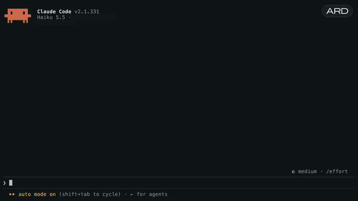

# ard-discovery for Hermes

Find a domain's MCP servers through Agentic Resource Discovery, or search a
registry for a capability. Hermes asks before sending your words to a
registry, then shows the cards it found and whether their publisher confirms
them. Adding a server requires a separate Hermes approval.

<a href="https://agentpolyfill.com/media/ard.mp4">
  <picture>
    <source media="(prefers-reduced-motion: reduce)" srcset="../../../site/public/media/ard.jpg">
    
  </picture>
</a>

[Watch Claude Code look up Buildkite and search a registry (16 s)](https://agentpolyfill.com/media/ard.mp4)

ARD is a spec from outside MCP: a draft (v0.91) published by the
ards-project on GitHub, not an MCP specification. It stays separate from
[`mcp-server-cards`](../../server-cards/hermes/README.md), which discovers only
AI Catalogs. Both plugins can be enabled together.

## Install

```sh
hermes plugins install idosal/AgentPolyfill/polyfills/ard/hermes/plugin --enable
```

Hermes accepts `owner/repo/path/to/plugin` (v0.23.4's
`hermes_cli/plugins_cmd.py`, `_resolve_git_url`). To try a copy from a clone
instead, put `plugin/` in `$HERMES_HOME/plugins/ard-discovery/` and run
`hermes plugins enable ard-discovery`.

You need Node.js 20 or newer on the gateway's PATH, or an executable named
by `AGENTPOLYFILL_NODE`. The plugin ships its helper bundle and needs no
runtime npm install. Checked in Hermes Agent v0.23.4.

## Try it

> Use ARD to discover the MCP servers neon.com publishes.

For a search, name a registry you want to use and the task you need it for.
There is no bundled registry or automatic third-party choice. You can set
`ARD_DISCOVERY_REGISTRY` in the environment that starts the Hermes gateway.

Approve the prompt naming the exact endpoint and query. A registry's order
is relevance, not trust. Read the publisher-confirmation line before asking
to add a result. Approve the addition, then `/reload-mcp` to connect it.

| Tool | What it does |
|---|---|
| `ard_discover(domain)` | Reads `/.well-known/ard.json`, `rel="ard"`, and AI Catalog sources; fetches and validates every bounded card result. Read-only. |
| `ard_search(query, registry?, referral?)` | Sends up to 300 plain characters to one approved registry endpoint. Returns referrals for separately approved calls. |
| `ard_add_mcp_server(identifier, url, domain?, remote?, name?, values?)` | Adds a validated card shown in this session, after approval. Omit domain for a registry result. Never pass secrets in values. |
| `ard_remove_mcp_server(name)` | Removes only an unchanged server this plugin added, after approval. |

The `ard_` add/remove names avoid Hermes's global tool-name collisions with
the Server Cards plugin. Each plugin owns its own additions.

## How it works

A Python `register(ctx)` plugin runs a bundled TypeScript helper over
newline-delimited JSON-RPC. The helper imports the same discovery,
validation, input and presentation modules as the Codex forms, plus ARD's
existing `registry.ts` and `urls.ts`. It has no model-provider secrets in its
environment and reads no Hermes credential files.

Domain discovery honors ARD manifests that omit `specVersion`. A registry
domain may publish registry entries in its catalogs; those public GETs send
no query, so the approval can name the final search endpoint. Base URLs get
`/search` appended. Referral URLs are complete endpoints and never get
`/search` appended.

Every `ard_search` returns a `pre_tool_call` approve directive whose rule
key is the registry host and a digest of the whole request: the endpoint,
the query and the referral. A decline or an unanswerable approval sends no
search request. The query is shown in full; markup, control characters,
userinfo and invisible direction marks are refused. Hermes owns the
once/session/always options. A lasting grant covers that exact query to that
endpoint only: any other words are asked about again, and the question says
so. This plugin does not store grants of its own. Where Hermes approves
without asking (`--yolo`, a session's `/yolo`, `hermes -z`, `approvals.mode: off`), a
search is refused before Hermes is asked, and so is an addition: Hermes would
answer itself, and both need your own yes. A removal still goes to Hermes.
Telling this takes the test Hermes's approval gate uses, which isn't on
Hermes's published plugin API (`hermes plugins validate` warns about it);
where it can't be evaluated (another Hermes version, `plugins.isolation:
host`), a search or an addition is refused too. Hermes's unattended approve
modes (`approvals.cron_mode`, `single_query_mode` or `unattended_mode:
approve`) still approve them where nobody is present, as you set them to, and
a kept "session" or "always" answer covers its exact search or addition there
too. ([Hermes calls it uses](#hermes-calls-it-uses).)

Only the approved endpoint receives the query. The shared ARD search code
still bounds and validates referrals, but each is returned as an
`ard_search` call with `referral: true` for a new approval. The session must
have received that exact referral for that exact query. Referrals stop
after one hop. Up to three initial catalog registries and three referrals
are considered; additional initial registries also need their own calls.
A request body is never redirected to a different origin.

Each result's card is fetched and checked. Up to five publisher domains are
checked using their own catalogs, including ARD sources. When a publisher
confirms a different card, its card is the one shown and added. An
unconfirmed result is labeled as such; registry scores never grant trust.

Adding uses the same Server Cards adapter as the standalone Hermes form.
Only a valid card shown in this session can supply the endpoint. Hermes's
approval names the server and shows the whole entry (the URL, each header with
its value, a secret only as its `${VAR}` reference, the transport and every
other setting), the config file and undo. The
entry goes under `mcp_servers.<name>` in `$HERMES_HOME/config.yaml` via the
public raw-config reader and `save_config`, the writer used by `hermes mcp
add`. Existing names are refused, including races during approval.

Secret card inputs are written as `${VAR}` references. Put those variables
in `$HERMES_HOME/.env`; never send their values to the model. A credential
literal in a header is refused. The plugin never opens `.env` or a token
store. For an endpoint without secret inputs, an anonymous initialization
after approval detects a live 401 Bearer challenge and writes `auth: oauth`.
The result then says `hermes mcp login <name>`. The plugin never handles
OAuth tokens or interprets undocumented card authentication fields.

An ownership fingerprint in `$HERMES_HOME/ard-discovery/added.json` limits
removal to an unchanged entry added by this plugin. It never removes an
entry owned by `mcp-server-cards`, an existing user entry, secret variables,
or token files. `/reload-mcp` connects additions and disconnects removals.

### Hermes calls it uses

| Call | What for | Documented |
|---|---|---|
| `ctx.register_tool`, `register_hook` (`pre_tool_call`), `register_system_prompt_section`, `on_unload` | The tools, the approvals, the tools' instructions, stopping the helper | Plugin guide |
| `hermes_constants.get_hermes_home`, `gateway.session_context.get_session_env` | The profile, and the session a call is from | Published API |
| `hermes_cli.config.get_config_path`, `require_readable_config_before_write`, `save_config` (with `merge_existing=True` for an addition) | Reading `config.yaml` as written, and writing `mcp_servers` under Hermes's own lock | Published API (`hermes_cli.config`); `hermes mcp add` uses the same writer. Hermes's own read errors aren't passed on: they can quote a line of `config.yaml` |
| `tools.approval._yolo_active`, `tools.approval_context._get_approval_mode`, `tools.approval.is_approval_bypass_active_for_session` | Whether Hermes would approve the plugin's question without asking (`--yolo`, `/yolo`, `hermes -z`, `approvals.mode: off`) | **Not published.** No published call says this. It's the test Hermes's approval gate uses (`tools/approval.py`, `_run_approval_gate`), evaluated in the same turn just before it. `hermes plugins validate` warns about it. Where it can't be evaluated, the step is refused |

## Spec and contract

Same revisions as the Codex form:

- **ARD v0.91**, commit `f073b1ea9b`, §5.1 domain discovery, §5.3 registry
  search, §5.4 federation and Appendix B error codes, for MCP cards only.
- **SEP-2127 Final**, `ext-server-card` at `28db12c9b4` (2026-11-19), and
  **AI Catalog v0.9** at `19208af2f8`.

The [ARD client rules](../claude-code/README.md#client-rules) and
[Server Cards client rules](../../server-cards/claude-code/README.md#client-rules)
map the shared requirements to their original tests. The Hermes build
redirects those tests' imports to its own installed helper bundle.

| Contract rule | How it's met |
|---|---|
| 1. One published extension | Met as a spec from outside MCP: ARD v0.91, a draft published by the ards-project on GitHub, the second kind rule 1 allows, and said so wherever this repository lists it. It implements the draft's client behavior for MCP Server Cards, without extra wire fields. `R-1`–`R-7`, `D-*`, `AH-2`, `AH-3`. |
| 2. Named revision | Exact revisions above. |
| 3. Rules and interop | Shared Server Cards rules, ARD registry tests, network `F-1`–`F-6`, adapter `AH-1`–`AH-4`. `V-2` replays saved independent publisher cards. Against a publisher this repository didn't write, through Hermes: buildkite.com's `ard.json` and card, read and validated ([Interop](#interop)). Not checked against a public registry: a search would send words to a third party. The upstream conformance suite has no ARD scenarios. |
| 4. Stand down | `hermes plugins disable ard-discovery`; `ARD_DISCOVERY_DISABLED=1` registers nothing (`test_disabled_registers_nothing`). No native ARD support exists at the pinned host. |
| 5. Limits | Below; tool results explain separate approvals, reload and login. |
| 6. Untrusted content and host approval | `AH-1`, `AH-2`, shared `X-*`, `P-*`, `O-*`; Python ownership/race tests; real-Hermes search decline proves no registry POST, and add/remove use Hermes approval. |

## Tests

From this directory:

```sh
npm ci
npm run build
npm run typecheck
npm run check
npm test
PYTHONDONTWRITEBYTECODE=1 python3 -m unittest discover -s test -p 'test_*.py' -v
HERMES_PYTHON=/path/to/pinned/venv/bin/python HERMES_SRC=/path/to/pinned/hermes-agent \
  python3 ../../../tools/hermes/run_card_e2e.py
```

Build the Server Cards Hermes plugin too before the coexistence E2E test.
The runner then runs `$HERMES_PYTHON test/e2e_test.py -v`. The tests need no
account, API key or external registry, and touch no host state of yours:
every process gets its own `HOME` and `HERMES_HOME`, the fixtures listen on
127.0.0.1 only, and Python may reach loopback only (on macOS, `sandbox-exec`
fences every process).

The real-Hermes suite repeats Server Cards' discover/decline/add/reload/tool
call/remove, secret-reference, OAuth and session-isolation scenarios. It
also runs `test_search_declined_approved_referral_and_add_with_both_plugins`:
no POST after decline; exact query after approval; no referral POST until a
second approval; add via ARD; both plugins' tools coexist; the wrong plugin
cannot remove the server. `test_no_search_where_hermes_approves_without_asking`
and `test_no_addition_where_hermes_approves_without_asking` check that with
`approvals.mode: off` nobody is asked, no word of the query reaches the
registry and nothing is added. `AH-4` checks bundle and copied-Python freshness.

## Interop

[`test/interop_real.py`](test/interop_real.py) runs this form in Hermes
against buildkite.com, a publisher this repository didn't write. It needs the
network. Its discovery finds the one server buildkite.com lists,
`urn:air:buildkite.com:mcp:buildkite`, in both its `ard.json` and its AI
Catalog, with a valid card, and asks nothing, since a domain lookup sends
nothing of yours. No registry search is part of it. Checked in Hermes v0.23.4.

```bash
$HERMES_PYTHON test/interop_real.py
```

## Security

[`SECURITY.md`](SECURITY.md). Among other things, fetching checks the address
when it connects (no request reaches a private address by a public name), and
"session" or "always" on a search covers that exact query to that endpoint
only.

## Limits

- **Configuration changes need `/reload-mcp` or a new session.** A public
  `ctx` MCP add/remove/connect API would make this immediate. Config writes
  use only Hermes's published config API: an addition is merged by Hermes
  under its own lock (`save_config(..., merge_existing=True)`), a removal is
  read, changed and saved as `hermes mcp remove` does it. External editors can
  still race a removal; the plugin checks what was saved.
- **One approval can name only one registry rule.** Further registries and
  one-hop referrals require more `ard_search` calls. A tool-handler API for
  host approval with custom choices would let a single search pause and
  resume across destinations. Today's behavior is deliberate: receiving a
  referral is never permission to disclose the query to it.
- **No custom result picker or non-secret-input form.** The model presents
  results and asks for inputs. A handler-safe `ctx` question API would help.
- **No comparison of a card with live `server/discover` metadata.** A public
  Hermes connection/request API would close this Server Cards S-3 gap.
- **OAuth detection only recognizes a live Bearer challenge and skips
  secret-bearing endpoints.** Other cases need manual `auth: oauth` setup.
  A public host authentication-discovery API would close this gap.
- **Only MCP cards are offered for addition.** Other ARD artifact types are
  ignored. The cache and displayed-card state are session-local memory;
  rediscover after restarting the helper or gateway. Ownership persists.
- **Protocol filtering covers the pinned handshake revisions through
  2025-11-25.** Cards advertising only the stateless 2026 protocol are
  conservatively refused pending a verified Hermes connection path. SSE
  uses `transport: sse`.

Disable it with `hermes plugins disable ard-discovery`. This removes its
tools and stops its helper, while leaving already approved MCP servers in
Hermes's own configuration.
