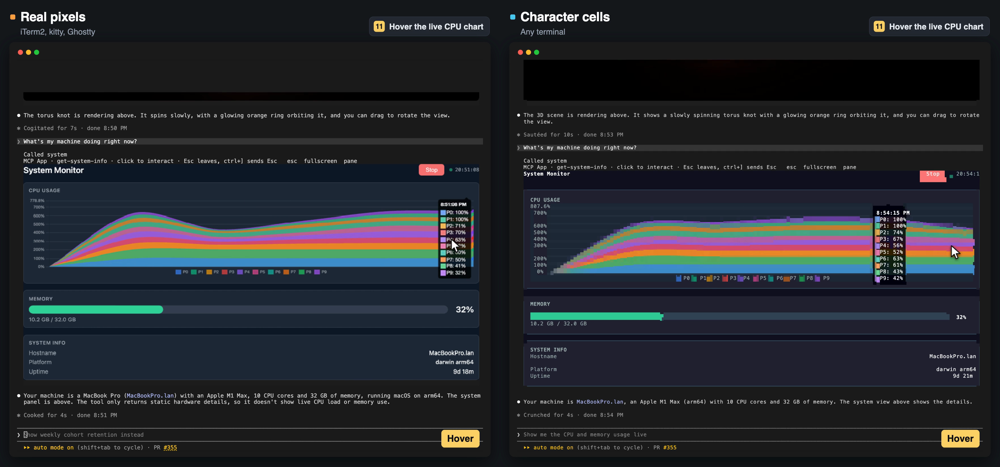

# mcp-apps-cli

MCP Apps in the Claude Code terminal. When Claude calls a tool that ships an
[MCP App](https://github.com/modelcontextprotocol/ext-apps), the app's
interface appears inline, under the tool call, and you can click, drag and
type into it. Existing MCP servers work unmodified.

- **Real pixels** in terminals that show images: iTerm2 3.5+, kitty and Ghostty.
- **Character cells** everywhere else: Terminal.app, VS Code, tmux and so on.
  Text, including chart labels, stays real characters.



The [video](https://github.com/idosal/MCPolyfill/releases/download/mcp-apps-cli-v0.1.0/mcp-apps-cli-demo.mp4) (57 s, MP4)
shows the same prompts in two terminals: pixels on the left, cells on the
right. It plays DOOM through an arcade MCP App, then a cohort heatmap, a
three.js scene Claude writes, and a live system monitor. Each side is one
real `claude` session.

## Install

In a terminal:

```bash
claude plugin marketplace add idosal/MCPolyfill
```

```bash
claude plugin install mcp-apps-cli@mcpolyfill
```

Or, at the prompt of a `claude` session, `/plugin marketplace add idosal/MCPolyfill`
and then `/plugin install mcp-apps-cli@mcpolyfill`.

The plugin is one zip, attached to a release of this repository and checked
against the SHA-256 in the repository's marketplace file
([`.claude-plugin/marketplace.json`](../../../.claude-plugin/marketplace.json))
before Claude Code unpacks it. It carries a small helper
program for each platform and needs nothing else installed, not even Node.

## Requirements

- **Claude Code** with plugin hooks. Tested with 2.1.329.
- **macOS** (Apple Silicon or Intel), **Linux** (x64 or Arm64, any
  distribution) or **Windows** x64. Windows is new: its helper passes the
  same checks on GitHub's Windows machines, but it hasn't yet been used in
  a Claude Code session on Windows, so please report what you see.
- **Chrome**, or another Chromium-based browser (Edge, Chromium, Brave).
  Views run in a headless copy of it. If none is installed, the plugin
  offers, once, to download Chrome for Testing's headless shell from Google
  (about 100 MB, kept in the plugin's data folder).
- **Clicking into views** needs Claude Code's fullscreen layout. The first
  time a view opens, the plugin offers to switch (Claude Code restarts and
  resumes the conversation), or run `/tui fullscreen` yourself. Also turn on
  mouse reporting in your terminal (iTerm2: Settings → Profiles → Terminal;
  tmux: `set -g mouse on`). Outside fullscreen, views are view-only.

## Using it

Add MCP servers as usual. When Claude calls a tool with an MCP App, the app
appears under the call, sized to fit. Click into it to use it; **Esc** gives
the keyboard back (**ctrl+]**, or **esc** in the view's header, sends the app
an Escape). A view taller than its box scrolls with PgUp/PgDn. The header
moves the view: **fullscreen**, **pane** (beside the chat, still running) or
**back to the chat**. The app follows Claude Code's theme.

Settings, in `/config`:

| Setting | Default | Choices |
|---|---|---|
| App tool calls: an app calling its own server's tools | allow, as Claude Desktop does; your deny rules still apply | allow, rules, ask |
| App messages: an app sending Claude a message | ask, as Claude Desktop does | ask, fill (put it in your prompt), allow |
| Offer fullscreen | ask once | ask, never |
| Offer a browser download | ask once | ask, never |

Opening a link or saving a file from an app always asks.

## Limits

- **Servers that need sign-in (OAuth) don't show apps yet.** Claude Code
  doesn't give plugins the UI metadata of a tool or of a resource, so the
  helper opens its own connection to each server, from your MCP config, and
  that connection can't sign in.
- **Clicks and keys** reach a view only in the fullscreen layout. There's no
  mouse wheel over inline views (use PgUp/PgDn), and a paste goes to the
  prompt.
- **Memory:** Chrome takes about 260 MB while views are open, plus 120–350 MB
  per live view. At most 3 views stay live, and a view you scrolled away from
  and never used sleeps after 10 minutes.
- **Cells** are one character each: wide characters show as `?`.

[`docs/DESIGN.md`](docs/DESIGN.md) lists the rest, with what Claude Code
could add to remove each.

## Privacy and security

- Each view runs in a sandboxed iframe inside a dedicated headless Chrome,
  under the app's Content Security Policy, one browser context per view.
  Chrome's own sandbox stays on.
- A view's cookies, localStorage and IndexedDB are saved, readable only by
  you, in the plugin's data folder, so a reopened view keeps its state.
  They're deleted after 30 days unused.
- The plugin sends nothing anywhere. Network traffic is the apps' own
  (limited by their CSP), the MCP servers you configured, and, if you accepted
  it, the Chrome download from Google and its update checks.
- The helper only answers requests that carry its per-session token.

To report a security issue, see [SECURITY.md](SECURITY.md).

## How it works

Claude Code runs the plugin's hooks module (`mod/hooks/`). When Claude calls
an MCP tool, the hooks start a helper for the session (`helper-rs/`, a Rust
binary, 8–10 MB). The helper reads the app's UI from its server, runs it in
headless Chrome behind an MCP Apps host page, and streams it back as pictures
or cells. Your clicks and keys go the other way.
[`docs/DESIGN.md`](docs/DESIGN.md) has the details and measurements;
[`helper-rs/PORT.md`](helper-rs/PORT.md) covers the helper.

### Building from source

From this folder (`polyfills/claude-code/apps` in the repository):

```bash
helper-rs/build-into-plugin.sh
```

```bash
package/package.sh
```

The first builds the helper for this machine into `mod/helper/bin/` (it
needs Rust, and several GB of disk for the build); the second packs the
plugin zip, and its entry for the repository's marketplace file, into
`package/dist/`. To try a local build, run `claude --plugin-dir mod`.
Releases are built on GitHub Actions
([`mcp-apps-cli-release.yml`](../../../.github/workflows/mcp-apps-cli-release.yml)):
see [Packaging and releasing](docs/DESIGN.md#packaging-and-releasing).

## Related

Part of [MCPolyfill](../../../README.md): MCP extensions for hosts that
haven't shipped them yet.

## License

Apache-2.0 ([LICENSE](../../../LICENSE)). The helper includes third-party crates and
npm packages under their own licenses:
[THIRD_PARTY_LICENSES.txt](THIRD_PARTY_LICENSES.txt).
