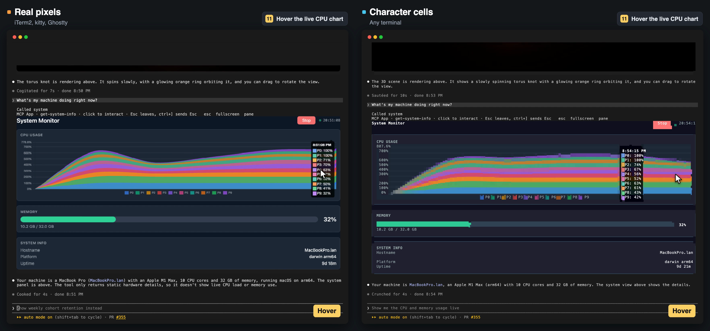

# mcp-apps-cli: design notes

How the plugin works, what it measured, and what Claude Code could add. The
[README](../README.md) covers installing and using it.

Renders MCP Apps (the interactive UIs MCP servers ship) inline in the
terminal `claude` CLI, under the tool call that produced them. Clicks, drags
and keys go to the app. Existing servers work unmodified, configured as usual.

[The demo video](https://github.com/idosal/MCPolyfill/releases/download/mcp-apps-cli-v0.1.0/mcp-apps-cli-demo.mp4) (57 s, MP4, attached to the 0.1.0 release): the
same prompts side by side, real pixels on the left (the terminal identified
itself to Claude Code as iTerm2) and character cells on the right (a
terminal without images). First DOOM through the arcade MCP Apps server
(the DOS boot sped up, play at normal speed), then a cohort heatmap, a
three.js scene Claude writes and a live system monitor from the unmodified
example servers. Each side is one real `claude` session, start to end,
replayed from its own terminal output.



### Terminals that show images: iTerm2 3.5+, kitty, Ghostty

The view is real pixels. kitty and Ghostty use the kitty graphics protocol. In real kitty 0.50 and
Ghostty 1.4 windows, each terminal answered Claude Code's probes itself
(its name and version, and OK to the graphics query), and the view arrived
as PNGs of its size, placed with Unicode placeholder cells; the picture
decodes to the app as drawn. Both read each picture from a file the
helper writes (see Pixels below), with no error back. Both report the
pointer in pixels (mode 1016), and a session sending pixel positions the
way kitty does switches the cohort dropdown with a click; in a real kitty
window, clicks land and hovers keep up with the pointer. There's no still
of either window here yet.

### Every other terminal (Terminal.app, VS Code, Windows Terminal, tmux, …)

The view is drawn in character cells. Each cell is the block glyph and two colours that best match its pixels,
with 3D scenes keeping their shading and glow. Text is placed as real
characters: the page's text, form controls, and the labels charts draw on a
canvas.

In terminals with 24-bit colour (`COLORTERM=truecolor`), a cell view is
drawn as styled text in exact colours by default: smooth glows and shading,
at about four times the CPU in Claude Code. Elsewhere, or with
`MCP_APPS_CLI_TRUECOLOR=0`, Claude Code draws its colours at 16 levels a
channel.

## How it works

```
claude (CLI, interactive terminal session)
 ├─ your MCP servers ── unchanged
 └─ mod/ = the plugin "mcp-apps-cli"
     ├─ hooks/register.tsx    wires the hooks below, which live in helper.ts (the helper
     │                        process), stream.ts, views.tsx, consent.ts, settings.ts
     │                        and state.ts (what they share)
     │    turn.step           Claude writing an MCP call: opens its view early (if the
     │                        call runs without asking), arguments as they're written
     │    tool.call           watches MCP calls; result unchanged, plus a note to the
     │                        model (unseen by the user) that the app is on screen
     │    config.set          a theme change reaches open views
     │    ToolUse / ToolGroup draws the view under the call's row or folded line:
     │                        an Image (pixels) or a Raster (cells), swapped in place
     │                        with $.ui.blit as the app changes
     │    ui.message          clicks/keys from the view, acknowledged so none are lost
     │    $.mcp.call          the app's tool calls, over Claude Code's connection
     │    $.prompt.submit     ui/message starts a turn; ui/update-model-context goes
     │                        to the model as hidden prompt context
     ├─ hooks/view.tsx        an empty Client laid over the picture: pointer + keys
     └─ helper/               one per session, started with its first MCP call
          bin/<os>-<arch>/    the helper (../helper-rs), one binary per platform, all
                              carried by the packaged plugin; the one for the machine runs
          host/host.js        the AppBridge host page, built into the helper binary
          *.mjs, package.json the Node helper this one replaced: not packaged and never
                              run by the plugin; kept as the reference the Rust port's
                              parity fixtures are made from, and for the bench checks
                              and a verification suite kept outside this repository
```

The helper is a Rust binary, about 8–10 MB for each platform. It takes
about a fifth of the Node helper's memory and a third of its CPU with views
open (42 MB against 230 MB with three picture views, 16 MB once they're out
of sight). [`helper-rs/PORT.md`](../helper-rs/PORT.md) has the measurements,
the platforms and what's left. On a machine the plugin carries no helper
for, or whose helper can't start, one toast says so and no view opens.
One whose helper lost its executable bit on the way (an archive that keeps
no file modes) is copied into the plugin's data folder and marked
executable there.

A view's page tells its helper when it changes (its DOM, a canvas it draws
on, a font loading, an animation running), and the helper captures it then:
a change is on screen in about 50 ms. An animated 3D scene runs at about 25
pictures a second in Ghostty, 16 in iTerm2, and 26 as cells. A backstop
capture catches what the page can't announce. An app that stops responding
is closed. A view out of sight
for 10 minutes that the person never used sleeps: it closes, keeping its
picture and store, and opens again from its call when it's back in sight.
With all views asleep, Chrome closes after its idle wait.

The helper picks the mode from the terminal (`TERM_PROGRAM`, kitty, Ghostty,
not inside tmux). If Claude Code reports it's drawing an image's alt text,
the view drops to cells on the first frame.

- **Pixels.** 2× PNG frames, shaped like the terminal's cells: the helper
  reads the window's pixel size from the session's terminal, so the pointer
  lands where the picture shows it. Views are sized to fit the screen with
  room for Claude's reply. The helper tells the app that room
  (`containerDimensions.maxHeight`) and follows the height it reports
  (`size-changed`), but many apps fix their own height and ignore the room;
  one that is up to about 1.6× too tall is drawn smaller to fit (down to
  60%, where 13 px text is about 6 pt on screen; laid out wider by the same
  factor, clicks mapped through), so all of it shows. Taller than that, it
  scrolls at full size (PgUp/PgDn); this works for fullscreen and pane views
  too. A picture keeps 14 rows free for the tool line, header, a short reply
  and the prompt, so a small window gives a short view: 80×25 leaves 11
  rows, and a 600 px app (the cohort heatmap) scrolls there; at 140×45 it
  shows whole. Cells don't shrink: their text
  is drawn one character per cell. In kitty and Ghostty on this machine the
  terminal reads each picture from a file in a private temp folder: a
  short command, where sending the PNG (about 300 KB) through the terminal
  took a third of a second. iTerm2, and any terminal over SSH, get the PNG
  inline; there a picture is 1× while the page moves (an animation, the
  pointer sweeping) and 2× at rest, and since iTerm2 shows a redrawn
  picture only after a fresh copy arrives, that copy follows within 80 ms
  (a reply arriving under the view redraws it). Pictures come from
  Chrome's own screenshot call, a third faster than Playwright's: a 3D
  scene runs at about 10 pictures a second in kitty and Ghostty and 7 in
  iTerm2 (140×45 cells, through Claude Code). A new picture is sent only
  when the page really changed: Chrome rasterizes on the CPU, so an idle
  page draws the same pixels each time, and the app's frame counts its own
  changes (DOM, animation frames, running CSS animations, playing media):
  a check with nothing new takes no screenshot, so an idle view costs about
  6% CPU in cells and 8% in pictures, down from 11–12%. In iTerm2 a
  picture goes as bands of 6 rows, each its own image, so a hover sends
  only the band or two it changed; the bands are whole rows of whole
  pixels and meet without a seam. Each band is a 256-colour PNG where that
  looks the same (an app page is flat colour with soft edges: 52 dB on the
  cohort heatmap); a band with too many colours (a photo, a 3D scene) goes
  in full colour. Claude Code sends a picture's bytes again each time the
  transcript moves it (a reply streaming in under it), at about 1 MB/s, so
  the size is the time: the cohort view is 89 KB, not 223 KB, and each
  such redraw takes 0.15 s, not 0.38 s; a hover sends about 42 KB, not 113.
  Each new picture replaces the whole image, so over a still page the
  pointer's first move is drawn at once (on screen about 0.15 s after the
  move), a sweep a few times a second, and the spot it rests on 0.1 s
  later; CSS transitions finish at once, so a hover takes one picture.
  Pages that animate keep drawing. The bands are decoded, compared and
  compressed in a worker thread, so the next screenshot is taken while one
  is compressed and pointer input isn't held up: a drag over a bloom-lit 3D
  scene draws about 12 pictures a second in iTerm2 (8 before), and its
  pointer moves reach the app on time (a 4 s drag had taken 6.5 s).
  Through Claude Code a drag also cost pictures: each pointer move was its
  own post from the input layer, each answered with new props, and Claude
  Code painted less of the picture meanwhile. Moves with a button held now
  go with the layer's 60 ms post (all of them, in order) and props at most
  every 150 ms: dragging that scene in iTerm2 puts 10.7 pictures a second
  on screen, not 5.5 (`bench/scenarios/iterm-drag.json`). Once a page has
  a WebGL or WebGPU canvas, `devicePixelRatio` reads 1 in it: a 3D scene
  that sizes its drawing by it (three.js's `setPixelRatio`) drew four
  times the pixels on the 2× page and stuttered; it now draws at 1×, as
  moving frames are captured anyway (in kitty and Ghostty, scaled up, a
  little softer). Text, 2D charts and images keep 2×.
- **Opening, and resizing.** A view's browser page is made while its UI
  resource is read, and a second view of the same app uses the copy read
  before: a view of the three.js example (a 10 MB resource) answers in
  about 0.7 s and shows its first picture at about 1.2 s (0.85 and 1.3
  before; 3D pictures are 75 KB, not 600 KB–1 MB, so iTerm2 draws the
  first one whole at once). A view opens at a first guess of its width and
  is resized once the transcript says; size changes, and screenshots, take
  turns per view. A screenshot at 2× restores the page's metrics after
  itself, so a viewport set during one was undone, and the app was laid
  out wider than its picture (its right side cut off and grey) or, in
  cells, drawn with its colour blocks out of step with its numbers. A
  stress run (`bench/`) had that in 4 of 16 opens and 2 of 8 updates;
  now none in 20 and 28. A shot of a view bigger than its box (shrunk to
  fit, or taller than its window) captures beyond Chrome's own window,
  whose content is 87 px shorter than the page (its toolbar): the bottom
  of a shrunk app, the cohort heatmap's legend, had come out grey.
  Pictures that came while a new size was still being drawn (a view
  opening at its guessed width) were swapped in, and each band refused:
  16 refusals, each carrying its band's PNG, as a 3D view opened. A swap
  is now made only to the size last drawn, and a refusal ends that
  picture's swaps: one at most, and none in two cohort opens.
- **Cost to every reply.** The mod reads the model's streamed response
  (`turn.step`) to see MCP calls as they're written, so every reply passes
  through it: about 20 µs a chunk in Claude Code's test engine, the same
  whether a session has apps or not, against a chunk every few
  milliseconds.
- **Games.** DOOM (the shareware, through the arcade example server,
  `bench/scenarios/doom.json`) plays in a view: a terminal reports key
  presses, never releases, so outside a text field an arrow key goes down
  and stays down while the terminal repeats it (walking; a tap is a short
  step, and a hold starts after the terminal's repeat delay); the app may
  take the pointer (clicks fire, moves turn); an app that never says how
  tall it is (it fills its window, like an emulator's canvas) gets all its
  room 0.4 s after it starts; and an app may call its own server on
  localhost (Chrome's local-network checks are off; its CSP still decides
  what it reaches, shown in its header, and names the person's machine or
  network only where the server itself runs). Claude Code keeps Escape (it
  gives the keyboard back, and a Client never receives it), so the app gets
  one from ctrl+] or the **esc** control in the view's header: DOOM's menu.
- **Out of sight, paused.** A view with none of its picture in the
  transcript's viewport (from the `onScreen` rows Claude Code reports for
  its tool row) isn't captured, its frame is moved out of Chrome's
  viewport, where Chrome stops drawing it, and its page's scripts are
  paused with the debugger's pause (headless Chrome has no background tab
  to freeze): no timers, animation frames or paint, in a frame from
  another site inside it too. A request for it (a resize, a theme, a tool
  result) wakes it for that moment. A row of it coming back, or the
  pointer on it, resumes it. A bloom-lit 3D scene costs the helper and its
  Chrome about 38% CPU in sight (67% for iTerm2's inline pictures) and 0%
  paused; a DOOM view (an emulator) about 60% in sight and 1–2% paused,
  where moving its frame off screen alone left it near 60%. Nor does the
  mod ask for fresh copies of its picture while it's out of sight (in
  iTerm2 it did at each
  redraw of the transcript); it gets one on the drawing that brings it
  back.
- **Cells.** For each cell, the glyph (quadrants, eighths, half blocks) and
  two colours that best match its pixels. Text from the DOM, form controls,
  SVG and canvas `fillText` is drawn as characters on top, so numbers and
  chart labels stay readable. UI areas are fitted by their two dominant
  colours, kept exact, so chart layers, tiles and gaps stay crisp instead of
  averaging into mud; thin lines (gridlines, borders, slider tracks, chart
  lines) snap to the nearest cell edge or the cell's middle at their own
  thickness, so they stay continuous; and slivers of a shape are dropped
  rather than left as debris. A thin line that slants or zig-zags (a
  sparkline, a steep chart line) is drawn in Braille dots, a 2×4 grid per
  cell, where blocks could only step; the end of a bar (a slider's track, a
  badge's edge) keeps the bar's shape; a dropdown shows its arrow as ▾. 3D
  canvases, images and video are fitted for shading, from a 48-colour
  palette per view that adapts slowly to the scene: Claude Code draws cell
  colours at 4 bits a channel and admits new colour pairs at a limited rate,
  and a fixed palette keeps an animation inside that budget, so colours
  never drift. Where the terminal draws them (WezTerm, kitty, Ghostty), 3D
  cells also use sextants, 2×3 blocks, for finer shapes. A cell keeps its
  glyph between frames until its pixels really change or a clearly better
  glyph appears, so 3D scenes and live charts don't shimmer.
- **When a view opens.** As Claude starts writing a call to a tool with an
  app, if Claude Code would run it without asking (`$.tool.check` says
  allow: a permission rule, or a mode that allows): the app gets the
  arguments as they're written (`tool-input-partial`, unfinished JSON
  closed, about 10 a second), then all of them as the call runs
  (`tool-input`), then the result. An app that draws its arguments (the
  three.js and shader examples) builds up while Claude writes instead of
  after. What the app asks of the host meanwhile (tool calls, messages,
  links, files) waits until the call runs, and is refused if it doesn't;
  context it sets reaches the model only then. A call that waits to be
  allowed (the person is asked, or auto mode's classifier decides:
  `$.tool.check` says ask) opens its view early too, so
  the app loads while Claude writes, but it gets none of the arguments
  until the call is allowed, then all of them at once; denied, the view
  goes and keeps nothing (its store is discarded). The arguments are the
  person's to release: the server's code never sees what's denied. A call
  the rules deny opens nothing. A call that's allowed and then fails, or
  that Claude never finishes (the turn stopped), reaches the app as
  cancelled; a view whose call never reached the transcript (a response
  that was retried) is closed. In a real session in auto mode, the view
  opened 7 s before the classifier allowed the call
  (`bench/scenarios/stream-3d-auto.json`). Chrome starts as Claude starts
  writing any MCP call: a first
  view with Chrome cold took 0.9 s to its first picture, and 0.65 s with
  Chrome running (it takes 0.25–0.3 s to start; `bench/host-check.mjs`),
  so starting it with every session, at about 260 MB in sessions that
  never open an app, would save at most a quarter second once. The helper
  itself (about 150 MB) starts then too: a session that calls no MCP tool
  never runs it, and the first call's lookup (is there an app?) happens
  while Claude writes; in that session the helper was ready 0.43 s after
  Claude started the call, and the view open 0.08 s later.
- **When Chrome or an app dies.** If Chrome stops (it crashed, ran out of
  memory, was killed), its views say so (`closed: Chrome stopped`) and can
  be opened again (**reopen**); the next view starts Chrome again. An
  app's page that crashes closes only its own view, the same way. Chrome
  is also closed after 5 minutes with no view open, and started again by
  the next one. `bench/host-check.mjs` checks each.
- **Input.** Two presses in one place within half a second are a double
  click (three a triple), as a browser counts them, so `dblclick` fires.
  A key is typed, or pressed by name (arrows, Enter, F1-F12, from the
  names Claude Code gives or the sequences a terminal sends); text of more
  than one character (an input method's, an emoji with a skin tone) is
  entered as text; a control sequence no key is known for is dropped,
  never typed into the app. A click in a tall view scrolled down (PgDn)
  lands where aimed: the page is laid out at its full height to capture
  it, so it can't scroll, and clicks had landed that far up (Button 9
  clicked Button 3 in `bench/host-check.mjs`). A paste goes to Claude
  Code's prompt, never to the app: a mod can't tell that a view has the
  keyboard, and sending a paste to an app on a guess could hand it what
  the person meant for Claude (see Known gaps). Ctrl+A in a text field is
  macOS's own (to the line's start); a terminal keeps Cmd.
- **Theme.** Claude Code's own (`/config`), light or dark; `auto` follows
  the terminal where it says its colours (`COLORFGBG`), else dark. A change
  reaches open views as it's made (`host-context-changed`, with the colours
  and `prefers-color-scheme`).
- **Alt text.** A picture view's alt, which Claude Code reads to a screen
  reader and draws where the terminal can't show the picture, is the
  app's text from its accessibility tree (headings, text, controls said as
  such; 300 characters at most), read once it settles after opening, after
  its result and after the person's input, not as it animates (a new alt
  draws the picture again).
- **What the person decides.** Two settings in `/config` (the plugin's
  `userConfig`), defaulting to what Claude Desktop does:
  - **App tool calls** (`appToolCalls`): `allow` (default) runs an app's
    calls to its own server's tools without asking, as Claude Desktop does
    for `app.callServerTool`; `rules` follows the person's permission rules
    for that tool, asking where they say ask; `ask` always asks. A deny
    rule refuses the call in every mode, and is checked first each time:
    it outranks a "this session" allowance given before. Where the check
    itself fails, the person is asked; but an app-only tool
    (`visibility: ["app"]`, like the system monitor's poll) has no check
    to make (Claude Code doesn't register it, so no rule names it), and
    under `allow` it runs, as in Claude Desktop: a live chart was asked
    about at every tick otherwise.
  - **App messages** (`appMessages`): `ask` (default) asks before an app's
    message goes to Claude, with a choice to allow that app's messages for
    the session, as Claude Desktop acts on a message only with the
    person's agreement; `fill` puts the text in the prompt to edit and send
    (added to any draft, never replacing it, marked as the app's); `allow`
    sends it at once. A sent message is framed as the app's, never as the
    person's own words.

  Opening a link and saving files (to Downloads, under safe names) are
  asked too. Text an app copies (it must ask for `clipboardWrite`) reaches
  the person's clipboard only right after a click or key in the view, once
  per click (a hover or the wheel doesn't count). What the person allows for
  the session ends with it (and with `/clear`). A view that closes while a
  request of its is waiting on the person gets it refused: a later yes
  does nothing.
- **Display modes.** A view can fill the terminal (fullscreen) or move to a
  pane beside the chat (picture-in-picture), where it keeps running while
  the conversation goes on. Apps that ask for a mode get it, and the
  person can switch from the view's header (**fullscreen**, **pane**,
  **back to the chat**); closing the pane brings the view back.

## Install

Needs Google Chrome or another Chromium-based browser: Edge, Chromium or
Brave, or `MCP_APPS_CLI_CHROME` set to one (or the headless shell the
plugin offers to download where there's none). Without one, a view's header
says so instead of the app, and the next view looks again. Nothing else:
no Node, no packages.

The plugin is released as one zip carrying a helper for each platform it
supports, installed from the MCPolyfill marketplace
([`.claude-plugin/marketplace.json`](../../../../.claude-plugin/marketplace.json)
at the repository's root) as an `archive` source pinned by the zip's
SHA-256: see [Packaging and releasing](#packaging-and-releasing) and the
[README](../README.md#install) for the commands. From a checkout, in this
polyfill's folder (`polyfills/claude-code/apps`), after building the helper
for your machine (`helper-rs/build-into-plugin.sh`), run
`claude --plugin-dir mod`.

Then once: `/tui fullscreen` (lets Claude Code receive the mouse), and in
iTerm2 Settings → Profiles → Terminal → Enable mouse reporting (in tmux:
`set -g mouse on`). Keep adding MCP servers as usual. The mod only acts in
interactive terminal sessions: the desktop app renders MCP Apps itself, and
`claude -p` and the Agent SDK are left alone.

Using a view: click into it to interact; keys then go to the app and **Esc**
gives the keyboard back. A view taller than its box scrolls with
**PgUp/PgDn**. Dropdowns: click, then ↑/↓. The newest view takes clicks;
an older one shows **use it** in its header to take them back. **fullscreen**
and **pane** in the header move a view; **back to the chat** returns it. In a
pane the mouse wheel reaches the app (zooming a map, scrolling a list);
Claude Code reports no wheel over views in the transcript.

Try it without installing. Start an example server from a checkout of
[modelcontextprotocol/ext-apps](https://github.com/modelcontextprotocol/ext-apps)
(after `npm install` and `npm run build:all` there):

```bash
PORT=3112 node examples/cohort-heatmap-server/dist/index.js
```

Then, from this polyfill's folder (`polyfills/claude-code/apps`):

```bash
CLAUDE_CODE_NO_FLICKER=1 claude --plugin-dir mod --mcp-config demo.mcp.json
```

## Packaging and releasing

Paths in this section are inside this polyfill's folder
(`polyfills/claude-code/apps`), except the workflow and the marketplace
file, which are at the repository's root.

One package serves every platform: it carries the helper for each, and the
plugin runs the one for the machine (`mod/hooks/helper.ts`, `helperArgv`).

| Machine | Carried as | Built for |
| --- | --- | --- |
| macOS, Apple Silicon | `helper/bin/darwin-arm64/` | `aarch64-apple-darwin` |
| macOS, Intel (or Rosetta) | `helper/bin/darwin-x64/` | `x86_64-apple-darwin` |
| Linux x64 | `helper/bin/linux-x64/` | `x86_64-unknown-linux-musl`, static |
| Linux Arm | `helper/bin/linux-arm64/` | `aarch64-unknown-linux-musl`, static |
| Windows x64 and Arm (emulated) | `helper/bin/win32-x64/` | `x86_64-pc-windows-msvc` |

Windows is told apart by its environment (`OS=Windows_NT`), since a Unix
toolkit on the PATH answers `uname` too; the rest by `uname -sm`. Linux
builds are static, so one binary runs on any distribution, glibc or musl,
old or new.

- **`helper-rs/build-into-plugin.sh --target <triple>`** builds one into
  `mod/helper/bin/<os>-<arch>/` (`--mac` builds both Mac ones; the Linux
  ones need musl-gcc, Debian's `musl-tools`).
- **`package/package.sh`** packs `package/dist/mcp-apps-cli-<version>.zip`:
  the manifest, the hooks module, its types, the README and every helper
  in `mod/helper/bin/` (each checked to be the format and processor its
  folder names, Linux ones static), nothing else. The same inputs give the
  same bytes. It writes the zip's SHA-256 and `marketplace-entry.json`,
  the plugin's entry for the repository's marketplace file: an `archive`
  source pinned by that SHA-256, which Claude Code checks before
  unpacking. `--require-all` insists on all five.
- **`.github/workflows/mcp-apps-cli-release.yml`** (at the repository's
  root) builds and checks the helper on each platform, on that platform,
  whenever the helper, the Node helper, the packing script or the bench
  checks change, and packs all five into the zip, which the run keeps as an
  artifact. On a tag `mcp-apps-cli-v<version>` (the version in
  `mod/.claude-plugin/plugin.json`) it also records build provenance for
  the zip and each binary, publishes the zip as a release and opens a pull
  request that sets the `source` of the mcp-apps-cli entry in
  `.claude-plugin/marketplace.json` to it, leaving the other entries as
  they are. The tag names the plugin so that each polyfill in the
  repository releases on its own. It signs and notarizes the Mac binaries
  where the repository holds Apple certificates; Windows Authenticode
  signing has its place marked. Unsigned, both still run: Claude Code's
  install marks nothing as downloaded. A pull request opened with the
  workflow's own token starts no workflows; close and reopen it to run its
  checks.

Why a zip and not the alternatives Claude Code offers: a git source would
put about 19 MB of binaries in the repository's history at each release; an
`npm` source fetches through the person's own npm (Node again) and installs
no per-platform packages; a `command` source runs a shell command at
install and each session, which people must approve and administrators can
turn off.

## What's verified

In live `claude` sessions (a pseudo-terminal driven by a script, and a real
iTerm2 window), the mod's tests (`claude plugin test mod`), the Rust
helper's (`cargo test --workspace` in `helper-rs`, including seeded
fuzz-style tests of every parser, and every check in `bench/` run against
it) and the Node helper's (`npm test` in `mod/helper`:
lines, gaps, Braille lines, bar ends, text placement, frame-to-frame
stability, sextants, full colour, a 3D scene checked against a model of
Claude Code's colour-pair budget, 256-colour pictures, strips in their
worker, and alt text). `bench/host-check.mjs` checks what the host page
tells an app and what a view may reach, through the helper and Chrome. The timings in this README come from the scripts in
[`bench/`](../bench/README.md), which drive a real `claude` in a
pseudo-terminal (or the helper alone) and read what it writes:

| MCP Apps feature | Status |
|---|---|
| View under the tool call, React and vanilla apps | ✓ |
| Clicks, typing, dropdowns, drags (pointer down/move/up) | ✓ |
| Tall views: PgUp/PgDn scrolling | ✓ |
| `tools/call` from the app, model-visible tools (Claude Code's connection) | ✓ run as in Claude Desktop, or by permission rules, or asked (a setting) |
| `tools/call` for app-only tools (`visibility: ["app"]`) | ✓ via the helper's connection |
| `ui/message` → a new turn; Claude answers the app | ✓ (an error back when it can't) |
| `ui/update-model-context` → model context, invisible to the user | ✓ |
| Logging, size changes | ✓ |
| Animated content (three.js, live charts) | ✓ ~26 fps cells; images ~25 fps in kitty and Ghostty, 16 in iTerm2 (Rust helper) |
| View opens as the tool runs; tool-input, then tool-result or tool-cancelled | ✓ |
| Views stay drawn while later messages scroll the transcript | ✓ |
| Real pixels in iTerm2 | ✓ in a real iTerm2 3.6.9 window |
| Real pixels in kitty and Ghostty | ✓ in real kitty 0.50 and Ghostty 1.4 windows (probes, pictures read from files, pixel pointer) |
| Display modes: fullscreen, picture-in-picture (a pane), back to inline | ✓ asked by the app and from the view's header |
| `ui/open-link` | ✓ asks, then opens the browser (tests stand in for the browser) |
| `ui/download-file` | ✓ asks, then saves to Downloads (tests cover the asking) |
| Mouse wheel | ✓ in pane views; not inline (Claude Code reports none there) |

## Spec parity

Checked against `specification/2026-01-26/apps.mdx` (and the draft's
`ui/download-file`), requirement by requirement:

| Area | Status |
|---|---|
| Discovery: `_meta.ui.resourceUri`, `resources/read`, MIME `text/html;profile=mcp-app`, `text` or base64 `blob` | ✓ over the helper's own connection (see Known gaps) |
| Client advertises `io.modelcontextprotocol/ui` | ✓ on the helper's connection; Claude Code's own can't be changed by a plugin |
| Tool visibility: apps only call tools that include `"app"`; same server only | ✓ for every tool, with a UI or not |
| Lifecycle: `ui/initialize`, `initialized`, then tool-input, tool-result or tool-cancelled, teardown | ✓; nothing (context included) goes to the app before `initialized`; teardown on eviction, session end and `/clear` |
| Partial tool input (`tool-input-partial`) | ✓ from Claude Code's streamed response (`turn.step`), for calls that run without asking; then `tool-input` once, and no partial after it |
| Host context | ✓ theme (Claude Code's own, from `/config`), styles, displayMode, availableDisplayModes, containerDimensions, locale, timeZone, userAgent, platform, deviceCapabilities, safeAreaInsets, toolInfo (no request id: a `tool_use_id` isn't one) |
| `host-context-changed` | ✓ on display mode, size, scale and theme changes |
| View→host: `tools/call`, `resources/read`, `resources/list`, `resources/templates/list`, logging, `ping` | ✓ |
| `ui/message`, `ui/update-model-context`, `ui/open-link`, `ui/request-display-mode`, `ui/download-file`, `size-changed` | ✓ (see How it works) |
| Host capabilities | ✓ openLinks, downloadFile, serverTools, serverResources, logging, updateModelContext, message, sandbox.csp |
| Sandbox and CSP from `_meta.ui.csp` (connect, resource, frame, base-uri domains) | ✓; the CSP is logged and the view's header names the domains it may reach. Not applied: the person's machine or network other than where the server runs, and sources naming no domain (`*`, `https:`). The view's document can't navigate away (a form or `location` would carry data past the CSP), and WebRTC is off |
| Restrictive default CSP when `ui.csp` is absent | ≈ basic-host's default (see below) |
| Dedicated origin (`_meta.ui.domain`) | ✓ Claude's format, so that servers' CSP and CORS rules written for Claude accept the view: the app is served at `https://{first 32 hex of sha256(server URL)}.claudemcpcontent.com`, its storage first party. The helper answers every HTTP request Chrome makes to that origin and to `host.` under it, inside Chrome (request interception, `page.rs`), so none goes to that host or to Anthropic; any other domain isn't given (logged), so a server can't take another's |
| `prefersBorder` | ✓ `true` draws a border and background around the app; omitted or `false`, none |
| Consent | ✓ configurable; defaults as Claude Desktop: app tool calls run (deny rules apply), messages asked; links and downloads asked |
| `permissions` | ✓ `clipboardWrite` (copies after a click or key); camera, microphone, location not granted (see below) |

**Deliberate departures**

- **Default CSP.** Without a declared `ui.csp` the spec asks for
  `default-src 'none'`, no `eval` and no connections. The helper sends
  basic-host's default instead, which allows `eval` and `blob:` (apps that
  run generated code, like threejs-server, need it) and still opens no other
  domain.
- **Fullscreen** is a view as tall as the terminal under its tool call, and
  **pip** a pane docked beside the chat: a terminal has no floating windows.
- **`platform`** is `"desktop"`; the spec has no value for a terminal.

**What can't work in a terminal**

- **Touch and safe areas**: no touch input or screen notches; sent as
  `touch: false` and zero insets.
- **Host fonts in cells mode** (`styles.css.fonts`): the terminal draws text
  in its own monospace font, one character per cell. Picture mode draws
  the page's own fonts.
- **Camera, microphone, location** (`permissions`): headless Chrome has no
  devices or location source, and no indicator the person could see; not
  granted.
- **Popups and `alert`/`confirm`/`prompt`**: there's no second window, and
  the sandbox has no `allow-modals`; links go to the browser through
  `ui/open-link` instead. Sign-in pages belong there too: typing a password
  into a picture of a page drawn in a terminal is not something to invite.
- **Over SSH**: links open, and files are saved, on the machine `claude`
  runs on, not the person's; pictures go inline (no shared files).

## Settings (environment)

In `/config` (the plugin's settings): **App tool calls** (`allow`, `rules`,
`ask`) and **App messages** (`ask`, `fill`, `allow`), described under How it
works, and **Offer fullscreen** (`ask`, `never`). On Claude Code's main screen
a view takes no clicks or keys, so the first time one is drawn there, once
ever and after the turn, the plugin asks whether to switch to Claude Code's
fullscreen layout. On yes it switches for you: Claude Code restarts and
resumes the conversation, with its views. It never asks if you set
`CLAUDE_CODE_NO_FLICKER=0` yourself. Claude Code refuses the switch in a
session started with a custom system prompt, a tool allowlist or restricted
settings (a restart can't carry them); after such a refusal a later session
asks once more, and never again after a second.

**Offer a browser** (`ask`, `never`): app views run in Chrome or another
Chromium browser. Where none is installed (nor a headless shell Puppeteer or
Playwright fetched), the first time a view can't open the plugin asks, once
ever, whether to download Chrome for Testing's headless shell: Google's own
build, about 100 MB (205 MB unpacked), from Google's version list and storage
only, kept in the plugin's data folder (`browsers/`). On yes the views that
couldn't open open again. While it's the one in use, the helper looks for a
newer Stable at most once a day and fetches it for the next launch.

- `MCP_APPS_CLI_HELPER=<binary>` is read by the bench checks only: it names the helper they run. The plugin always runs the one it carries for the machine.
- `MCP_APPS_CLI_MODE=cells|image` forces a mode.
- `MCP_APPS_CLI_STRIPS=0` sends iTerm2 pictures whole instead of in bands.
- `MCP_APPS_CLI_PALETTE=0` sends iTerm2's bands in full colour, never in 256 colours.
- `MCP_APPS_CLI_RESOURCE_CACHE=0` reads an app's UI resource each time a view opens. By default a second view of an app uses the copy read before (the spec lets a host cache them) and reads it again in the background for the next one.
- `MCP_APPS_CLI_CELL_ASPECT=2.4` sets the cells' height/width ratio where the helper can't measure it.
- `MCP_APPS_CLI_IMAGE_FILES=0` sends pictures to kitty and Ghostty inline, as PNG bytes, instead of as files they read.
- Cell views are drawn in exact colours, as styled text, in terminals with 24-bit colour (`COLORTERM=truecolor`), by default. `MCP_APPS_CLI_TRUECOLOR=0` goes back to Claude Code's 16 levels a channel, for less CPU. Measured on the 3D scene: Claude Code at 53% CPU on average in full colour, against 14% at 16 levels.
- `MCP_APPS_CLI_SEXTANTS=1|0` turns sextant shapes for 3D cells on or off; they're on where the terminal draws them itself (WezTerm, kitty, Ghostty) and off elsewhere, where a font may lack them.
- `MCP_APPS_CLI_CHROME=/path/to/chrome` picks the browser; `MCP_APPS_CLI_CHROME_ARGS` adds flags. With no Chromium browser installed, the Rust helper uses Chrome for Testing's headless shell where Puppeteer or Playwright fetched it (the newest, version 152 or later), with Chrome's site isolation forced on and, on macOS, the GPU: same engine, about 60 MB lighter a view, 3D close to Chrome's rate (142–153 pictures in 6 s against 155). It doesn't update itself, so the helper refuses one older than that.
- `MCP_APPS_CLI_STORAGE_DIR=/path` keeps view stores there instead of the plugin's data folder; `=off` keeps none. A folder that isn't the person's alone (another owner, a link) keeps none. Outside the plugin, with no data folder, they go under `~/.cache/mcp-apps-cli`.
- `MCP_APPS_CLI_TRANSPORT=tcp` connects the mod and helper over loopback TCP, as on Windows. Either way every request carries a token the mod got on the helper's stdout.
- `MCP_APPS_CLI_CHROME_IDLE_S=60` closes Chrome after that many seconds with no view open; `0` keeps it running. On Claude Code's main screen, where views take no input, a view that has its result, was never touched and hasn't changed for 45 s (and whose app hasn't called a tool for 90 s) rests: it keeps its picture and gives up its page, so Chrome can close. A view that reaches other sites (its CSP names them) rests only when its own network is quiet too: no WebSocket open, nothing in flight (a stream, a long poll), nothing for 3 minutes; a live feed keeps its page.
- `MCP_APPS_CLI_SLEEP_S=600` puts a view to sleep after that many seconds out of sight (only one the person never used); `0` never does.
- `MCP_APPS_CLI_NO_SANDBOX=1` runs Chrome without its own sandbox, where the system can't give it (some Linux containers). It's on by default.
- `MCP_APPS_CLI_GROUP=0` leaves each text of a cell view on its own centre's row. By default texts that share a visual line (a heatmap's month label and that row's numbers) are put on one row, and a text in the way moves down one row at most; a click on a text drawn on another row goes where the text is on the page (Rust helper).
- `MCP_APPS_CLI_SNAP=0` stops a cell view's rows from being snapped to the cells. By default a picture whose long edges include a run of at least four rows at one height (a table, a heatmap) has those edges moved to the nearest cell boundary (at most half a cell), and gaps thinner than a third of a cell closed, so its rows aren't drawn with lines of partial blocks between them (the cohort heatmap: 604 horizontal partial blocks to 344, 10 such rows to 6). Other pictures (a clock's button, a dashboard's panels) are left as they are. `=all` snaps every picture. A click is mapped back through it, as through line grouping (Rust helper).
- `MCP_APPS_CLI_SPARE=0` stops the helper from keeping a Chrome tab ready for the next view. By default, while Chrome runs, one tab is kept made, set up and showing the host page, so a view skips about 140 ms of its open; it costs about 30 MB (Rust helper).
- `MCP_APPS_CLI_TIMINGS=1` logs each capture's stages (the screenshot, then the rest) as p50/p95, every 60 captures, and each open's stages: the tab and host page (kept ready or made then), the app, the resize (Rust helper).
- `MCP_APPS_CLI_DEBUG=1` traces pointer hits and host calls to Claude Code's debug log, and enables the helper's `/locate` route used by test drivers.

## Known gaps, and what Claude Code could add

- **No input outside fullscreen.** On Claude Code's main screen (not
  `/tui fullscreen`), a `Client` gets no mouse, and the layout is fixed for
  the session, so a plugin can't switch it. Views there are drawn but are
  view only. Ask: pointer input for a `Client` on the main screen, or a
  way for a plugin to ask for fullscreen.
- **Tool metadata and resources.** A mod sees a tool's name and description,
  not its `_meta`. It can read a resource's contents only through Claude
  Code's built-in resource tool (`$.tool.call`), which leaves out the
  resource's `_meta` (an app's CSP and permissions). So the helper lists each
  server's tools and reads its UI over a connection of its own, using the
  config from the `claude` command line (`--mcp-config`), `.mcp.json` or
  `~/.claude.json`. That connection can't do OAuth. Asks: `_meta` (and
  `outputSchema`) on `$.tool.list()`, and `$.mcp.readResource()` with `_meta`.
- **Results lose `structuredContent`.** Mods get a tool result as the model
  reads it (one JSON text block). The helper restores `structuredContent` for
  tools that declare an `outputSchema`. Ask: the raw `CallToolResult`.
- **App-only tools.** Claude Code doesn't register tools with
  `visibility: ["app"]`, so `$.mcp.call` can't reach them; they go over the
  helper's connection. Ask: let `$.mcp.call` reach them.
- **Escape.** A `Client` never receives Escape (it gives the keyboard
  back), so an app gets one from ctrl+] or the header's **esc**. Ask: let a
  Client take Escape, with another key to leave.
- **Paste.** A paste goes to the prompt even while a `Client` has the
  keyboard, and a mod isn't told which has it (`ui.focus` covers panes and
  the band). Ask: give a focused Client the paste, or say when a Client
  has the keyboard.
- **No mouse wheel over inline views.** A `Client` receives presses,
  moves and releases, no wheel; tall views scroll with PgUp/PgDn. Ask:
  wheel events for a `Client`.
- **Drawing workarounds.** Claude Code behaviours the mod works around, each
  an ask:
  - In iTerm2 the first drawing of an `Image` only clears its cells; the mod
    swaps in a fresh copy each time a picture is drawn anew. kitty and
    Ghostty show it at once and get one swap per view (it's how a terminal
    that drew the alt text is found out). Ask: draw the first source.
  - An idle session doesn't paint a `Raster` swap (`$.ui.blit`), nor a redraw
    that changes only its cells, so an animation stood still between turns.
    The mod redraws cell views per frame with an invisible change to the
    header text, which does get painted. An `Image` swap waited the same way
    (a hover showed up to a second late), so in kitty and Ghostty each
    picture after a view's first is drawn anew like that; iTerm2 keeps to
    swaps. Ask: paint blits when idle.
  - `$.ui.blit` doesn't update the drawn tree, so a scroll repainted stale
    cells; redrawing per frame avoids it. Ask: let blits update the tree.
  - `Raster` colours are 4 bits a channel, with 1024 colour pairs per Raster
    and new pairs admitted at about 160 a second, then drawn as the nearest
    held pair (wrong-colour patches). Hence the photo palette. Styled text
    keeps exact colours but costs about four times the CPU. Ask: 24-bit
    colour, or a larger budget, for Rasters.
  - A `Client` scrolled partly off the top of the screen keeps its full
    height from the top row, so it covers what is drawn under it and takes
    its clicks, and its own rows read too few by the rows scrolled away
    (the pointer lands above where it is). The mod adds them back, from the
    `onScreen` rows the transcript reports for the tool row; only the newest
    view (or the one chosen) has a Client, so views don't take each other's
    clicks. Ask: clip a Client's region to what is on screen.
  - Claude Code knows no cell pixel size in iTerm2 (`mousePixels` probe), so
    the helper measures it. Nor does a mod learn the terminal's cell size in
    pixels anywhere, so pictures are captured at 2× (16 pixels a cell, where
    this iTerm2 draws 14): with it they'd be drawn pixel for pixel, sharper
    and about a quarter smaller. Ask: the cell size in pixels on `viewport`.
  - Claude Code writes a picture's bytes again each time the transcript
    moves it, as each line of a streaming reply does, at about 1 MB/s; in
    iTerm2 the picture is blank meanwhile. With 256-colour bands that is
    89 KB, 0.15 s, per line (`bench/scenarios/iterm-redraw.json`). Ask:
    move the cells (a scroll region) so iTerm2 moves the picture with them,
    re-place kitty images by id, and write image data faster.
  - In iTerm2, an `Image` first drawn after the reply has ended is cleared
    on the next frame, and swaps after it are taken without being written:
    the picture stays blank. Opening a view at a first guess of its width
    and redrawing it at the real one avoids it (that second drawing is
    kept); opening at the real width straight away left 2 to 3 views in 6
    blank (`bench/scenarios/open-iterm.json`, checked with `shown.py`).
    Ask: write a swap even when the drawn picture was cleared.
- **Cells rendering** is one character per cell: wide characters become `?`,
  text is laid out monospace, and a gently sloped chart line steps a third
  of a cell at a time. Braille dots drawn from a font (Terminal.app, VS Code)
  are small, so a Braille sparkline is faint there. Block characters are drawn as exact
  shapes by iTerm2, kitty, Ghostty, WezTerm and VS Code (as in the
  recordings); Terminal.app draws them from the font, with hairline seams.
- **Isolation, and storage.** The view runs in a sandboxed iframe
  (`allow-scripts allow-forms allow-same-origin allow-pointer-lock`) with
  basic-host's CSP as a response header, in a dedicated headless Chrome,
  one browser context per view. The app has its own origin
  (`http://mcp-app.localhost`), so `localStorage`, IndexedDB and cookies
  work; the host page is served from another origin of the same site
  (`http://host.mcp-app.localhost`), so the app's storage is first party
  (Chrome refused it under the opaque page it had) and it still can't
  reach the page. Each view's store (its context's cookies, localStorage
  and IndexedDB) is saved to a file of its own, by server and tool call,
  a second after the app writes and when the view closes, and given back
  when the same view opens again: **reopen** on a closed view (older ones
  close as new ones open), or after the helper restarted. Two views, even
  of one app, never share a context or a store. The files are in the
  plugin's data folder (`CLAUDE_PLUGIN_DATA/views`), readable by the person
  only, and removed after 30 days unused. Not kept: sessionStorage (per
  page, as in a browser), Cache Storage, private files (OPFS).
  `bench/store-check.mjs` checks all of it, including a helper ended
  outright. An app's teardown gets 1.5 s; one that never answered it held
  its view's close for a minute.
  That is one Chrome per Claude Code session, while it has views (about
  260 MB, plus the helper's 150 MB, from its first MCP call). Its temporary profile is
  in a folder of the helper's own: removed when the helper exits, and, as
  Claude Code ends its helper outright when it quits, by the next helper
  otherwise (each session had left 30-80 MB behind); each view adds a context and one renderer
  process (about 120–350 MB, by app), and at most 3 views stay live.
  Chrome would also preload its address bar's popup for every page, a
  renderer of its own (about 100 MB a view, never shown), so that is turned
  off: three views took 1.3 GB and now take 1 GB.
  The helper's bridge function answers only the host page's own frame, not
  the view or anything it embeds (Playwright puts it in every frame).
  Chrome's per-site process isolation is on: the app's frame is the same
  site as its host page, so it shares the page's process, and a frame it
  embeds from another site gets one of its own. (It was off while the host
  page was opaque, which put the app out of process, where input into a
  scrolled page went astray; `bench/host-check.mjs` clicks in a scrolled
  view and in a frame from another site inside one, both on target.)
  Chrome's own sandbox is on too (Playwright turns it off by default). The helper answers only requests that carry its token, over the
  socket too: another program of the person's can't drive it or answer
  for them. Store files are written under unguessable names, never through
  a link. An independent security review of the plugin (given the threat
  model and the code) found eleven issues; all are fixed but two defaults it
  questioned, kept on purpose: app tool calls run without asking (as in
  Claude Desktop), and Chrome's local-network checks stay off (a localhost
  server's own app needs them off; the CSP rule above keeps the rest of the
  network out).
- **Platforms.** macOS and Linux, and Windows, though no Windows machine
  has run it yet. There the mod reaches the helper over loopback TCP with a
  token every request must carry (a Unix socket elsewhere), the helper
  reads Claude Code's command line through PowerShell (quoted paths with
  spaces kept whole, on every system now), npm runs through a shell
  (`npm.cmd`), links open with the system's URL handler, and the cell size
  is the usual shape (the probe uses perl). Windows Terminal shows views in
  cells; WezTerm, which takes iTerm2's images, in pixels.
  `MCP_APPS_CLI_TRANSPORT=tcp` runs the Windows connection on macOS or
  Linux; a real Claude Code session and `bench/store-check.mjs` pass over it.
