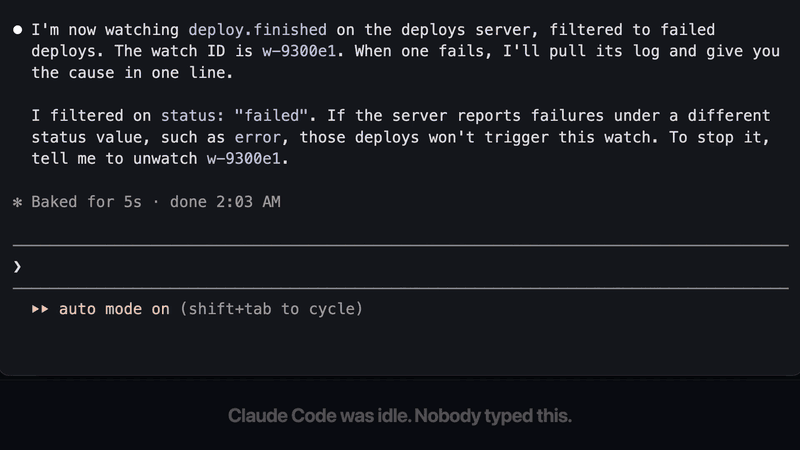

# mcp-events: MCP Events for Claude Code

A Claude Code mod that lets Claude watch events on your MCP servers ("tell me
when a deploy fails") and act when one fires, even while the session sits idle
with nobody typing. It adds the client side of the MCP **Events** extension
([SEP-3415](https://github.com/modelcontextprotocol/modelcontextprotocol/blob/main/seps/3415-events-extension.md)),
which Claude Code does not support by itself yet.



*A real session with the demo server in [`demo/`](demo/), which Claude
watches and which fires the event. Waits are shortened, and the frame zooms in
on what is being typed or shown. [Full video](docs/media/demo.mp4) (24 seconds).*

## Install

At the prompt of a `claude` session:

```
/plugin install mcp-events --marketplace idosal/MCPolyfill
```

Or in a terminal:

```bash
claude plugin install mcp-events --marketplace idosal/MCPolyfill
```

Either adds the [MCPolyfill](../../../README.md) marketplace and installs
the plugin in one step. With the marketplace already added,
`/plugin install mcp-events@mcpolyfill` does the same; to add the marketplace
by itself, `/plugin marketplace add idosal/MCPolyfill`.
`/plugin install mcpolyfill --marketplace idosal/MCPolyfill` installs every
polyfill in the marketplace, this one included.

The install is one small folder ([`mod/`](mod/), about 0.7 MB), and nothing
else is downloaded. It needs Claude Code 2.1.326 or newer, and Node 20 or
newer or Bun on your PATH ([Requirements](#requirements)).

## Try it

A demo server with events is hosted for anyone to try, with no sign-in. With
the mod installed, add it:

```bash
claude mcp add --transport http feeds https://event-feeds.idosalomon.workers.dev/mcp
```

Start `claude` in the same folder (one you trust) and ask:

> Give me a demo button and tell me what I type when I press it.

[Watch it (28 s)](docs/media/button-demo.mp4).

Claude makes a private button page with the server's `new_demo_button` tool,
gives you its link, and watches it. Open the link and press the button: a few
seconds later the idle session wakes by itself, shows a "Prompt from the
mcp-events plugin" line, and answers. The same server also offers
`hn.comment` (new comments in a Hacker News thread), `hn.story`,
`npm.release`, `github.release` and `usgs.earthquake`, all delivered by poll.

To stop: "Stop watching the demo button."

### Or run a demo server yourself

[`demo/`](demo/) holds a small Events server: a "deploys" service with a page
of buttons. It needs Node 22.18 or newer.

```bash
git clone https://github.com/idosal/MCPolyfill
cd MCPolyfill/polyfills/claude-code/events/demo
npm install
DEPLOYS_TOKEN=demo-token npm start
```

In another terminal, in a project folder you trust in Claude Code, tell Claude
Code about the server and start a session:

```bash
claude mcp add --transport http deploys http://127.0.0.1:4010/mcp --header "Authorization: Bearer demo-token"
claude
```

Then ask:

> Watch the deploys server. When a deploy fails, tell me why in one line.

Claude sets a watch and the session goes idle. Open http://127.0.0.1:4010/ and
press **Deploy a bad commit**. A couple of seconds later the session wakes by
itself, shows a "Prompt from the mcp-events plugin" line saying one event is
new, reads the event and the deploy's log, and tells you the cause.

To stop: "Stop watching the deploys server."

## From install to the first event

Every step and question between the install line and an event waking your
session, and what happens when one is missing or you say no:

1. **Install** (above). In a session, Claude Code shows the marketplace it
   resolved and asks you to confirm adding it, then opens the plugin's page,
   where you choose who gets it: you, everyone on this repository, or you in
   this repository only. The terminal form asks nothing. The plugin has no
   settings to fill in. Say no to the marketplace and nothing is installed.
2. **A folder you trust.** Claude Code runs a plugin's code only in a folder
   you have told it you trust, which it asks the first time you start
   `claude` in a folder. In a folder you have not trusted, the mod does
   nothing.
3. **Node 20 or newer, or Bun, on your PATH.** Claude Code itself needs
   neither, so check with `node --version`. Without one, the mod shows one
   notice saying so, each of its tools answers with the same sentence, and
   nothing else happens.
4. **An MCP server with events that Claude Code itself uses in the session:**
   added with `claude mcp add` or in a project's `.mcp.json`, approved, and
   not switched off. The mod leaves alone any server Claude Code is not
   using. A server you can reach only by signing in through `/mcp` (OAuth),
   and claude.ai connectors, do not work
   ([Which servers it works with](#which-servers-it-works-with)).
5. **Ask for a watch**, in plain words. In the default permission mode, the
   first time Claude uses each of the mod's tools, Claude Code asks "Do you
   want to proceed?", as for any MCP tool. This matters for waking: the
   message that wakes a session says only that there are new events, and
   Claude reads what happened with `get_event`. If Claude has to ask before it
   may call that, an event that arrives while you are away waits at that
   question until you answer, and so does any tool of the server's that
   Claude uses to act on the event. Choose the answer that stops
   Claude Code asking again for that tool, or allow all six of the mod's tools
   up front in `~/.claude/settings.json`:

   ```json
   { "permissions": { "allow": ["mcp__mcp-events__*"] } }
   ```

   Say no and that tool does not run.
6. **A server that delivers only by webhook** also needs a relay: a public
   https address that holds deliveries until the mod collects them. Set up
   your own first, from inside Claude Code, with `/mcp-events:relay-setup`
   (it deploys a small Worker to your own Cloudflare account). If you cannot,
   the public relay is the second choice, off until you turn it on by name
   with `MCP_EVENTS_RELAY=public`; read
   [what that means](#the-public-relay-opt-in) first. Without a relay, a
   watch on such a server is refused with a message that lists these choices.
   Push and poll delivery need no relay.

## Requirements

- **Claude Code 2.1.326 or newer.** Mods, the kind of plugin this is, are on
  by default from Claude Code 2.1.287.
- **Node 20 or newer, or Bun, on your PATH**, for the helper process. Webhook
  delivery through a relay needs Node 22 or newer (or Bun); push and poll
  work on Node 20.
- **A terminal session, or one an app keeps open** ([Where it runs](#where-it-runs)).

## What Claude can do with it

The mod gives Claude six tools. You do not call them yourself; you ask in
plain words.

| You say | Claude uses |
|---|---|
| "What can you watch on my servers?" | `list_event_types` |
| "Tell me when a high-priority ticket comes in." | `watch_event` |
| "What are you watching?" | `list_watches` |
| "Show me that last event in full." | `get_event`, `recent_events` |
| "Stop watching tickets." | `unwatch_event` |

Watches belong to the project folder and survive a restart: when you start
Claude Code there again, a watch picks up where it stopped, and events from
the meantime arrive if the server (or your relay, below) kept them.

## How it works

```
your MCP server (SEP-3415) ──events/stream · events/poll──────────────────►  helper process (mod/dist/helper.js)
        │                                                                    │  the Events client: one connection per
        └─signed webhooks──►  relay (your Cloudflare Worker)  ──WebSocket──► │  server, one subscription per watch; every
                              holds deliveries, no signing secret            │  event written to disk before it is acknowledged
                                                                             ▲
                                              a local endpoint (127.0.0.1) + │ one JSON line per message
                                                                             ▼
Claude Code  ◄── $.prompt.submit: "[mcp-events] …" wakes an idle session ──  hooks module (mod/hooks/register.ts)
     └── watch_event / unwatch_event / list_watches / get_event / recent_events / list_event_types ──► $.tool.register
```

A mod is a Claude Code plugin whose code runs inside Claude Code as a *hooks
module* ([mods reference](https://code.claude.com/docs/en/plugins/mods/reference)).
A hooks module has no network or process of its own, so the Events client
lives in a small helper process the module starts.

- **Finding servers.** The helper reads the MCP servers Claude Code is
  configured with, and connects only to those Claude Code itself is using in
  this session: not one that is switched off, unapproved, refused by policy,
  or waiting for a sign-in. It keeps the ones that offer events and tells
  Claude what they offer.
- **Watching.** A watch is one subscription. The delivery mode follows the
  SEP's guidance for clients: webhook where a relay is set up, then push
  (`events/stream`), then poll (`events/poll`).
- **Waking Claude.** Each event is written to disk, then handed to Claude Code
  as a prompt from the plugin, which starts a turn once the session is idle.
  Claude reads it as a message from the plugin, never as your words. The
  message names the server and event type and gives the new events' ids, and
  nothing the server wrote; Claude reads what happened with `get_event`.
- **One session per project** runs the watches. A second Claude Code window on
  the same project can list them; if the first closes, the second takes over.
- **Nothing to watch, nothing running.** If no server offers events and
  nothing is watched, the helper exits after 20 seconds and adds nothing to
  the session. It starts again when Claude uses one of the tools.

## Which servers it works with

- **Servers that implement the Events extension** (SEP-3415), over stdio or
  Streamable HTTP, with push, poll or webhook delivery.
- **Servers that speak the form from before the standard**, which is what
  ChatGPT reads today: they advertise events as a top-level `events`
  capability instead of the extension. The mod uses these by default.
  Strictly, SEP-3415 says a client must not send `events/*` to a server that
  has not advertised the extension, so this is a step outside it; set
  `MCP_EVENTS_PRE_STANDARD=off` to keep to the SEP exactly.
- **Servers that need credentials**, when the credential is in the server's
  configuration: a header (including `${VAR}`), or a `headersHelper`.

It does **not** work with a server you can only reach through Claude Code's
interactive OAuth sign-in (`/mcp`), or with claude.ai connectors. Claude Code
does not share that connection or its tokens with a mod. Details and the
alternatives: [`docs/sign-in.md`](docs/sign-in.md).

## Webhook delivery: the relay

Push and poll need no setup, and nothing but you and the MCP server is
involved. Some servers deliver only by webhook, and a webhook needs a public
https address, which Claude Code on your machine does not have. A relay is
that address: it keeps each delivery until the mod collects it, at once while
Claude Code is open and on the next start otherwise, so it also holds events
while Claude Code is closed. Nothing uses a relay until you set one up.

### Your own relay (recommended)

A small Cloudflare Worker ([`mod/relay/`](mod/relay/)) deployed to your own
Cloudflare account. From inside Claude Code:

```
/mcp-events:relay-setup
```

or by hand, from a clone of this repository (Node 22.18 or newer):

```bash
cd polyfills/claude-code/events/mod/relay
npm install && npx wrangler login && npm run setup
```

It gets a random access key that only your machine knows, and nobody else's
server sees your events.

### The public relay (opt-in)

If you cannot deploy one, there is a relay anyone may use. It is **off unless
you turn it on by name**:

```json
{ "env": { "MCP_EVENTS_RELAY": "public" } }
```

in `~/.claude/settings.json`. Know what that means before you do:

- It is run by Ido Salomon, the author of this mod, at
  `https://mcp-events-public-relay.idosalomon.workers.dev`. Opening that
  address in a browser shows what it is and what it keeps.
- **The payloads of your webhook-delivered events pass through that server**
  and are stored there until the mod collects them, for about a day at most.
  Webhooks are signed, not encrypted, so whoever runs a relay can read them.
- It cannot create or alter an event: the signing secret never leaves your
  machine, and the mod checks every delivery. Your mailbox opens only with a
  key that the mod makes and keeps.
- It is a courtesy with limits (100 waiting deliveries and 16 webhook
  addresses per project, about two deliveries a second to one address, and
  a ceiling of 2,000 new mailboxes an hour, past which new users are turned
  away until the hour is over) and no promise of
  availability. Its source is the same [`mod/relay/`](mod/relay/), deployed
  from `wrangler.public.jsonc`.
- A relay of your own always takes precedence over it.

Each time a watch is set through it, Claude is told, and tells you, whose
server it is.

### Who can see your events

| Delivery | Besides you and the MCP server |
|---|---|
| Push, poll | Nobody. |
| Webhook, your own relay | Nobody else's server. It runs on your Cloudflare account. |
| Webhook, the public relay | The public relay's operator could read payloads in transit and while stored (about a day at most). It cannot forge them. |
| Webhook, `MCP_EVENTS_PUBLIC_URL` | Whoever runs the forwarder you pointed it at. |

More on the relay: [`mod/relay/README.md`](mod/relay/README.md). Webhook
delivery through a relay needs Node 22 or newer (or Bun); push and poll work
on Node 20.

## Where it runs

| | Tools | An event wakes the session |
|---|---|---|
| `claude` in a terminal | Yes | Yes |
| A session kept open by an app or the Agent SDK (streaming input) | Yes | Yes |
| `claude -p "…"` (one prompt, then exit) | Yes | No: the process ends with its turn |
| Cloud sessions (Claude Code on the web) | Not supported: the mod has to start a local process | |

Tested live in Claude Code on macOS. The helper's tests also run on Linux and
Windows on every push, and the bundle is started on Node 20 and on Bun, but
the mod has not been run inside Claude Code on Linux or Windows, in the
desktop app, or in an IDE. If you try it there, an issue saying how it went is
welcome.

## Limits

- **No interactive OAuth**, as above.
- **It needs an open session.** Nothing starts Claude Code when an event
  arrives. With a relay, webhook events wait for your next session (for up to
  a week on your own relay, a day on the public one).
- **Events wake a session only so often.** A watch can start a wake at most
  once a minute: events that come sooner wait, and are announced together. A
  session is woken at most 30 times in an hour; after that it is told once
  that events are waiting, and is not woken again until you send a message.
  Nothing is dropped, and `recent_events` lists what waited. Two settings
  below change the numbers.
- **A second connection.** The helper opens its own connection to each server
  that offers events, so a local (stdio) server runs twice. Servers without
  events are disconnected at once and not asked again for a day.
- **Webhook needs credentials.** The extension requires `events/subscribe` to
  come from an authenticated caller, so webhook delivery is used only for a
  server whose configuration carries a header or a `headersHelper`.
- **Delivery is at least once.** After a crash at the wrong moment an event
  can show twice.
- **Sizes.** One event is at most 256 KiB, one answer from a remote server
  4 MiB, one session's stored events 64 MiB.
- **Managed machines.** Where your organisation sets an MCP allow or deny
  policy that the mod can see, it connects to nothing.
- **The mod API is new.** Mods are on by default from Claude Code 2.1.287,
  and the API still gains and changes parts between releases, which can
  break the mod until it is updated.

## Security

An event is data from a server you configured. What the server sent reaches
Claude only as a tool result, when Claude reads it with `get_event` or
`recent_events`. The message that wakes the session is a prompt from the
plugin, not a tool result, so it carries nothing the server wrote: only which
watch has new events, how many, and their ids. Receiving an event gives Claude
no permission it did not already have: what Claude does next goes through
Claude Code's own permission mode, rules and hooks. Keep in mind that an event
arrives without anyone asking, so in a session that approves actions without
asking, a server you watch can set work in motion, as often as the wake limit
above allows.

The mod connects only to servers Claude Code itself uses, verifies every
webhook itself, holds no OAuth grant, and listens only on the loopback address
behind a token. What it does and does not protect against, and how to report
a vulnerability: [`SECURITY.md`](SECURITY.md).

## Settings

Environment variables, for example in the `env` block of
`~/.claude/settings.json`. None is needed to start.

| Variable | What it does |
|---|---|
| `MCP_EVENTS_OFF=1` | Installed, and doing nothing. |
| `MCP_EVENTS_PRE_STANDARD` | Servers that advertise events only in the form from before the standard are used by default. `off` refuses them all, which is exactly the SEP; a comma-separated list of server names allows that form for those servers only. |
| `MCP_EVENTS_SERVERS` / `MCP_EVENTS_SKIP` | Only these server names, or never these (comma-separated). |
| `MCP_EVENTS_SOURCES` | Which Claude Code configuration scopes to read: `project,local,user` (default all three). |
| `MCP_EVENTS_CONFIG` | A servers file of your own (`{"mcpServers": {...}}`) instead of Claude Code's configuration. It must be outside the project folder and its repository. |
| `MCP_EVENTS_BATCH_MS` | How long the helper waits after an event before handing it over, so a burst arrives as one prompt. Default 1000. |
| `MCP_EVENTS_WAKE_GAP_S` | The least time between two wakes that one watch starts, in seconds. Default 60; 0 for none. |
| `MCP_EVENTS_WAKES_PER_HOUR` | How many times events may wake a session in an hour before waking stops until you send a message. Default 30; 0 for no limit. |
| `MCP_EVENTS_WAKE_VALUES=1` | Put a few short fields of each event's payload into the message that wakes the session, instead of only its id. Off by default: it puts text a server wrote into a prompt. |
| `MCP_EVENTS_MIN_POLL_MS` | The least time between two polls of one watch, whatever the server recommends. Default 1000. |
| `MCP_EVENTS_RELAY=public` | Use the public relay for webhook delivery when you have no relay of your own. Off by default; event payloads then pass through a server you do not run (see above). |
| `MCP_EVENTS_RELAY_URL`, `MCP_EVENTS_RELAY_ACCESS_KEY` | Your own relay, instead of `~/.mcp-events/relay.json`. |
| `MCP_EVENTS_PUBLIC_URL` | A public https forwarder of your own to the helper's local receiver (port: `MCP_EVENTS_RECEIVER_PORT`), instead of a relay. |
| `MCP_EVENTS_STATE` | Where watches and events are kept. Default: the plugin's data folder. |

## If something does not work

- Ask Claude "what can you watch?" If a server you expected is missing, the
  answer lists it under `unavailable` with the reason.
- The helper's log is `mcp-events.log` in the plugin's data folder
  (`~/.claude/plugins/data/mcp-events-mcp-events/`). Tokens from your
  configuration are removed from it.
- `claude --debug` shows the hooks module's side.
- A server that has just gained events support is noticed within a day, or at
  once if you delete `servers-without-events.json` in the data folder.

Bugs and questions: [open an issue](https://github.com/idosal/MCPolyfill/issues)
that names `mcp-events`, with your Claude Code version, your operating system,
and the relevant lines of the log. For a security problem, see [`SECURITY.md`](SECURITY.md) instead.

## When Claude Code supports Events itself

This mod is a stopgap. Once Claude Code handles Events natively, uninstall it
(`/plugin uninstall mcp-events`) or set `MCP_EVENTS_OFF=1`; running both would
show each event twice. It cannot stand down by itself, because a mod has no
way to see what Claude Code's own MCP client supports.

## More

- [`docs/conformance.md`](docs/conformance.md): every client-side rule of
  SEP-3415, with the code and the test for each.
- [`docs/sign-in.md`](docs/sign-in.md): servers that need credentials, and why
  interactive OAuth is out of reach.
- [`docs/performance.md`](docs/performance.md): what it costs to run.
- [`docs/claude-code-and-mcp-events.md`](docs/claude-code-and-mcp-events.md):
  what Claude Code would need for this not to be a mod.
- [`docs/live-run.md`](docs/live-run.md): a transcript of a live session.

## Development

From this folder (`polyfills/claude-code/events` in the repository):

```bash
npm install
npm test             # the helper and the Events client (Node 22.18+ runs the TypeScript tests)
npm run test:mod     # the hooks module, with Claude Code's own test runner
npm run typecheck
npm run build        # mod/dist/helper.js; a test fails when it is stale
npm run validate     # claude plugin validate mod
claude --plugin-dir mod   # run it from this checkout
```

- [`mod/`](mod/) is what gets installed, and all of it: the manifest, the
  hooks module (`mod/hooks/`), the bundled helper (`mod/dist/helper.js`), the
  relay's source and the skill that deploys it.
- `src/` is the helper's source. The Events client is host-neutral
  (`events-client.ts`, `watcher.ts`, `routing-headers.ts`, `webhooks.ts`,
  `relay.ts`, `store.ts`); the rest is specific to Claude Code (`config.ts`,
  `tools.ts`, `delivery.ts`, `helper.ts`).
- `test/` holds the tests (run on macOS, Linux and Windows in CI, by
  [`mcp-events-test.yml`](../../../.github/workflows/mcp-events-test.yml)) and three
  interop runs against servers built on Mastra's `@mastra/mcp`
  (`npm run interop`, `test/interop/deploys.ts`, `test/interop/sign-in.ts`).
- To release, change the version in `mod/.claude-plugin/plugin.json`,
  `package.json` and `src/version.ts`, rebuild, and merge to `main`: the
  marketplace installs this folder from `main`. Claude Code updates an
  installed copy only when the version changes.

## Related

Part of [MCPolyfill](../../../README.md): MCP extensions for hosts that
haven't shipped them yet.

## Licence

Apache-2.0. See [`LICENSE`](../../../LICENSE). The bundled helper (`mod/dist/helper.js`)
includes npm packages under their own licences:
[`mod/THIRD_PARTY_LICENSES.txt`](mod/THIRD_PARTY_LICENSES.txt).
