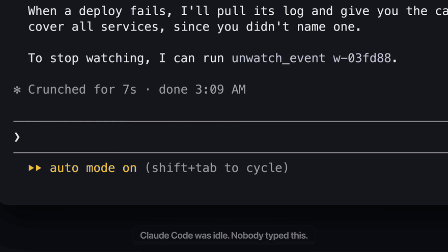

# mcp-events for Claude Code

Claude can watch events on your MCP servers ("tell me when a deploy fails")
and act when one fires, even while the session sits idle with nobody typing.

Also available for Codex, Pi and OpenCode: [mcp-events for Codex](../codex/README.md), [mcp-events for Pi](../pi/README.md), [mcp-events for OpenCode](../opencode/README.md).

This mod implements the client side of the MCP Events extension,
[SEP-3415](https://github.com/modelcontextprotocol/modelcontextprotocol/blob/main/seps/3415-events-extension.md)
(Final), which Claude Code doesn't support by itself yet. Details are in
[Spec and conformance](#spec-and-conformance).



*A real session with the demo server in [`demo/`](demo/): Claude watches it,
and it fires the event. Waits are shortened, and the frame zooms in on what is
being typed or shown. [Full video](docs/media/demo.mp4) (24 seconds).*

## Install

At the prompt of a `claude` session:

```
/plugin install mcp-events --marketplace idosal/AgentPolyfill
```

Or in a terminal:

```bash
claude plugin install mcp-events --marketplace idosal/AgentPolyfill
```

Either one adds the [AgentPolyfill](../../../README.md) marketplace and
installs the plugin in one step. Once the marketplace is added,
`/plugin install mcp-events@agent-polyfill` does the same. To add only the
marketplace, run `/plugin marketplace add idosal/AgentPolyfill`. To install
every polyfill in the marketplace, this one included, run
`/plugin install agent-polyfill --marketplace idosal/AgentPolyfill`.

The install is one small folder, [`mod/`](mod/), of about 0.8 MB. Nothing else
is downloaded unless you ask for it with `/mcp-events setup`
([The mod's own runtime](#the-mods-own-runtime)).

You need:

- **Claude Code 2.1.326 or newer.** Mods, the kind of plugin this is, are on
  by default from Claude Code 2.1.287.
- **Node 20 or newer, or Bun**, to run the helper process. On a machine with
  neither, `/mcp-events setup` fetches a copy of Bun for the mod alone (macOS
  and Linux). Webhook delivery through a relay needs Node 22 or newer, or Bun.
  Push and poll work on Node 20.
- **A terminal session, or one an app keeps open**
  ([Where it runs](#where-it-runs)).

To remove it, run `/plugin uninstall mcp-events`. If `/mcp-events setup`
fetched Bun for you, see [The mod's own runtime](#the-mods-own-runtime) first.

### The mod's own runtime

The mod's helper is JavaScript, so it needs Node or Bun, and Claude Code comes
with neither. On a machine that has neither, `/mcp-events setup` fetches one:

- **Only when you ask, and only after you say yes.** The command counts only
  when you type it at the prompt, or send it from your own Remote Control. It
  is refused when it comes from Claude, a script, another session or an
  unattended run (`claude -p`). When you run it, Claude Code's own dialog asks
  whether to download, and "Not now" is the first answer.
- **What it fetches.** One fixed Bun release, for macOS or Linux on arm64 or
  x64, from that release's page on GitHub, over HTTPS only. The version is in
  [`mod/hooks/runtime.ts`](mod/hooks/runtime.ts). GitHub redirects the
  download to its file storage. The checksum below is what makes it safe, not
  the host.
- **What it checks before installing.** Inside the mod, before anything is
  unpacked or run, it computes the SHA-256 of the downloaded bytes. That hash
  must equal the one written in the mod's source, which was copied from the
  release's own checksum file. A download that doesn't match is deleted. The
  check happens when Bun is fetched, not each time it runs. Only the copy of
  the pinned version is ever run. A folder of any other version there is never
  run, not even to ask its version, and the next setup deletes it.
- **Where it goes.** The `runtime` folder in the plugin's data folder
  (`~/.claude/plugins/data/mcp-events-mcp-events/runtime`, or the same under
  `CLAUDE_CONFIG_DIR`). It's used for this mod's helper and for nothing else.
  Your PATH and shell profile aren't touched. `/mcp-events setup remove`
  deletes it. Run that before you uninstall the plugin, or delete the folder
  afterwards.
- **What it needs.** `curl` and `unzip`, as Bun's own installer does. On
  Windows, or without them, install Node or Bun yourself.

`/mcp-events` tells you what the helper runs on, or why nothing does and what
to do. If you have a Node or Bun of your own, the mod uses it first. To run the
helper on a particular one, name it in `MCP_EVENTS_RUNTIME`, or set that to
`private` to use only the copy the mod fetched. A project's settings can set
that variable too. So a folder you trust can choose the program that runs the
helper, as it can already run code through its own hooks.

Not checked as one sequence: the download, the check and the unpacking are
tested with stand-ins for the machine (`mod/hooks/setup.test.ts`), but the
download itself hasn't been run from this mod.

## Try it

A demo server with events is hosted for anyone to try, with no sign-in. With
the mod installed, add it:

```bash
claude mcp add --transport http feeds https://event-feeds.idosalomon.workers.dev/mcp
```

Start `claude` in the same folder (one you trust) and ask:

> Give me a demo button and tell me what I type when I press it.

[Watch it (28 s)](docs/media/button-demo.mp4).

Claude makes a private button page with the server's `new_demo_button` tool,
gives you its link, and watches it. Open the link, type a message and press
the button. A few seconds later the idle session wakes by itself, shows a
"Prompt from the mcp-events plugin" line, and answers.

The same server also offers `hn.comment` (new comments in a Hacker News
thread), `hn.story`, `npm.release`, `github.release` and `usgs.earthquake`,
all delivered by poll.

To stop: "Stop watching the demo button."

### Or run a demo server yourself

[`demo/`](demo/) holds a small Events server: a "deploys" service with a page
of buttons. It needs Node 22.18 or newer.

```bash
git clone https://github.com/idosal/AgentPolyfill
cd AgentPolyfill/polyfills/events/claude-code/demo
npm install
DEPLOYS_TOKEN=demo-token npm start
```

In another terminal, in a project folder you trust in Claude Code, tell Claude
Code about the server and start a session:

```bash
claude mcp add --transport http deploys http://127.0.0.1:4010/mcp --header "Authorization: Bearer demo-token"
claude
```

Then ask:

> Watch the deploys server. When a deploy fails, tell me why in one line.

Claude sets a watch and the session goes idle. Open http://127.0.0.1:4010/ and
press **Deploy a bad commit**. A couple of seconds later the session wakes by
itself and shows a "Prompt from the mcp-events plugin" line saying one event
is new. Claude reads the event and the deploy's log, and tells you the cause.

To stop: "Stop watching the deploys server."

## How it works

### From install to the first event

Here is every step and question between the install line and an event waking
your session, and what happens when something is missing or you say no.

1. **Install** (above). In a session, Claude Code shows the marketplace it
   resolved and asks you to confirm adding it. Then it opens the plugin's
   page, where you choose who gets it: you, everyone on this repository, or
   you in this repository only. The terminal command asks nothing. The plugin
   has no settings to fill in. If you say no to the marketplace, nothing is
   installed.
2. **A folder you trust.** Claude Code runs a plugin's code only in a folder
   you've told it you trust. It asks the first time you start `claude` in a
   folder. In a folder you haven't trusted, the mod does nothing.
3. **Node 20 or newer, or Bun.** Claude Code itself needs neither, so check
   with `node --version`. The mod looks on Claude Code's PATH, then where your
   login shell finds them, then where their installers put them. Without one,
   the mod shows one notice saying so, and each of its tools and `/mcp-events`
   answer with what to do. Nothing else happens. On macOS or Linux,
   `/mcp-events setup` then fetches a copy of Bun for the mod alone
   ([The mod's own runtime](#the-mods-own-runtime)).
4. **An MCP server with events that Claude Code itself uses in the session.**
   That is, a server added with `claude mcp add` or in a project's
   `.mcp.json`, approved, and not switched off. The mod leaves alone any server
   Claude Code isn't using. A server you can reach only by signing in through
   `/mcp` (OAuth) doesn't work, and neither do claude.ai connectors
   ([Servers that need sign-in](#servers-that-need-sign-in)).
5. **Ask for a watch**, in plain words. In the default permission mode, the
   first time Claude uses each of the mod's tools, Claude Code asks "Do you
   want to proceed?", as for any MCP tool.

   This matters for waking. The message that wakes a session says only that
   there are new events, and Claude reads what happened with `get_event`. If
   Claude has to ask before it may call that tool, an event that arrives while
   you're away waits at that question until you answer. So does any tool of
   the server's that Claude uses to act on the event. Choose the answer that
   stops Claude Code asking again for that tool, or allow all six of the mod's
   tools up front in `~/.claude/settings.json`:

   ```json
   { "permissions": { "allow": ["mcp__mcp-events__*"] } }
   ```

   If you say no, that tool doesn't run.
6. **A server that delivers only by webhook** also needs a relay: a public
   https address that holds deliveries until the mod collects them. Set up
   your own first, from inside Claude Code, with `/mcp-events:relay-setup`. It
   deploys a small Worker to your own Cloudflare account. If you can't, the
   public relay is the second choice. It's off until you turn it on by name
   with `MCP_EVENTS_RELAY=public`; read [what that means](#the-public-relay-opt-in)
   first. Without a relay, a watch on such a server is refused, with a message
   that lists these choices. Push and poll delivery need no relay.

### What Claude can do with it

The mod gives Claude six tools. You don't call them yourself: you ask in plain
words.

| You say | Claude uses |
|---|---|
| "What can you watch on my servers?" | `list_event_types` |
| "Tell me when a high-priority ticket comes in." | `watch_event` |
| "What are you watching?" | `list_watches` |
| "Show me that last event in full." | `get_event`, `recent_events` |
| "Stop watching tickets." | `unwatch_event` |

Watches belong to the project folder and survive a restart. When you start
Claude Code there again, a watch picks up where it stopped, and events from
the meantime arrive if the server, or your relay, kept them. Events that had
arrived but hadn't been shown yet when Claude Code closed (their wake was held
back; see [Limits](#limits)) are shown in the next session there.

### How the parts fit together

```
your MCP server (SEP-3415) ──events/stream · events/poll──────────────────►  helper process (mod/dist/helper.js)
        │                                                                    │  the Events client: one connection per
        └─signed webhooks──►  relay (your Cloudflare Worker)  ──WebSocket──► │  server, one subscription per watch; every
                              holds deliveries, no signing secret            │  event written to disk before it is acknowledged
                                                                             ▲
                                              a local endpoint (127.0.0.1) + │ one JSON line per message
                                                                             ▼
Claude Code  ◄── $.prompt.submit: "[mcp-events] …" wakes an idle session ──  hooks module (mod/hooks/register.ts)
     └── watch_event / unwatch_event / list_watches / get_event / recent_events / list_event_types ──► $.tool.register
```

A mod is a Claude Code plugin whose code runs inside Claude Code as a *hooks
module* ([mods reference](https://code.claude.com/docs/en/plugins/mods/reference)).
A hooks module has no network or process of its own, so the Events client
lives in a small helper process that the module starts.

- **Finding servers.** The helper reads the MCP servers Claude Code is
  configured with. It connects only to those Claude Code itself is using in
  this session: not one that is switched off, unapproved, refused by policy,
  or waiting for a sign-in. It keeps the ones that offer events and tells
  Claude what they offer.
- **Watching.** A watch is one subscription. The delivery mode follows the
  SEP's guidance for clients: webhook where a relay is set up, then push
  (`events/stream`), then poll (`events/poll`).
- **Waking Claude.** Each event is written to disk first. Then it's handed to
  Claude Code as a prompt from the plugin, which starts a turn once the
  session is idle. Claude reads it as a message from the plugin, never as your
  words. The message names the server and event type and gives the new
  events' ids. It carries nothing the server wrote: Claude reads what happened
  with `get_event`.
- **One session per project** runs the watches. A second Claude Code window on
  the same project can list them, and if the first closes, the second takes
  over.
- **Nothing to watch, nothing running.** If no server offers events and
  nothing is watched, the helper exits after 20 seconds and adds nothing to
  the session. It starts again when Claude uses one of the tools.

What it costs to run is in [`docs/performance.md`](docs/performance.md).

### Which servers it works with

- **Servers that implement the Events extension** (SEP-3415), over stdio or
  Streamable HTTP, with push, poll or webhook delivery.
- **Servers that speak the form from before the standard**, which is what
  ChatGPT reads today. They advertise events as a top-level `events`
  capability instead of the extension. The mod uses these by default.
  Strictly, SEP-3415 says a client must not send `events/*` to a server that
  hasn't advertised the extension, so this is a step outside it. Set
  `MCP_EVENTS_PRE_STANDARD=off` to keep to the SEP exactly.
- **Servers that need credentials**, when the credential is in the server's
  configuration ([below](#servers-that-need-credentials)).

### Servers that need credentials

The mod works with a server whose credential is in its configuration: a
header (including `${VAR}`), or a `headersHelper`.

### Servers that need sign-in

It doesn't work with a server you can reach only through Claude Code's
interactive OAuth sign-in (`/mcp`), or with claude.ai connectors. Claude Code
doesn't share that connection or its tokens with a mod.
[`docs/sign-in.md`](docs/sign-in.md) has the details and the alternatives:
servers that need credentials, and why interactive OAuth is out of reach.

### Webhook delivery: the relay

Push and poll need no setup, and nothing but you and the MCP server is
involved. Some servers deliver only by webhook, and a webhook needs a public
https address, which Claude Code on your machine doesn't have. A relay is that
address. It keeps each delivery until the mod collects it: at once while
Claude Code is open, and on the next start otherwise. So it also holds events
while Claude Code is closed. Nothing uses a relay until you set one up.

#### Your own relay (recommended)

This is a small Cloudflare Worker ([`mod/relay/`](mod/relay/)) deployed to
your own Cloudflare account. From inside Claude Code:

```
/mcp-events:relay-setup
```

Or by hand, from a clone of this repository (Node 22.18 or newer):

```bash
cd polyfills/events/claude-code/mod/relay
npm install && npx wrangler login && npm run setup
```

It gets a random access key that only your machine knows, and nobody else's
server sees your events.

#### The public relay (opt-in)

If you can't deploy one, there is a relay anyone may use. It's off unless you
turn it on by name, in `~/.claude/settings.json`:

```json
{ "env": { "MCP_EVENTS_RELAY": "public" } }
```

Know what that means before you do:

- It's run by Ido Salomon, the author of this mod, at
  `https://mcp-events-public-relay.idosalomon.workers.dev`. Opening that
  address in a browser shows what it is and what it keeps.
- **The payloads of your webhook-delivered events pass through that server**,
  and are stored there until the mod collects them, for about a day at most.
  Webhooks are signed, not encrypted, so whoever runs a relay can read them.
- It can't create or alter an event. The signing secret never leaves your
  machine, and the mod checks every delivery. Your mailbox opens only with a
  key that the mod makes and keeps.
- It's a courtesy with limits, and no promise of availability:
  - 100 waiting deliveries and 16 webhook addresses per mailbox. Each MCP
    server you watch by webhook has a mailbox of its own in each project.
  - About two deliveries a second to one address.
  - A ceiling of 2,000 new mailboxes an hour. Past it, new users are turned
    away until the hour is over.
- Its source is the same [`mod/relay/`](mod/relay/), deployed from
  `wrangler.public.jsonc`.
- A relay of your own always takes precedence over it.

Each time a watch is set through it, Claude is told whose server it is, and
tells you.

#### Who can see your events

| Delivery | Besides you and the MCP server |
|---|---|
| Push, poll | Nobody. |
| Webhook, your own relay | Nobody else's server. It runs on your Cloudflare account. |
| Webhook, the public relay | The public relay's operator could read payloads in transit and while stored (about a day at most). It cannot forge them. |
| Webhook, `MCP_EVENTS_PUBLIC_URL` | Whoever runs the forwarder you pointed it at. |

More on the relay: [`mod/relay/README.md`](mod/relay/README.md).

### Where it runs

| | Tools | An event wakes the session |
|---|---|---|
| `claude` in a terminal | Yes | Yes |
| A session kept open by an app or the Agent SDK (streaming input) | Yes | Yes |
| `claude -p "…"` (one prompt, then exit) | Yes | No: the process ends with its turn |
| Cloud sessions (Claude Code on the web) | Not supported: the mod has to start a local process | |

Checked in Claude Code 2.1.329 on macOS. The helper's tests also run on Linux
and Windows on every push, and the bundle is started on Node 20 and on Bun.
Not checked inside Claude Code on Linux or Windows, in the desktop app, or in
an IDE. If you try it there, an issue saying how it went is welcome.

### If something doesn't work

- Ask Claude "what can you watch?" If a server you expected is missing, the
  answer lists it under `unavailable`, with the reason.
- The helper's log is `mcp-events.log` in the plugin's data folder
  (`~/.claude/plugins/data/mcp-events-mcp-events/`). Tokens from your
  configuration are removed from it.
- `claude --debug` shows the hooks module's side.
- A server that has just gained events support is noticed within a day, or at
  once if you delete `servers-without-events.json` in the data folder.

For bugs and questions, [open an issue](https://github.com/idosal/AgentPolyfill/issues)
that names `mcp-events`, with your Claude Code version, your operating system
and the relevant lines of the log. For a security problem, see
[`SECURITY.md`](SECURITY.md) instead.

### What differs between Claude Code and Codex

Both forms share the same Events client ([`../core`](../core)). Where they
differ:

| | Claude Code | Codex |
|---|---|---|
| What runs | A mod: a hooks module inside Claude Code, and a helper process it starts | A plugin: a helper that Codex starts as an MCP server for each session |
| Needs | Claude Code 2.1.326 or newer; Node 20 or newer, or Bun | Codex 0.170 or newer; Node 20 or newer on the PATH Codex runs with |
| No Node on the machine | `/mcp-events setup` fetches Bun (macOS and Linux) | Codex reports that the `mcp-events` server failed to start; the plugin downloads nothing |
| Who a watch belongs to | The project folder. One session per project runs the watches | The Codex session that set it (`_meta.threadId`). One process per session runs them |
| Asking before a tool runs | Claude Code asks the first time Claude uses each tool, in the default permission mode | `watch_event` and `unwatch_event` go through Codex's approval; the four tools that only read run without asking |
| How a wake arrives | `$.prompt.submit`, shown as "Prompt from the mcp-events plugin" | `codex queue --thread <id> --message "[mcp-events] …" --resume`, an input message whose first line says it's from the plugin |
| After 30 wakes in an hour | Not woken again until you send a message | Not woken again for an hour, or until you write and Codex calls one of the plugin's tools in that turn (this needs Codex 0.172's turn metadata) |
| Servers it reads | Claude Code's configuration scopes, and only servers Claude Code itself uses in the session | `[mcp_servers.*]` in `config.toml`; not a project's `.codex/config.toml`, and not servers other plugins bring |
| Servers it can't reach | `/mcp` OAuth sign-in, and claude.ai connectors | `codex mcp login`, OAuth, `auth = "chatgpt"`; and tokens in variables that don't reach the helper |
| Setting up your own relay | `/mcp-events:relay-setup` inside Claude Code, or by hand | By hand, from a clone. The same relay serves both forms |
| A session you come back to | Watches pick up when Claude Code starts in the project again | A resumed session's watches start at its first call of one of the plugin's tools |
| One prompt, then exit | `claude -p`: tools work, no wake | `codex exec`: tools work, no wake |
| Where state is kept | The plugin's data folder | `$CODEX_HOME/mcp-events` |
| Checked in | Claude Code 2.1.329 on macOS | The Codex TUI 0.172.0 on macOS |

## Settings

Settings are environment variables, for example in the `env` block of
`~/.claude/settings.json`. You don't need any of them to start.

| Variable | What it does |
|---|---|
| `MCP_EVENTS_OFF=1` | Installed, and doing nothing. |
| `MCP_EVENTS_RUNTIME` | What runs the helper: the full path of a Node 20+ or a Bun (nothing else is then tried), or `private` for only the copy of Bun `/mcp-events setup` fetched. Default: whatever is found ([The mod's own runtime](#the-mods-own-runtime)). |
| `MCP_EVENTS_PRE_STANDARD` | Servers that advertise events only in the form from before the standard are used by default. `off` refuses them all, which is exactly the SEP. A comma-separated list of server names allows that form for those servers only. |
| `MCP_EVENTS_SERVERS` / `MCP_EVENTS_SKIP` | Only these server names, or never these (comma-separated). |
| `MCP_EVENTS_SOURCES` | Which Claude Code configuration scopes to read: `project,local,user` (default all three). |
| `MCP_EVENTS_CONFIG` | A servers file of your own (`{"mcpServers": {...}}`) instead of Claude Code's configuration. It must be outside the project folder and its repository. |
| `MCP_EVENTS_BATCH_MS` | How long the helper waits after an event before handing it over, so a burst arrives as one prompt. Default 1000. |
| `MCP_EVENTS_WAKE_GAP_S` | The least time between two wakes that one watch starts, in seconds. Default 60; 0 for none. |
| `MCP_EVENTS_WAKES_PER_HOUR` | How many times events may wake a session in an hour before waking stops until you send a message. Default 30; 0 for no limit. |
| `MCP_EVENTS_WAKE_VALUES=1` | Put a few short fields of each event's payload into the message that wakes the session, instead of only its id. Off by default, because it puts text a server wrote into a prompt. |
| `MCP_EVENTS_MIN_POLL_MS` | The least time between two polls of one watch, whatever the server recommends. Default 1000. |
| `MCP_EVENTS_RELAY=public` | Use the public relay for webhook delivery when you have no relay of your own. Off by default. Event payloads then pass through a server you don't run ([The public relay](#the-public-relay-opt-in)). |
| `MCP_EVENTS_RELAY_URL`, `MCP_EVENTS_RELAY_ACCESS_KEY` | Your own relay, instead of `~/.mcp-events/relay.json`. |
| `MCP_EVENTS_PUBLIC_URL` | A public https forwarder of your own to the helper's local receiver (port: `MCP_EVENTS_RECEIVER_PORT`), instead of a relay. |
| `MCP_EVENTS_STATE` | Where watches and events are kept. Default: the plugin's data folder. |

### When Claude Code supports Events itself

This mod is a stopgap. Once Claude Code handles Events natively, uninstall it
(`/plugin uninstall mcp-events`) or set `MCP_EVENTS_OFF=1`. Running both would
show each event twice. The mod can't stand down by itself, because a mod has
no way to see what Claude Code's own MCP client supports.

## Limits

What Claude Code would need to change for this not to be a mod is in
[`docs/claude-code-and-mcp-events.md`](docs/claude-code-and-mcp-events.md).
The changes both hosts would need are in
[What hosts would need to change](../../../docs/host-changes.md).

- **No interactive OAuth** ([Servers that need sign-in](#servers-that-need-sign-in)).
  A way to send any MCP method over the host's connection (change 1 in
  [What hosts would need to change](../../../docs/host-changes.md#1-send-any-mcp-method-over-the-hosts-connection))
  would remove this, and the second connection below.
- **It needs an open session.** Nothing starts Claude Code when an event
  arrives. With a relay, webhook events wait for your next session: for up to
  a week on your own relay, and a day on the public one.
- **Events wake a session only so often.** A watch can start a wake at most
  once a minute. Events that come sooner wait, and are announced together. A
  session is woken at most 30 times in an hour. After that it's told once that
  events are waiting, and isn't woken again until you send a message. Nothing
  is dropped: `recent_events` lists what waited, and if Claude Code is closed
  first, the next session in the project is shown it. Two
  [settings](#settings) change the numbers.
- **A second connection.** The helper opens its own connection to each server
  that offers events, so a local (stdio) server runs twice. Servers without
  events are disconnected at once and not asked again for a day.
- **Webhook needs credentials.** The extension requires `events/subscribe` to
  come from an authenticated caller. So webhook delivery is used only for a
  server whose configuration carries a header or a `headersHelper`.
- **Delivery is at least once.** After a crash at the wrong moment an event
  can show twice. For example, when Claude Code closes just after a batch was
  shown and before that was saved, the next session shows it again.
- **Sizes.** One event is at most 256 KiB, one answer from a remote server
  4 MiB, and one session's stored events 64 MiB.
- **Managed machines.** Where your organisation sets an MCP allow or deny
  policy that the mod can see, it connects to nothing.
- **The mod API is new.** Mods are on by default from Claude Code 2.1.287,
  and the API still gains and changes parts between releases. That can break
  the mod until it's updated.

## Security

An event is data from a server you configured. What the server sent reaches
Claude only as a tool result, when Claude reads it with `get_event` or
`recent_events`.

The message that wakes the session is a prompt from the plugin, not a tool
result. So it carries nothing the server wrote: only which watch has new
events, how many, and their ids.

Receiving an event gives Claude no permission it didn't already have. What
Claude does next goes through Claude Code's own permission mode, rules and
hooks. Keep in mind that an event arrives without anyone asking. So in a
session that approves actions without asking, a server you watch can set work
in motion, as often as the [wake limit](#limits) allows.

The mod connects only to servers Claude Code itself uses, verifies every
webhook itself, holds no OAuth grant, and listens only on the loopback address,
behind a token. What it does and doesn't protect against, and how to report a
vulnerability, are in [`SECURITY.md`](SECURITY.md).

## Spec and conformance

mcp-events implements
[SEP-3415](https://github.com/modelcontextprotocol/modelcontextprotocol/blob/main/seps/3415-events-extension.md),
the Final text as fetched on 24 November 2026. One step outside it is on by
default: servers that advertise events in the form from before the standard
([Which servers it works with](#which-servers-it-works-with)).
`MCP_EVENTS_PRE_STANDARD=off` makes it follow the SEP exactly.

### Proof

- [`docs/conformance.md`](docs/conformance.md) lists every client-side rule of
  SEP-3415, with the code and the test for each. It also has the upstream
  conformance suite's result: 17 of 17 of its Events client scenarios. Those
  scenarios are an open pull request in the suite
  (`modelcontextprotocol/conformance#541`).
- Three interop tests against servers built on Mastra's `@mastra/mcp`
  (`npm run interop`).
- [`model/`](model/README.md) is a formal model, in Quint and in TLA+, of how
  events get from a server to the session and of how often they wake it. It
  says what holds within small, stated bounds, and which configurations must
  find a violation.

## Development

From this folder (`polyfills/events/claude-code` in the repository):

```bash
npm install
npm test             # the helper and the Events client (Node 22.18+ runs the TypeScript tests)
npm run test:mod     # the hooks module, with Claude Code's own test runner
npm run typecheck
npm run build        # mod/dist/helper.js; a test fails when it is stale
npm run validate     # claude plugin validate mod
claude --plugin-dir mod   # run it from this checkout
```

- [`mod/`](mod/) is what gets installed, all of it: the manifest, the hooks
  module (`mod/hooks/`), the bundled helper (`mod/dist/helper.js`), the
  relay's source and the skill that deploys it.
- `src/` is the helper's source. The Events client is host-neutral
  (`events-client.ts`, `watcher.ts`, `routing-headers.ts`, `webhooks.ts`,
  `relay.ts`, `store.ts`). The rest is specific to Claude Code (`config.ts`,
  `tools.ts`, `delivery.ts`, `helper.ts`).
- `test/` holds the tests, which CI runs on macOS, Linux and Windows
  ([`mcp-events-test.yml`](../../../.github/workflows/mcp-events-test.yml)). It
  also holds the interop tests (`test/interop/deploys.ts`,
  `test/interop/sign-in.ts`).
- `npm run conformance` runs the upstream conformance suite's Events client
  scenarios against the client, from a checkout of the suite
  ([`docs/conformance.md`](docs/conformance.md)). [`model/README.md`](model/README.md)
  says how to run the model's checks (TLC: `node model/check.mjs`).
- To release, change the version in `mod/.claude-plugin/plugin.json`,
  `package.json` and `src/version.ts`, rebuild, and merge to `main`. The
  marketplace installs this folder from `main`, and Claude Code updates an
  installed copy only when the version changes.

## Licence

Part of [AgentPolyfill](../../../README.md): MCP extensions for hosts that
haven't shipped them yet.

Apache-2.0. See [`LICENSE`](../../../LICENSE). The bundled helper
(`mod/dist/helper.js`) includes npm packages under their own licences:
[`mod/THIRD_PARTY_LICENSES.txt`](mod/THIRD_PARTY_LICENSES.txt).

This is a community project. It isn't affiliated with or endorsed by
Anthropic, OpenAI, the Model Context Protocol project, the Agentic AI
Foundation or the Linux Foundation. Claude and Claude Code are trademarks of
Anthropic, PBC. OpenAI and Codex are trademarks of OpenAI.
