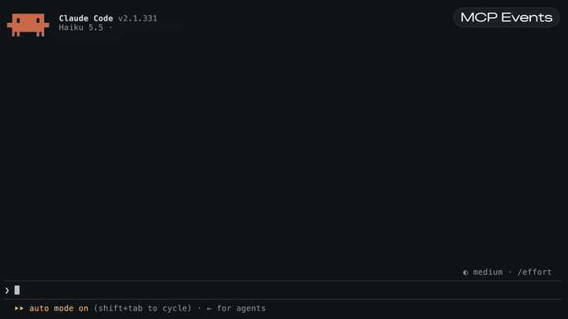

# mcp-events for Hermes

Hermes Agent can watch events on your MCP servers ("tell me when a deploy
fails") and act when one fires, even while the session sits idle with nobody
typing.

<a href="https://agentpolyfill.com/media/events.mp4">
  <picture>
    <source media="(prefers-reduced-motion: reduce)" srcset="../../../site/public/media/events.jpg">
    
  </picture>
</a>

[Watch a Worker error wake Claude Code (15 s)](https://agentpolyfill.com/media/events.mp4)

Also available for [Claude Code](../claude-code/README.md),
[Codex](../codex/README.md), [Pi](../pi/README.md),
[OpenCode](../opencode/README.md), [T3 Code](../t3/README.md) and
[Copilot CLI](../copilot/README.md).

This plugin implements the client side of the MCP Events extension,
[SEP-3415](https://github.com/modelcontextprotocol/modelcontextprotocol/blob/main/seps/3415-events-extension.md)
(the Final text, as of 24 November 2026), for **webhook, push and poll** delivery. Each watch uses a mode the server
advertises for that event type. Servers configured with `events: true` use
Hermes’s native webhook subscriptions. Details are in
[Spec and conformance](#spec-and-conformance).

## Install

```bash
hermes plugins install idosal/AgentPolyfill/polyfills/events/hermes/plugin --enable
```

Then name the servers you want it to watch, and let it start a turn when an
event arrives. It uses no server you don't name, and Hermes lets no plugin
start a turn until you allow it. In `~/.hermes/config.yaml` (or your
profile's):

```yaml
plugins:
  entries:
    mcp-events:
      settings:
        servers: [feeds]              # the MCP servers it may connect to, by name
      allow_gateway_injection: true   # an event may start a turn in its session
```

`settings` is where Hermes keeps a plugin's settings (the plugin reads it
with `ctx.get_config`). It isn't Hermes's `mcp_allowlist`, which lets a
plugin call a server's tools over Hermes's own connection: this plugin opens
a connection of its own, so it has a grant of its own. Without
`allow_gateway_injection`, watches still store every event, but can't wake a
session; `list_watches` says so.

You need:

- **Hermes Agent v0.23.4** or newer. Checked in Hermes v0.23.4.
- **Node 20 or newer** on the `PATH` of the Hermes gateway. Hermes's TUI and
  Desktop app run on Node, so it's usually there; `node --version` tells you.
  `AGENTPOLYFILL_NODE` can name a different `node`.

To remove it, run `hermes plugins remove mcp-events`. Its state is in
`$HERMES_HOME/mcp-events/`.

## Try it

A demo server with events is hosted for anyone to try, with no sign-in. Add
it to `config.yaml` (and to `settings.servers` above):

```yaml
mcp_servers:
  feeds:
    url: https://event-feeds.idosalomon.workers.dev/mcp
```

Start `hermes` and ask:

> Give me a demo button and tell me what I type when I press it.

Hermes makes a private button page with the server's `new_demo_button` tool,
gives you its link, and asks you to approve the watch. Open the link, type a
message and press the button. A few seconds later the idle session gets a
message that starts with `[mcp-events]`, reads the event, and tells you what
you typed.

The same server also offers `hn.comment`, `hn.story`, `npm.release`,
`github.release` and `usgs.earthquake`, all delivered by poll.

To stop: "Stop watching the demo button."

## How it works

### From install to the first event

1. **Install and enable** (above). If the plugin's server or injection grant
   is missing, its tools still answer, and say what's missing.
2. **Node.** Without it, the tools answer that Node 20 or newer is needed, and
   nothing else happens.
3. **A server with events** in Hermes's `mcp_servers`, named in
   `settings.servers`, and not switched off. A server you sign in to through
   Hermes (`auth: oauth`) doesn't work ([Limits](#limits)).
4. **Ask for a watch**, in plain words. Starting and stopping a watch go
   through Hermes's own approval, like a dangerous command: Hermes asks you
   (once, for this session, always, or deny) wherever the session is, the
   terminal, Desktop or a chat app, and fails closed where nobody can answer.
   The question shows the whole watch (server, event type, every filter, the
   note), and "always" covers that exact watch only. Where Hermes approves
   without asking (`--yolo`, a session's `/yolo`, `hermes -z`, `approvals.mode: off`), no
   watch starts: Hermes would answer the question itself, and a watch starts
   turns later by itself, so it needs your own yes. Stopping one still goes
   to Hermes. Reading what happened (`get_event`, `recent_events`,
   `list_watches`, `list_event_types`) asks nothing.
5. **Waking.** When an event arrives, the plugin calls Hermes's
   `ctx.inject_message(..., session_key=<the session that set the watch>)`. An
   idle session starts a turn with it; a busy one runs it after the current
   turn. The message names the watch, the server (by its name in your config)
   and the event ids, and nothing the server wrote, not even the event type's
   name. The model reads the event with `get_event`.

### How the parts fit together

```
your MCP server ◄── events/list · poll · stream · subscribe ── helper (Node: plugin/dist/helper.mjs)
                                                                    │  ▲
                                  wake {session, text}              │  │ initialize {servers} · call {tool, session} · spoke
                                                                    ▼  │
Hermes gateway ◄── ctx.inject_message ── mcp-events plugin (Python: plugin/__init__.py)
               ── tools, pre_tool_call (approval), pre_llm_call ──►
```

- **The Python half** runs inside the Hermes gateway, where every Hermes
  session runs (CLI, TUI, Desktop and chat apps). It registers the six tools,
  asks Hermes's approval before a watch starts or stops (a `pre_tool_call`
  approve directive), reads Hermes's MCP configuration, and starts the helper.
- **The helper** is the same Events client the Claude Code and Codex forms
  use ([`../core`](../core/)), bundled into one file. It connects to the
  servers, runs the watches, stores every event on disk before it
  acknowledges it, and decides when a session may be woken. The per-session
  logic is in [`src/session.ts`](src/session.ts); the line between the two
  halves is newline-delimited JSON-RPC over the helper's stdin and stdout
  ([`../../../tools/hermes/shared`](../../../tools/hermes/shared)).
- **Why Node in a Python host.** Every rule of SEP-3415 the client must meet
  lives in that one client, with its tests, for every host. A Python copy
  would be a second implementation to keep in step with the spec. Hermes only
  needs the parts that are Hermes's own: the tools, the approval, the session
  key and `inject_message`. The cost is Node on the gateway's machine.

### Which servers it works with

| A server in `mcp_servers` | Works |
|---|---|
| A local command (`command`, `args`, `env`, `cwd`) | Yes. The helper starts its own copy. |
| A URL, with or without `headers` | Yes |
| A `url`, `headers`, `command` or `env` that takes `${VAR}` from Hermes's `.env` | No: `.env` is where Hermes keeps secrets, and the plugin doesn't read them. Hermes's own connection still works |
| `events: true` | Left to Hermes, which delivers its events by webhook. The plugin doesn't connect to it. |
| `auth: oauth` (signed in with `hermes mcp login`) | No: the plugin can't use Hermes's sign-in |
| A client certificate (`client_cert`), a per-user identity header, or the legacy SSE transport | No |
| `enabled: false`, or not in `settings.servers` | Left alone |

`list_event_types` names every server it left alone, and why. The
configuration is read again at every turn and tool call. When the servers the
plugin may use change (one named or removed, its entry edited, or switched to
`events: true`), the helper starts again with the new set: saved watches
resume on the servers still in it, and a watch on a server now left to Hermes
stays saved but doesn't run, so no server is watched twice.

### Webhook delivery

Push and poll work as soon as a server is connected. To receive signed
webhooks in the watching session, give the MCP server a credential header
in its configuration and set up a public HTTPS callback for the gateway.
For a type offering several modes, the plugin chooses webhook when configured
and authenticated, then push, then poll.

- **Private relay.** Set `MCP_EVENTS_RELAY_URL` and, if required by your
  relay, `MCP_EVENTS_RELAY_ACCESS_KEY` in the gateway environment. The
  gateway can also read a relay settings file at
  `$HERMES_HOME/mcp-events/relay.json`. Set `MCP_EVENTS_RELAY_FILE` to
  select an existing file, including one created by another Events plugin.
- **Public relay.** Set `MCP_EVENTS_RELAY=public` to opt in. Its operator
  can read event payloads. Both relay options need Node 22 or newer.
  See the [shared relay setup](../codex/README.md#webhook-delivery-the-relay).
- **Your HTTPS forwarder.** Set `MCP_EVENTS_PUBLIC_URL` to its public base
  URL and `MCP_EVENTS_RECEIVER_PORT` to the loopback port it forwards to.
  One session can own a given receiver port at a time. A relay supports
  concurrent sessions.

For native Hermes webhook runs, configure `events: true` on the server and
`platforms.webhook.extra.public_url` for Hermes. That server then uses
Hermes’s own `subscribe_event` tool.

### Where it keeps things

`$HERMES_HOME/mcp-events/`, private to you:

- `watch-sessions/<digest of the session key>/`: the session's watches
  (`watches.json`), and `session.json`, which holds the session key itself
  (the helper needs it to wake that session after a restart);
- `sessions/<digest>/`: the session's events, payloads included, how far
  they were handed over, and the wake count. A session's folder is removed
  14 days after it last stored anything, and its events are capped at 64 MB;
- `mcp-events.log`, with known secrets taken out, and `helper-stderr.log`,
  what Node itself printed, which isn't scrubbed. Watches outlive the
gateway: when Hermes starts again, they resume from their cursors when the
first session opens or the first turn runs, and what arrived meanwhile is
announced once.

### Settings

The shared client's
environment variables work as in the other forms (`MCP_EVENTS_WAKES_PER_HOUR`,
`MCP_EVENTS_WAKE_GAP_S`, `MCP_EVENTS_PRE_STANDARD`), set in the gateway's
environment.

### When Hermes supports Events itself

For a server with `events: true`, the plugin already stands down, from the
next turn after you set it. For the rest, Hermes v0.23.4 has no poll or push
delivery, and nothing to detect if a later release adds them. When it does,
turn this plugin off with Hermes's own switch, `hermes plugins disable
mcp-events`: Hermes then doesn't load it, so there are no tools or hooks of
it.

### Hermes calls it uses

All on Hermes's documented plugin API or its published module list
(`hermes_cli/data/plugin_api.json`), except one call:

| Call | What for | Documented |
|---|---|---|
| `ctx.register_tool`, `register_hook` (`pre_tool_call`, `pre_llm_call`, `on_session_open`), `inject_message`, `register_system_prompt_section`, `on_unload`, `get_config` | The tools, approvals, the wake, the plugin's settings | Plugin guide |
| `hermes_constants.get_hermes_home`, `gateway.session_context.get_session_env` | The profile, and the session a call is from | Published API |
| `hermes_cli.config.read_raw_config` | `mcp_servers` and `allow_gateway_injection`, as written (no `${VAR}` filled in) | Published API (`hermes_cli.config`). No plugin call lists the MCP servers |
| `tools.approval._yolo_active`, `tools.approval_context._get_approval_mode`, `tools.approval.is_approval_bypass_active_for_session` | Whether Hermes would approve the plugin's question without asking (`--yolo`, `/yolo`, `hermes -z`, `approvals.mode: off`) | **Not published.** No published call says this. It's the test Hermes's approval gate uses (`tools/approval.py`, `_run_approval_gate`), evaluated in the same turn just before it. `hermes plugins validate` warns about it. Where it can't be evaluated (another Hermes, or `plugins.isolation: host`), the step is refused |

## Limits

Each limit is Hermes's, and names the change in Hermes that would close it.
The changes for all hosts are in
[What hosts would need to change](../../../docs/host-changes.md).

- **A second connection, and no servers behind Hermes's sign-in.** The plugin
  opens its own connection, with the headers in your config, so a local
  server runs twice and an `auth: oauth` server is out of reach. Hermes
  already sends `events/*` over its own connection for its webhook support
  (`tools/mcp_tool_events.py`); a plugin can't. The change:
  `ctx.mcp_request(server, method, params)` over the native client, behind
  Hermes's per-server `mcp_allowlist`, as `ctx.call_mcp` is. It would also
  reach servers whose entry takes `${VAR}` from `.env`, which the plugin's own
  connection leaves alone.
- **Push needs that request's notifications too.** `events/stream` delivers
  each event as a notification on the request's own stream. With
  `ctx.mcp_request`, push also needs a way to receive those notifications
  (a callback per request, or `ctx.mcp_subscribe`).
- **What a server advertised.** A plugin can't see a server's capabilities
  (Hermes's MCP SDK drops the `events` capability while parsing, which is why
  `events: true` is a manual setting). The change: `ctx.mcp_server_info(server)`
  with capabilities, extensions and the negotiated revision.
- **The wake is a user message.** `inject_message` puts it in the
  conversation as if typed (roles other than `user` only get a `[role]`
  prefix), so it starts with a line saying it's from the plugin. The change:
  an injected turn marked as a plugin's, to the model and in the UI (Hermes
  already marks turns the gateway starts itself, with `display_kind`).
- **Telling that you wrote.** Past the hour's wakes, waking resumes when you
  next write to the session. The plugin tells your message from its own wake
  only by the `[mcp-events]` prefix in `pre_llm_call`, so a turn another
  plugin or Hermes itself starts in the session counts as yours, and ends the
  pause early (the [model](../claude-code/model/README.md#wakehermestla-how-often-events-wake-a-hermes-session)
  shows what that costs). A delegated child agent's turn (`delegate_task`,
  which carries `parent_session_id`) doesn't count. The model can still start
  a turn that does, through another plugin or a Hermes tool that starts one.
  The change: the turn's origin in hook arguments.
- **Injection needs a broad grant.** `allow_gateway_injection` also lets the
  plugin start turns in chat-app sessions, whose replies go to that chat. The
  plugin only ever wakes the session that set the watch. The change: a grant
  scoped to sessions that called the plugin.
- **After a restart, watches wait for a session.** A plugin can't tell, in
  `register()`, whether it's loading in the gateway or in a short CLI command,
  so the helper starts with the first session or turn, not with the gateway.
  The change: a gateway-started hook.
- **Tool Search.** By default Hermes lists plugin tools by name only and the
  model loads them with `tool_search` / `tool_call`. That works (tested), but
  a model may not find them there. `tools.tool_search.enabled: off` lists them
  directly.
- **Events wake a session only so often**, as in the other forms: a watch at
  most once a minute, a session 30 times an hour, then one notice and a pause.
  Nothing is dropped: `recent_events` lists what waited.
- **After a crash, an event can be announced twice, or not at all.** Stored
  events are handed over at most once: one the plugin handed to Hermes but
  heard nothing back about counts as announced. They're all stored.
- **Config changes are picked up at the next turn.** The plugin reads the
  configuration again at each turn and tool call, not when you change it, so
  between your `events: true` (with `/reload-mcp`) and the next turn, the
  plugin may still be watching a server Hermes has started on. The change: a
  hook when Hermes reloads its MCP configuration.
- **No new watches in YOLO.** Where Hermes approves without asking (above),
  no watch starts, and where the plugin can't tell (another Hermes version,
  `plugins.isolation: host`), none either. Unattended runs with an approve mode
  (`approvals.cron_mode`, `single_query_mode` or `unattended_mode: approve`)
  approve watches where nobody is present, as you set them to, and a kept
  "session" or "always" answer covers its exact watch there too. Telling this
  needs Hermes's unpublished gate test. The change: the approval mode in hook
  arguments, or a published call for it.
- **Not checked on Windows.**

## Security

In short, details in [`SECURITY.md`](SECURITY.md):

- What a server sends is data. The wake names the watch, your server's name
  and event ids only; the payload reaches the model as a tool result, marked
  as the server's.
- A watch is a standing instruction, so Hermes asks first, showing the whole
  of it, and a kept approval covers that exact watch only.
- The plugin reads no Hermes credentials, connects only to servers you
  granted, and stays in the profile it was loaded for.
- The plugin verifies webhook signatures before recording a delivery. A relay operator can read the payload.

## Spec and conformance

SEP-3415, Final as of 24 November 2026, with the shared client.
[`docs/conformance.md`](docs/conformance.md) says which clauses this form's
tests check end to end and what differs in Hermes; the clause-by-clause table
of the shared client is the Claude Code form's.

| Test | What it covers |
|---|---|
| `test/spec-test.ts` | LIST-1, DM-1, CAP-2, CAP-4, PUSH-1, PUSH-2, PUSH-11, POLL-1, POLL-2, POLL-5, STATE-1, DEDUP-1, SEC-1, SEC-2, the wake gate, refused and unanswered wakes, sessions kept apart, webhook setup, signed delivery and unsubscribe, no server text in a wake |
| `test/e2e_test.py` | In Hermes: Hermes's approval for a watch (and a declined one), no watch with `approvals.mode: off` or in `hermes -z`, push and poll waking an idle session, `events: true` and servers not named left alone, a server switched to `events: true` mid-run no longer watched after the next turn, no injection grant, Tool Search |
| `test/test_plugin.py`, `tools/hermes/shared/test_servers.py` | The Python half: approvals keyed by the whole watch and the server's entry, only the call asked about run, questions shown in full, no watch where Hermes approves without asking, a delegated child's turn not counted as the person, the grant read with `ctx.get_config`, the helper started again when the servers change; which servers it may use, no `${VAR}` filled in, its own profile only, a stuck helper ended, telling that Hermes approves without asking |
| `test/plugin-test.ts` | The installed folder matches a fresh build |
| The upstream conformance suite's Events client scenarios (`modelcontextprotocol/conformance#541` at `c8625de`), through the bundled helper: `test/conformance-driver.ts --suite` | Discovery, poll, push and webhook scenarios against the installed helper |
| [`WakeHermes.tla`](../claude-code/model/README.md#wakehermestla-how-often-events-wake-a-hermes-session), TLC | The wake budget and hand-over, with the gateway stopping between any two steps: holds, with five documented limits |
| `test/interop_hookbench.py` | [NHTanvir/hookbench](https://github.com/NHTanvir/hookbench)'s reference server, through Hermes: discovery, push, routing headers, filtering, payload as data, termination |
| `test/e2e_shared_gateway.py` | In Hermes's shared gateway, which the TUI and Desktop attach to: a watch, then an event waking the idle session |
| `hermes plugins validate` (Hermes's own admission check) | Manifest, loading in isolation, declared tools and hooks, security scan, unpublished imports: passes, with one warning, the approval check above |

## Development

```bash
(cd ../core && npm ci) && npm ci
npm run build        # plugin/dist and the shared Python modules
npm test             # spec, freshness
python3 -m unittest discover -s test -p 'test_*.py'
../../../tools/hermes/setup.sh      # the pinned Hermes, from its release tag, into tools/hermes/.hermes-test
$HERMES_PYTHON test/e2e_test.py -v
$HERMES_PYTHON test/e2e_shared_gateway.py
```

The end-to-end tests need the pinned Hermes (`setup.sh`) and Node, and no
account or API key: the harness in
[`../../../tools/hermes`](../../../tools/hermes) brings its own model stub
and servers.

The interop check runs against a server others wrote, and needs a built
checkout of it (commit `0df78ef`). hookbench is code this repository doesn't
hold: read it before you run it. The script gives it only the system's basics
and a temporary `HOME`.

```bash
HOOKBENCH=<checkout of NHTanvir/hookbench> $HERMES_PYTHON test/interop_hookbench.py
```

## Licence

Apache-2.0, like the rest of this repository.
