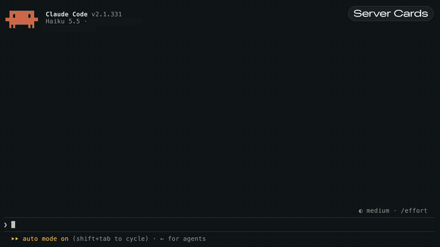

# mcp-server-cards for Antigravity

Name a company, and Antigravity's agent finds the MCP servers its domain
publishes. Ask it to add one, approve it in Antigravity's own approval card,
and the server goes into Antigravity's MCP configuration, where Antigravity
connects it with its own sign-in.

<a href="https://agentpolyfill.com/media/server-cards.mp4">
  <picture>
    <source media="(prefers-reduced-motion: reduce)" srcset="../../../site/public/media/server-cards.jpg">
    
  </picture>
</a>

[Watch Claude Code and Codex discover and add Neon Docs (27 s)](https://agentpolyfill.com/media/server-cards.mp4)

Also available for [Claude Code](../claude-code/README.md) and
[Codex](../codex/README.md).

> What MCP servers does buildkite.com publish?

This plugin implements the client side of the MCP Server Cards extension
(SEP-2127), which Google Antigravity doesn't support itself yet. It works in
the Antigravity App and the CLI (`agy`). It isn't supported in the Antigravity
IDE, which documents no plugin hooks: an addition there is refused. The
revisions it follows are in [Spec and conformance](#spec-and-conformance).

Checked in Antigravity App 2.35.1 and CLI 1.5.17.

ARD isn't in this plugin. Its `/.well-known/ard.json` and its registry search
are in [`ard-discovery` for Antigravity](../../ard/antigravity/README.md),
because a search sends your words to a third party.

## Install

You need the Antigravity CLI (`agy`) to install a plugin: the App doesn't
ship it. `agy` fetches the plugin with Git, so Git must be on your `PATH`.
You need Node 20 or newer on your `PATH`. Antigravity starts the plugin's MCP
server with `node` (it falls back to its own Node for that), and runs the
plugin's approval hook with `node`, which has no such fallback.

```bash
agy plugin install https://github.com/idosal/AgentPolyfill/tree/main/polyfills/server-cards/antigravity/plugin
agy plugin list
```

`agy plugin install` fetches this repository from GitHub and copies the
plugin's folder to `~/.gemini/config/plugins/mcp-server-cards/`, which the App
and the CLI both read; the App picks it up when it next starts. Run the same
line again to update it. From a clone of this repository,
`agy plugin install ./polyfills/server-cards/antigravity/plugin` does the
same. Nothing is published to Antigravity's Marketplace. To turn it off, disable it in Customizations >
Installed, or run `agy plugin disable mcp-server-cards`.

### Uninstall, and what stays behind

```bash
agy plugin uninstall mcp-server-cards
```

That removes the plugin's folder. It leaves:

- the servers you added, under `mcpServers` in
  `~/.gemini/config/mcp_config.json` (remove one in Customizations > Installed
  > MCP Servers, or from the file);
- the plugin's own folder, `~/.gemini/agentpolyfill/mcp-server-cards/` (cards
  shown in the last hour, and tickets): delete it by hand.

### Where it runs

| Surface | Supported | Checked |
|---|---|---|
| Antigravity CLI 1.5.17 (macOS) | yes | an addition approved (while Antigravity wrote the same file), one declined, one around the hook refused |
| Antigravity App 2.35.1 (macOS) | yes | an addition approved (the card shows the whole question), one declined, one around the hook refused, a written entry connected |
| Antigravity IDE | no | Antigravity documents no plugin hooks for the IDE, so there is no question and no ticket: every addition there is refused |

## Try it

Ask "What MCP servers does neon.com publish?", then "Add Neon Docs".
Antigravity's approval card asks you first:

```
neon.com: add the MCP server "neon-docs" to Antigravity?
URL https://neon.com/docs/mcp · headers none · written to ~/.gemini/config/mcp_config.json
It connects to the host neon.com.
Headers: none
From the Server Card com.neon/docs-mcp, listed in https://neon.com's catalog.
Written to ~/.gemini/config/mcp_config.json, for all your projects.
To undo: delete the server in Customizations > Installed > MCP Servers, or remove "neon-docs" under mcpServers in ~/.gemini/config/mcp_config.json.
```

The CLI's card shows the first two lines and hides the rest ("⋯ (5 lines
hidden)"), so those two say what is written and where (CLI 1.5.17).

Approve it, and the entry is written. For a server behind a sign-in, such as
Buildkite's, Antigravity then shows **Authenticate** next to it in
Customizations > Installed > MCP Servers (`/mcp` in the CLI).

## How it works

1. **`discover_mcp_servers(domain)`** reads the domain's AI Catalog
   (`/.well-known/ai-catalog.json` and `rel="ai-catalog"` links), fetches
   each Server Card it lists, checks it against the schema, and shows what it
   found, valid or refused. It only reads.
2. **`add_mcp_server(identifier, url, name, headers, file, ...)`** adds a
   server that a discovery showed. Its arguments must name what would be
   written: the name, the URL, the names of the headers and the file. An
   editor connected to `agy acp` shows the person only a tool's name and
   arguments, so those are what they approve there; a call whose arguments
   say anything else is refused before any question, with the arguments to
   use. `add_mcp_server` is eager (`plugin/mcp_config.json`), so Antigravity
   calls it as `mcp_mcp-server-cards_cards_add_mcp_server`, and the plugin's
   `PreToolUse` hook (`hooks.json`) matches that name only. The hook works out
   exactly what would be written and answers `force_ask`: Antigravity shows
   its approval card with the question above, whatever you have allowed
   before. The hook also leaves a one-use ticket for that exact entry and
   adds it to the call.
3. **The server writes only with that ticket.** It recomputes the entry, and
   writes it only if the ticket is there, unused, less than an hour old (and
   the turn it was given in hasn't ended), and for that same entry. No
   ticket, no write: a call through `call_mcp_tool`, which doesn't reach the
   hook, is refused and says how to call the tool.
4. **The entry** goes into `~/.gemini/config/mcp_config.json` as
   `{"serverUrl": ..., "headers": {...}}`, keeping the rest of the file as it
   is. The plugin refuses a name you already have, a file it can't read as
   JSON, and a card that needs a secret.

Why a hook: Antigravity's MCP client declares elicitation but cancels every
request without showing it, so an MCP server can't put a question to you
itself. A `PreToolUse` hook can, through Antigravity's own approval card. The
ticket is what ties the server's write to that question: without it, nothing
is written. (In CLI 1.5.17 a hook that fails makes Antigravity fail the call
too.)

What the hook and the server share sits in `~/.gemini/agentpolyfill/mcp-server-cards/`,
private to you: the cards shown in the last hour, and the tickets (an hour at
most; the plugin's `PreInvocation` and `Stop` hooks remove a conversation's
unused ones at its next model call and when its turn ends).

### The tools

| Tool | What it does |
|---|---|
| `discover_mcp_servers(domain)` | Reads the domain's catalogs and every card they list. Read-only. |
| `add_mcp_server(identifier, url, name, headers, file, domain?, remote?, values?)` | Adds a server shown in this conversation, after your approval. `url`, `name`, `headers` (names) and `file` must be what would be written. |

### What differs between the forms

All three run the same card, discovery and configuration code, in
[`../claude-code/mod/hooks`](../claude-code/mod/hooks), and this form reuses
the Codex form's MCP server, fetch and checks (`../codex/src`).

| | Claude Code | Codex | Antigravity |
|---|---|---|---|
| What runs | a mod inside Claude Code | a stdio MCP server | a stdio MCP server and a `PreToolUse` command hook |
| Consent to an add | Claude Code's permission prompt | an MCP elicitation form | Antigravity's approval card (`force_ask`), with a one-use ticket |
| Where it's written | `claude mcp add`, in the scope you choose | `codex mcp add`, `~/.codex/config.toml` | `~/.gemini/config/mcp_config.json`, written by the plugin (the CLI's `agy mcp add` isn't in the App) |
| Secrets | `${VAR}` references | names of environment variables | refused: the file reads no variables, and the plugin never writes a secret |
| SSE remotes | added | refused | refused: `serverUrl` is streamable HTTP |
| Sign-in | `/mcp` | `codex mcp login` | Authenticate, in Customizations or `/mcp` |
| Settings | `/config` | environment variables | environment variables |

## Settings

| Variable | Default | What it does |
|---|---|---|
| `MCP_SERVER_CARDS_DISABLED` | unset | `1` turns the plugin's server off: no tools, nothing fetched. |
| `AGENTPOLYFILL_STATE_DIR` | `~/.gemini/agentpolyfill` | Where the hook and the server keep what they share. Both must see the same value. |
| `MCP_SERVER_CARDS_LOG` | unset | A file to log to, for development. |

### When Antigravity supports Server Cards itself

Antigravity has no Server Card support to detect yet. When it ships, disable
or uninstall the plugin, or set `MCP_SERVER_CARDS_DISABLED=1`.

## Gaps, and the host changes that would close them

[What hosts would need to change](../../../docs/host-changes.md) has the
Antigravity column.

| Gap | What it means for you | Host change that closes it |
|---|---|---|
| No MCP elicitation: Antigravity declares it and cancels every request. | The addition is put to you in Antigravity's approval card, yes or no, without the choices the Codex form's form gives. | Elicitation shown to the person. |
| The CLI's card shows a question's first two lines. | You see the server, its URL, its header names and the file; the provenance and the undo are behind "⋯ lines hidden". | The whole question on the card. |
| An editor connected to `agy acp` gets the tool's name and arguments, not the question. | The arguments say the name, URL, header names and file; the card's provenance and undo aren't shown there. | The hook's `reason` in ACP's permission request. |
| No plugin hooks in the IDE. | The plugin doesn't work in the Antigravity IDE: an addition there is refused. | Plugin hooks in the IDE. |
| The personal `mcp_config.json` reads no `${VAR}`. | A card that needs a secret (an API key) can't be added this way; you add it by hand. | `${VAR}` in the personal file. |
| No plugin API for adding a server. | The plugin writes the file itself, in one step, keeping the rest. A file with comments is refused; a write by another program at the very same moment could lose one of the two (one made while the question is open is kept; checked in CLI 1.5.17). | A plugin API for adding a server. |
| The plugin can't use Antigravity's MCP connection. | The card isn't compared with the live server (rule S-3). | Extension requests over the host's own connection. |
| The plugin's server isn't told which project you're in. | A project's own `.agents/mcp_config.json` isn't checked for a name clash. | The project in the hook or the call. |
| A `PreToolUse` hook that fails makes the call fail (CLI 1.5.17). | If Node isn't on `PATH` or the hook crashes, the addition fails; nothing is written. | Documented hook failure behaviour. |
| When a new server's tools arrive isn't documented. | In a new conversation, or after refreshing it in the MCP Servers list or `/mcp`. | Documented refresh. |

Also, as in the Codex form: a public name that resolves to a private address
isn't caught (redirects are checked).

## What was checked

Checked in Antigravity CLI 1.5.17 and App 2.35.1, against neon.com's
published Server Card. Not checked: a server behind a sign-in (Authenticate)
after an addition.

## Security

[SECURITY.md](SECURITY.md) says what the plugin fetches, reads and writes, and
what it trusts. In short:

- Antigravity's approval card is the boundary: every addition asks, and
  nothing is auto-approved. The hook sees this plugin's `add_mcp_server` and
  nothing else.
- It reads `~/.gemini/config/mcp_config.json`, which can hold header values,
  to check names, and never logs or shows them. It never opens
  `mcp_oauth_tokens.json` or any sign-in store, and never writes a secret.
- It changes only `mcp_config.json`, for the entry you approve, and its own
  folder in `~/.gemini/agentpolyfill/`.

## Spec and conformance

The same revisions as the other forms:

- [SEP-2127](https://github.com/modelcontextprotocol/modelcontextprotocol/blob/main/seps/2127-mcp-server-cards.md),
  Final. The extension's stage is Beta, so it can still change.
- The schema and discovery rules in
  [ext-server-card](https://github.com/modelcontextprotocol/ext-server-card)
  at commit `28db12c9b4` (2026-11-19).
- The [AI Catalog](https://github.com/Agent-Card/ai-catalog) v0.9 at
  `19208af2f8`.

The client rules table, with this form's tests, and the proof (124 tests: 90
shared rule tests and 34 of this form's own) are in
[docs/conformance.md](docs/conformance.md). The MCP conformance suite has no
Server Card scenarios.

## Development

```bash
npm ci
npm run build      # plugin/dist/server.mjs
npm test
npm run typecheck
```

`src/gate.ts` (the hook, the ticket) and `src/host.ts` are shared with the
ARD form, and with the Skills and Events forms for Antigravity.
