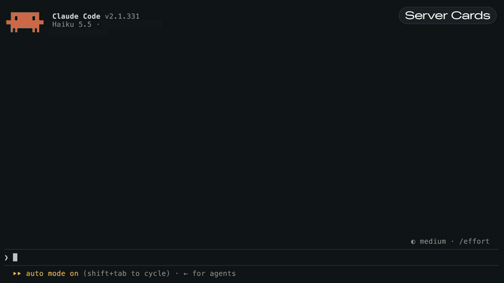

# mcp-server-cards for Codex

Name a company, and Codex finds the MCP servers its domain publishes. Ask it
to add one, accept the form Codex shows you, and the server goes into Codex's
own MCP configuration.

<a href="https://agentpolyfill.com/media/server-cards.mp4">
  <picture>
    <source media="(prefers-reduced-motion: reduce)" srcset="../../../site/public/media/server-cards.jpg">
    
  </picture>
</a>

[Watch Claude Code and Codex discover and add Neon Docs (27 s)](https://agentpolyfill.com/media/server-cards.mp4)

Also available for Claude Code, Pi and OpenCode: [mcp-server-cards for Claude Code](../claude-code/README.md), [mcp-server-cards for Pi](../pi/README.md), [mcp-server-cards for OpenCode](../opencode/README.md).

> What MCP servers does neon.com publish?

Codex reads that domain's catalog, fetches each Server Card it lists, checks
the card against the schema, and tells you what it found. When you ask it to
add one, Codex shows you a form naming the server, the URL, the headers, the
file it writes and the undo command. Only if you accept does the server go
into Codex's own MCP configuration, as if you had typed `codex mcp add`.

This Codex plugin implements the client side of the MCP Server Cards
extension (SEP-2127), which Codex doesn't support itself yet. The revisions it
follows are in [Spec and conformance](#spec-and-conformance).

Agentic Resource Discovery (ARD) isn't in this plugin. ARD is a draft, not an
MCP specification. Its `/.well-known/ard.json` and its registry search are in
a separate plugin, [`ard-discovery`](../../ard/codex/README.md), because a
search sends your words to a third party.

## Cursor IDE

Cursor and Codex install the same `plugin/` directory. From a clone of AgentPolyfill, with Node.js 20+ on your PATH, copy it into Cursor's local plugins and restart the editor. On macOS or Linux, run this from the repository root for a first install:

```sh
mkdir -p ~/.cursor/plugins/local
cp -R polyfills/server-cards/codex/plugin ~/.cursor/plugins/local/mcp-server-cards
```

Ask “What MCP servers does neon.com publish?” Choose a remote and ask to add it. Open the returned Cursor link, or paste it into your browser's address bar. Compare the name and full URL in the dialog. **Install** saves the entry to your user MCP settings across projects. **Cancel** dismisses the dialog. Remove an installed server through Cursor’s MCP settings.

The plugin offers links for Streamable HTTP remotes without headers or secrets. Discovery also shows other remotes. The plugin checks the user and current workspace MCP files for a name collision when preparing a link. Cursor may replace a same-name entry if your settings change before you open the link. Generate a fresh link after editing your configuration. Disable the plugin or set `MCP_SERVER_CARDS_DISABLED=1` for its process to turn off both tools.

[Cursor local plugins](https://cursor.com/docs/plugins#test-plugins-locally) · [Cursor install links](https://cursor.com/docs/mcp/install-links)

## Install

In a terminal:

```bash
codex plugin marketplace add idosal/AgentPolyfill && codex plugin add mcp-server-cards@agent-polyfill
```

The first command adds the [AgentPolyfill](../../../README.md) marketplace
(Codex reads its `.agents/plugins/marketplace.json`), and the second installs
the plugin. With the marketplace added, `codex plugin list` shows its Codex
plugins, `mcp-server-cards` and `ard-discovery` among them. Start a new Codex
session afterwards.

You need:

- Codex CLI 0.170.0 or newer (checked in 0.170.0 and 0.172.0). Plugins are on
  by default.
- Node.js 20 or newer on your `PATH`. The plugin is one JavaScript file with
  no dependencies, [`plugin/dist/server.mjs`](plugin/dist/server.mjs), which
  Codex starts as a stdio MCP server.
- Nothing else: no account, no key.

To remove it, run `codex plugin remove mcp-server-cards@agent-polyfill`.

To run it from a clone instead, add the clone as the marketplace,
`codex plugin marketplace add ./AgentPolyfill`, then run
`codex plugin add mcp-server-cards@agent-polyfill`.

## Try it

Ask Codex "What MCP servers does neon.com publish?", then "Add Neon Docs".
Codex shows a form: accept it. Neon Docs needs no sign-in. Start a new session
to use it. `codex mcp remove neon-docs` removes it again.

For a server behind a sign-in, ask about buildkite.com and add Buildkite. Then
run `codex mcp login buildkite` in a terminal.

## How it works

### Step by step

1. **Ask.** For example "connect Codex to Buildkite", or "what MCP servers
   does neon.com publish?".
2. **Codex calls `discover_mcp_servers`.** It reads the domain's
   `/.well-known/ai-catalog.json` and the `rel="ai-catalog"` links on its home
   page, then fetches and checks each card. The tool is read-only. Codex calls
   it, and `add_mcp_server`, without an approval prompt of its own: the
   plugin's form is the question. Checked in Codex CLI 0.172.0.
3. **Codex tells you what it found:** each server's card, the URL it connects
   to, and whether the card is valid. A refused card says why, and nothing
   refused can be added.
4. **Ask Codex to add one.** Codex calls `add_mcp_server`, and the plugin asks
   you through Codex's form (MCP elicitation):

   ```
   neon.com: add the MCP server "neon-docs" to Codex?
   It connects to the host neon.com
   URL: https://neon.com/docs/mcp
   Headers: none
   From the Server Card com.neon/docs-mcp, listed in https://neon.com's catalog.
   Written to /Users/you/.codex/config.toml (all your projects).
   To undo: codex mcp remove neon-docs

   1. Don't add it
   2. Add it
   ```

   The form starts with the host because some clients join its lines into one
   paragraph. The ChatGPT desktop app, for one, shows it as an approval card
   that way. The host also has a line of its own, for clients that keep line
   breaks, such as the TUI.

   - Choose **Add it**, and the server is written with `codex mcp add`. Only
     that choice adds.
   - Choose **Don't add it**, decline or close the form, or send it back
     without a choice, and nothing is written. Codex is told not to ask again
     unless you bring it up.
   - Where nobody can be asked (`-a never`, `codex exec`), Codex declines the
     form, so nothing is written. Under
     `--dangerously-bypass-approvals-and-sandbox`, Codex 0.172 shows you the
     form or declines it. It doesn't answer it for you.
     [Which Codex modes ask you](#which-codex-modes-ask-you) has the details.
   - The plugin adds only a card a tool showed in this session, at the URL
     that card gives, and only if no server of that name exists
     (`codex mcp get`). Otherwise it refuses before asking.
5. **The server is added** to `$CODEX_HOME/config.toml`
   (`~/.codex/config.toml`), which serves all your projects. Codex connects
   MCP servers when a session starts, so the server's tools arrive in your
   next session.
6. **If it needs a sign-in:** `codex mcp add` starts a browser sign-in by
   itself when a server offers OAuth, and waits for it. A tool call can't wait
   like that. So the plugin stops the command there, once the entry is
   written, and the result tells you to run `codex mcp login <name>`. The
   sign-in is Codex's own, and the plugin never sees it.
7. **If the card asks for a secret,** such as an API key, the plugin never
   asks you for it and never shows it to Codex's model. The configuration
   holds the name of an environment variable, such as
   `MCP_EXAMPLE__TOKEN_4GQXEC3IVEMVBYCQ`, and the result tells you that name.
   Set it where you start Codex, then start a new session. The tag at the end
   is 80 bits of SHA-256 over the card's name and URL, so no other card can be
   given a reference to it.
   - A bearer token is written as `bearer_token_env_var`, with
     `codex mcp add --bearer-token-env-var`.
   - Any other secret header is written as `env_http_headers`, and a fixed
     header as `http_headers`. `codex mcp add` can't set those, so such a
     server is written through `codex app-server`'s `config/value/write`,
     which edits the same file.
8. **To undo an addition,** run `codex mcp remove <name>`. The result gives
   the exact line.

### Which Codex modes ask you

Checked in Codex CLI 0.172.0, and `codex exec` in 0.170.0 too. "App-server"
is the API the TUI and the desktop app run on.

| Mode | The form | What the plugin does |
|---|---|---|
| TUI or desktop, `--ask-for-approval on-request` (the default), approvals to you | shown to you | adds only on your **Add it** |
| The same with auto-review (`approvals_reviewer = "auto_review"`, `--approve-for-me`) | shown to you: auto-review doesn't answer it | adds only on your **Add it** |
| The same with `--sandbox danger-full-access` | shown to you | adds only on your **Add it** |
| `--ask-for-approval never` | declined by Codex, without asking | nothing is written |
| Granular approvals with `mcp_elicitations = false` | declined by Codex, without asking | nothing is written |
| `codex exec`, with or without `--approve-for-me` | declined or closed by Codex (nobody to ask) | nothing is written |
| `--dangerously-bypass-approvals-and-sandbox` (and its app-server form: `never` with full access) | shown to you where the client takes form input in that mode (checked: app-server, a user's thread, `openai/standard-form-input` declared); declined otherwise (checked: `codex exec`, and app-server without one of those) | adds only on your **Add it**; otherwise nothing is written |

The form is the consent. It is one required choice, **Don't add it** or
**Add it**, and only **Add it** adds.

Codex 0.172 shows a form with a required choice to the person even under
`--dangerously-bypass-approvals-and-sandbox`. It auto-accepts only forms with
no fields: see `can_auto_accept_elicitation` in `codex-mcp/src/elicitation.rs`
at `rust-v0.172.0`. More exactly, in that mode it shows the form where the
Codex client takes form input (it declares `openai/standard-form-input`, for a
thread the person started). Otherwise it declines the form, so nothing is
added. This is Codex 0.172's behaviour, not something the MCP spec promises,
and a later Codex may change it.

Under `-a never` and in `codex exec`, Codex declines the form, so nothing is
added. The proper fix is in Codex: a field in a tool call's metadata naming
the approval mode. See [Limits](#limits).

### The tools

| Tool | What it does |
|---|---|
| `discover_mcp_servers(domain)` | Reads the domain's catalogs and every card they list, and reports each card, valid or refused. Read-only. |
| `add_mcp_server(identifier, url, domain?, remote?, name?, values?)` | Adds a server shown in this session, after your accept in the form. `url` must be the URL the server will connect to. |

### What differs between Claude Code and Codex

Both forms run the same card, discovery and configuration code, in
[`../claude-code/mod/hooks`](../claude-code/mod/hooks). This plugin bundles it
with a Codex front: an MCP server, a form for consent, and `codex mcp add`.

| | Claude Code | Codex |
|---|---|---|
| What runs | a mod (hooks) inside Claude Code | a stdio MCP server in a Codex plugin, started with Node |
| Consent to an add | a question the mod makes in Claude Code's permission prompt | a form through MCP elicitation; refused without a form, or on a decline or close |
| A picker with **Add** buttons | under each result | none: the TUI draws no third-party UI, so you ask Codex to add a server |
| Where it's written | `claude mcp add`, in the scope you choose (local, project, user) | `codex mcp add`, into Codex's one configuration file (all projects). There is no `scope` |
| A name you already have | refused for Claude's add; the picker takes `name-2` | refused; pass another `name` |
| Secrets | `${VAR}` references in the URL and headers | names of environment variables (`bearer_token_env_var`, `env_http_headers`). Codex reads no `${VAR}`, so a card with a secret in its URL, or a secret mixed into a header (`Token {key}`), is refused |
| SSE remotes | added | refused: Codex connects to streamable HTTP servers only |
| Sign-in | `/mcp` | `codex mcp login <name>` |
| Redirects | followed by Claude Code's fetch, unseen, so one to a private address isn't caught | followed by the plugin, each hop under the same address rule, so a redirect to a local or private address is refused |
| Protocol revisions it adds for | Claude Code's: 2026-07-28 back to 2024-11-05 | Codex's: 2025-06-18 back to 2024-11-05. Codex 0.170.0 asks for 2025-06-18, and 2026-07-28 is behind its `mcp_2026_07_28` feature, which is off |
| The cache | the plugin store, kept between sessions | in memory, for one session |
| A notice after a web fetch | yes (`notice_on_fetch`) | no: a plugin can't see Codex's web fetches |
| Cards from another plugin (`present_server_cards`) | yes | no: one Codex plugin's server can't call another's tools, so `ard-discovery` carries the same core instead |
| Settings | `/config` | environment variables |

## Settings

Codex plugins have no settings page, so the plugin reads these from the
environment Codex starts in. Its `.mcp.json` passes them through.

| Variable | Default | What it does |
|---|---|---|
| `MCP_SERVER_CARDS_DISABLED` | unset | `1` turns the plugin off: no tools, nothing fetched. |
| `CODEX_HOME` | `~/.codex` | Where Codex keeps its configuration. The plugin writes there. |
| `CODEX_CLI_PATH` | unset | The `codex` command to run, when it isn't on `PATH` (the desktop app sets it). Without it, the plugin tries `codex` on `PATH`, then `~/.local/bin`, `/opt/homebrew/bin` and `/usr/local/bin`. |

### When Codex supports Server Cards itself

Codex has no Server Card support to detect yet. When it ships, remove or
disable the plugin, or set `MCP_SERVER_CARDS_DISABLED=1`. To remove it, run
`codex plugin remove mcp-server-cards@agent-polyfill`. To disable it, set
`enabled = false` under `[plugins."mcp-server-cards@agent-polyfill"]` in
`config.toml`. The server then registers no tools and fetches nothing.

## Limits

Each limit below names the host change that would remove it, where there is
one. [What hosts would need to change](../../../docs/host-changes.md) covers
these changes for both hosts.

- **The card isn't compared with the live server** (rule S-3). The plugin
  can't send `server/discover` over Codex's connection. A Codex app-server
  method that passes an MCP request to a configured server would let it.
- **No picker in the TUI.** Codex's TUI draws no third-party UI. The desktop
  app shows MCP Apps, which a later version could use.
- **A public name that resolves to a private address isn't caught,** because
  Node's `fetch` resolves names itself. Redirects are now checked. Checking
  the resolved address in the plugin's own fetch (a `lookup` that refuses
  private results) is a known follow-up.
- **Bypass mode rests on Codex's behaviour.** Under
  `--dangerously-bypass-approvals-and-sandbox`, Codex 0.172 shows the form to
  the person or declines it, as described in
  [Which Codex modes ask you](#which-codex-modes-ask-you). This is Codex
  0.172's behaviour, not something the MCP spec promises, and a later Codex
  may change it. The proper fix is Codex putting the approval mode in a tool
  call's metadata, so the plugin need not rely on how Codex treats a form's
  fields.
- **Headers other than a bearer token need `codex app-server`,** which Codex
  marks experimental. It is on by default, and the TUI runs on it. A
  `--header` and `--env-header` for `codex mcp add` would remove that.
- **A secret in a URL, or mixed into a header, can't be added.** Codex reads
  environment variables only as a bearer token or a whole header value.
- **A project's own `.codex/config.toml` isn't checked for a name clash.** The
  plugin's server runs in the plugin's folder, not the project's.
- **New servers arrive in the next session,** because Codex reads its MCP
  configuration when a session starts.

## Security

[SECURITY.md](SECURITY.md) says what the plugin sends, what it stores, what it
changes and what it trusts. In short:

- It reads public documents from the domain you name, and the card URLs that
  domain's catalog lists. It never fetches a local or private address unless
  you name one yourself, and no redirect takes it to one.
- It changes only Codex's MCP configuration, for the server you accept in the
  form.
- It never reads Codex's credentials, holds no token, and never puts a
  secret's value anywhere.

## Spec and conformance

It implements the client side of the MCP Server Cards extension, which Codex
doesn't support itself yet:

- [SEP-2127](https://github.com/modelcontextprotocol/modelcontextprotocol/blob/main/seps/2127-mcp-server-cards.md),
  Final. The extension's stage is Beta, so it can still change.
- The schema and discovery rules in
  [ext-server-card](https://github.com/modelcontextprotocol/ext-server-card)
  at commit `28db12c9b4` (2026-11-19): `schema.ts` and `docs/discovery.md`.
- The [AI Catalog](https://github.com/Agent-Card/ai-catalog) that SEP-2127
  hands domain discovery to: v0.9, a release candidate, at `19208af2f8`.

### Client rules

Both forms run the same code and tests for the discovery, validation, input
and transport rules: D-1 to D-9, V-1 to V-3, C-1 to C-3, S-1 to S-6 and I-1
to I-4. The full table, with each rule's source and test, is with the
Claude Code form's [client rules](../claude-code/README.md#client-rules),
beside the tests in `../claude-code/mod/tests`. Here, those tests run against
the built [`plugin/dist/server.mjs`](plugin/dist/server.mjs), with `npm test`.
These are the rows where Codex differs:

| # | Rule | Source | Test | State |
|---|---|---|---|---|
| P-1 | Never replace a server the person has | the polyfills' own | E-6 | met: a name `codex mcp get` knows, or can't rule out, is refused before the person is asked, and again before writing |
| P-2 | A person approves every addition | the polyfills' own | E-3, E-4, E-11 | met: an MCP elicitation form naming the server, URL, headers, file and undo, with a required choice. Only **Add it** adds. No form, a decline, a close, or an accept without that choice adds nothing. Codex 0.172 doesn't answer such a form by itself, even under `--dangerously-bypass-approvals-and-sandbox`; see [Which Codex modes ask you](#which-codex-modes-ask-you) |
| P-3 | Add only what was shown, as shown | the polyfills' own | E-6 | met: a card a tool showed in this session, at the URL it yields |
| I-2 | Handle `isSecret` values securely | schema.ts, `Input` | C-2, C-3, E-8 | met: an environment variable's name, never a value. A secret in a URL, or mixed into a header, is refused |
| I-3 | Choose a remote by its `supportedProtocolVersions` | schema.ts, `Remote` | C-6 | met, with Codex's revisions |
| I-4 | Transport `streamable-http` or `sse` | schema.ts, `Remote.type` | C-4 | streamable HTTP met. SSE is refused, because Codex has no SSE client |
| S-1 | HTTPS for cards; plain HTTP only for local development | discovery.md | F-1, F-3 | met, for every redirect hop too |
| N-1 | No step from a public origin to a local or private address | the polyfills' own | F-1 | met for documents and, here, for redirects |
| N-2 | Bounded answers | the polyfills' own | F-4, F-6 | 512 KiB per answer, read no further; five redirects |
| V-3 | No text that displays as something else | the polyfills' own | X-4, X-5, X-6, A-24, A-25, A-26, P-6, P-7, O-9, O-10, C-7, E-3, E-9, E-10 | met. Control and invisible characters are refused, and characters that show as nothing (a soft hyphen, variation selectors, tag characters) are taken out of everything shown, and a header value that would be written holding one is refused. A URL from a card or a finder also may hold no `` ` ``, `<`, `>` or square bracket outside an IPv6 host, so a host that renders the form as Markdown can't show a link text in place of the URL. This is in the shared core, so the Claude Code form has it too. A URL may not name a user before its host (`https://good.example@evil.example/`) or hold a backslash (`https://evil.example\@good.example/`). Either one shows one host and connects to another, and the form names the host on its own line. A card's fixed header value holds no markup either |

### Proof

- **Per rule:** 116 tests, run with `npm test`.
  - 90 are the shared rule tests from `../claude-code/mod/tests` (card,
    configure, discover, format, offer), run against the committed bundle.
  - 24 are this form's own: the fetch guard (F-), the Codex plan (C-), and
    the server as Codex runs it (E-), over stdio, with a stand-in `codex`
    command and a web on 127.0.0.1.
  - 2 check the bundle: it is byte-identical to a fresh build, and a copy of
    `plugin/` alone starts and lists its tools.
- **The real host:** Checked in Codex CLI 0.170.0 and 0.172.0. Not checked: a
  card with headers from a public server, and the form as the TUI or the
  desktop app draws it. The headers path (`codex app-server`
  `config/value/write`) is tested with the stand-in `codex` (E-8).
- **Upstream conformance:** the MCP conformance suite has no Server Card
  scenarios.

### Interoperability notes

The findings concern the specs themselves, so they apply to both forms. They
are listed once, with the Claude Code form's
[findings](../claude-code/README.md#interoperability-notes): on
`specVersion`, the well-known path, version ranges, Zapier's card, JSON
values, and the ext-server-card README's stage.

## Development

```bash
npm ci
npm run build       # plugin/dist/server.mjs, from src/ and ../claude-code/mod/hooks
npm run check       # fails if plugin/dist/server.mjs is not what the sources build
npm run typecheck
npm test            # against the committed plugin/dist/server.mjs: run npm run build first
```

`plugin/dist/server.mjs` is committed, because Codex installs `plugin/` as it
is. `npm test` fails while it is stale, and CI rebuilds it and fails if the
result differs.

| Path | What it is |
|---|---|
| `src/main.ts` | The server: its two tools, and the entry of the bundle. |
| `src/tools.ts` | `discover_mcp_servers`, `add_mcp_server`, and the form. |
| `src/codex.ts` | The plan in Codex's terms, and `codex mcp get`, `codex mcp add`, `codex app-server`. |
| `src/fetch.ts` | Node's `fetch`, with redirects followed under the address rule, and the size cap. |
| `src/mcp.ts` | A small stdio MCP server, with elicitation. |
| `src/host.ts` | Codex's name and protocol revisions, the store, the logger. |
| `build.mjs` | The esbuild bundle, and the tests' build. |
| `plugin/` | What Codex installs: `.codex-plugin/plugin.json`, `.mcp.json`, a skill and `dist/server.mjs`. |
| `test/` | The adapter tests, their harness and the `claude-code/testing` stand-in. |

## Licence

Apache-2.0, like the rest of this repository ([LICENSE](../../../LICENSE)).
