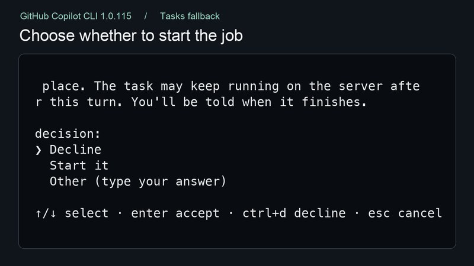

# MCP Tasks for GitHub Copilot CLI

Start a task on an MCP server, continue the session while it runs, and return
to it when the server needs input or the task finishes. This is the client
side of [SEP-2663](https://github.com/modelcontextprotocol/ext-tasks/blob/cc9aaac1047a9440b07486e38f37060bbebeef4c/seps/2663-tasks-extension.md)
for MCP revision 2026-07-28.

Watch the opt-in fallback ask for approval, collect the requested field and confirm delivery.

[](../../../docs/media/demos/tasks-copilot.mp4)

## Native Tasks and fallback

Stock Copilot CLI 1.0.115 and 1.0.116 started and polled a SEP-2663 task
in experimental mode in an isolated stdio test. Stock 1.0.116 in default mode
returned ordinary tool content. Native form handling and visible idle wake
depend on the client. Try the native tool first. This extension joins without
registering tools or opening connections by default. Only in a profile where
you verified that the actual tool call lacks native Tasks, set
`MCP_TASKS_FALLBACK=1` before starting the host to enable the adapter.

## Install

Requires Copilot CLI 1.0.115 or newer, experimental extensions, and Node 20+.

```sh
copilot plugin marketplace add idosal/AgentPolyfill
copilot plugin install mcp-tasks@agent-polyfill
copilot --experimental
```

For a local checkout, pass its path to `copilot plugin marketplace add`. Use
`copilot plugin uninstall mcp-tasks@agent-polyfill` to remove the plugin.

## Use

Ask Copilot which configured MCP servers offer Tasks. When it starts a task,
review the server, tool and arguments in Copilot's dialogs. Declining or
closing the dialog sends no start to the server. A task that needs input
wakes the session and uses Copilot's form. Ask for its status or result, or
cancel it, using its local task ID.

- Use an interactive Copilot terminal. The extension waits up to two minutes
  for a form response and leaves the action unapproved if the host cannot
  collect it. VS Code and other Copilot surfaces have separate UI coverage.
- The extension reads the MCP entries that Copilot reports as enabled in
  this session. It opens a separate connection. Stdio servers run a second
  process and the extension cannot reuse Copilot’s OAuth sign-in.
- State stays under `mcp-tasks/` in the Copilot config directory. Set
  `MCP_TASKS_OFF=1` before launching Copilot to disable the extension.
- The tool shows text and text resources. Binary result blocks are omitted.
- Checkboxes, selections and primitive inputs follow the shared client's
  supported form schema. Requests for sampling, roots or URL input are
  left unanswered. The extension treats server content as data.

## Verification

The adapter was exercised in the Copilot CLI 1.0.115 terminal using an
isolated profile and a scripted model. Decline produced no MCP tool call.
Approval sent the displayed arguments, completion started another turn, and
an answer entered in Copilot's native form reached the server in
`tasks/update`. The shared client's protocol and independent FastMCP checks
are in the [Codex conformance table](../codex/docs/conformance.md).

Run `npm ci` in `../core` and here, then `npm run typecheck`, `npm run build`
and `npm test`. The adapter test covers the session boundary, decline, wake,
and the exact structured answer with a Tasks fixture.
