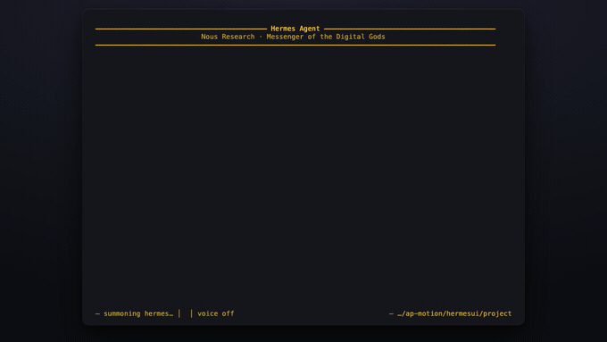

# MCP Tasks in Hermes

Hermes 0.23.4 gateway users can start SEP-2663 tasks, continue their conversation,
receive a notification when input is needed, and retrieve the result in the same
session. The command needs a viewer that can answer Hermes’s choice prompt.

Watch the Hermes terminal approve a job, confirm the name and retrieve the greeting.

<a href="../../../docs/media/demos/tasks-hermes.mp4">
  <picture>
    <source media="(prefers-reduced-motion: reduce)" srcset="../../../docs/media/demos/tasks-hermes.jpg">
    
  </picture>
</a>

[Watch the 21-second walkthrough](../../../docs/media/demos/tasks-hermes.mp4).

## Local setup

Copy the contents of `plugin/` into `$HERMES_HOME/plugins/mcp-tasks/`, enable
`mcp-tasks` in the profile’s `plugins.enabled` list, and configure the grant:

```yaml
plugins:
  entries:
    mcp-tasks:
      settings:
        servers: [jobs]
      allow_gateway_injection: true
```

Restart the gateway with Node 22 on its PATH. Each named server must also be
enabled in the profile’s MCP configuration. Each session owns its Tasks
connection. Stdio servers start a separate process. Servers with host tool
filters, managed sign-in or dynamic identity are skipped. Task notifications
require the injection grant. To disable the plugin, set `MCP_TASKS_OFF=1`
before launching Hermes.

## Use

1. Run `/mcp-tasks servers`, then `/mcp-tasks start jobs ask {}`. Review the
   server, tool and arguments in Hermes’s chooser. Declining makes no tool call.
2. When the session wakes, use `/mcp-tasks input TASK` to see the requested
   fields. Submit e.g. `/mcp-tasks input TASK {"name":"Luca"}` and confirm the
   exact answer. The command and its arguments may be retained in host history.
3. Use `/mcp-tasks result TASK` for the result. The commands `list`, `get TASK`
   and `cancel TASK` inspect or stop a task. Reopen the original session after a gateway restart to resume polling.
   Running `/mcp-tasks list` also reattaches the session. Recovery also
   requires the upstream server to retain the task across connections.

## Verification

Install dependencies with `npm ci` in `../core` first. Run `npm ci && npm run typecheck && npm run build` here and
`python3 test/gateway.py` with the environment described in
[the Hermes harness](../../../tools/hermes). The fixture uses a real gateway,
two separate sessions, a scripted model, and one local MCP server. The walkthrough
uses the 0.23.4 terminal viewer and gateway on a local fixture. It shows the
native chooser and one accepted name reaching the upstream server.

This uses MCP revision 2026-07-28 and the shared [SEP-2663 Tasks
client](../core). The isolated Hermes 0.23.4 MCP client negotiated 2025-11-25;
the session helper negotiates the Tasks revision separately. Hermes desktop
viewer and messaging-platform UIs have separate interaction requirements.
